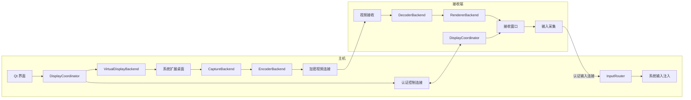
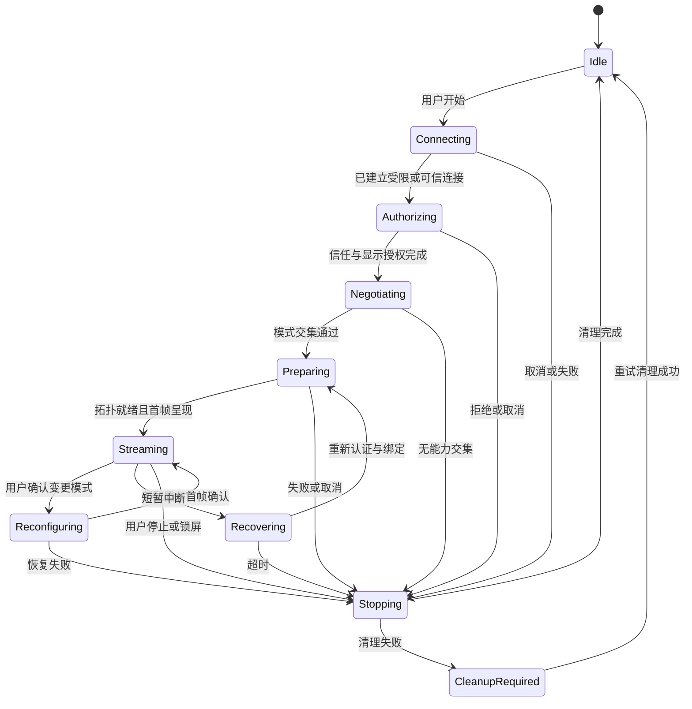

# Linux、Windows、macOS 跨平台虚拟扩展屏设计

日期：2026-10-24

版本：0.1，设计草案

状态：用于架构评审和原型开发，尚未实现，尚未完成六方向实机验证。

本文基于当前本地仓库结构、平台公开文档和开源项目调研。文中的模块、协议和配置为拟新增设计，不代表仓库已有能力。平台支持、性能数字和阶段完成条件分别标注，避免把技术可行性当作交付结果。

按项目约定应以 Ubuntu 远端仓库为开发目标。本次 SSH 已到达认证阶段，但免密认证失败，无法检查远端内容；因此仅在本地新增本文，不覆盖远端文件，不修改现有源码。后续同步前必须重新检查远端同名文件和工作区。

## 1. 设计结论与范围

三端任意互作主机和副屏，在限定系统版本、桌面环境与硬件的前提下具有实现路径。核心是三种主机后端、一套公共协议、三种接收后端，不是为六个方向分别实现一套产品。

最大的风险依次是 Linux 主机端桌面环境适配、macOS 私有虚拟屏接口、Windows 驱动分发，以及三端一致的输入所有权和故障恢复。现有组件能降低原型成本，但没有证据表明任意拼接即可得到稳定的完整产品。

### 1.1 用户目标

- A 电脑创建一块额外显示器，将画面输出到 B 电脑的指定屏幕。
- A 的应用能够像使用物理副屏一样跨屏拖动，系统显示设置中可看到额外显示器。
- B 可以全屏展示副屏，也可暂时以窗口查看。
- A 的键鼠直接操作 A 的扩展桌面；可选使用 B 的键鼠控制该副屏。
- Windows → Linux、Windows → macOS、macOS → Windows、macOS → Linux、Linux → Windows、Linux → macOS 使用相同会话模型。

“真正扩展”必须扩展 A 当前交互桌面的显示拓扑。新建独立远程登录桌面、镜像 A 主屏、共享一个窗口，不计为该目标通过。

### 1.2 首个可交付版本

| 项目 | 决策 |
| --- | --- |
| 网络 | 同一局域网，优先有线以太网；支持可达的 IPv4/IPv6 地址 |
| 会话 | 每台电脑最多参与一个扩展显示会话，角色二选一：发送或接收 |
| 显示 | 一个虚拟副屏，一个接收窗口，可全屏到一个物理屏 |
| 初始模式 | 1920×1080、SDR、30 fps；硬件通过后开放 60 fps |
| 编码 | H.264 8-bit 4:2:0、无 B 帧；必须声明实际 profile/level |
| 输入 | 主机键鼠为基础能力；接收端输入需单独授权并获得控制权 |
| 平台策略 | 按具体 OS、桌面、显卡和后端逐项认证，不笼统声明支持所有 Linux |
| 安全 | 所有控制、画面和输入连接均认证并加密 |
| 集成 | 独立显示工作进程，复用应用入口和信任基础，保留键鼠模式 |

首版不包含声音、HDR、文件拖放、多接收端、互联网中继、蓝牙视频、通用 USB 直连、登录界面/安全桌面控制和无人值守解锁。4K、HiDPI、4:4:4 和 HEVC 为后续能力；不能用编码分辨率支持推导文字清晰度或帧率达标。

## 2. 术语与角色

| 名称 | 含义 |
| --- | --- |
| Host / 主机 | 运行应用并创建虚拟副屏的电脑，发送画面 |
| Receiver / 接收端 | 解码并显示主机副屏的电脑，可发送输入 |
| Peer | 经本地授权的远端设备身份，不以名称或 IP 作为身份 |
| SessionId | 一次扩展显示会话的随机 128 位标识 |
| Generation | 本地操作代次，取消/重试后递增，拒绝晚到回调 |
| DisplayEpoch | 流配置代次，分辨率、布局或采集资源重建后递增 |
| InputLease | 一段有效期内唯一的输入控制权及其编号 |
| NativeControl | 主机本地键鼠操作，由操作系统正常处理 |
| ReceiverControl | 接收窗口采集键鼠并向主机注入 |

显示 Host/Receiver 角色与 Deskflow 现有 server/client 角色独立。例如，Deskflow 的输入客户端也可能是显示主机。实现中不能复用 server/client 布尔值表达显示角色。

## 3. 可行性证据与平台策略

### 3.1 三类主机

| 主机系统 | 虚拟显示路径 | 画面来源 | 编码候选 | 当前判断 |
| --- | --- | --- | --- | --- |
| Windows | IDD / IddCx，原型可用现有 VDD | 原型使用 DXGI Desktop Duplication；产品可直接消费 IDD 帧 | Media Foundation，或 FFmpeg 对接硬件编码器 | 有官方驱动框架与开源实现，需驱动和显卡实测 |
| macOS | 私有 CGVirtualDisplay | ScreenCaptureKit，按明确的 display ID 采集 | VideoToolbox | 开源完整链路已存在；虚拟屏接口缺少公开兼容保证 |
| Linux Wayland | 合成器/Portal 支持的虚拟输出能力 | PipeWire/合成器采集接口 | FFmpeg + VA-API/NVENC 等 | 各桌面能力不同，需要分别适配 |
| Linux X11 | 可用输出模式、显卡专用虚拟输出等 | X11/XShm，后续评估其他路径 | 同上 | 独立后端；不能把 xrandr 命令存在当作虚拟输出可用 |

Windows 的 IDD 驱动运行在用户模式，但仍属于需要安装和签名的驱动，不等于一个普通应用库。首个产品阶段只安装经过验证的签名驱动，不要求用户关闭安全启动或开启测试签名。

macOS 将私有接口封装在一个 Objective-C++ 适配层，运行时检查类和方法、校验创建结果。检查失败时明确禁用发送能力；不得继续调用假定存在的接口。签名、公证与 Mac App Store 审核是不同流程，不能把公证通过视为公开 API 支持。

Linux 的 ScreenCast Portal 可能声明 Virtual source type，但必须查询运行中的 backend 支持；创建权限、生命周期、布局控制和流的实际尺寸仍需验证。PipeWire 负责帧流，不自动提供通用虚拟显示创建能力。VKMS 是可研究的 DRM 虚拟设备，不能直接等同于当前 GNOME/KDE 用户会话新增副屏的通用方案。

### 3.2 接收端

三端接收端通常只需普通用户进程完成认证、解码和显示，无需为接收画面安装显示驱动。Windows 使用 D3D11、macOS 使用 VideoToolbox/CoreVideo + Metal、Linux 使用 FFmpeg 解码与适配的 GPU 渲染路径。Qt 承担界面和窗口管理，不在 GUI 主线程做视频解码，不将 QImage 往返转换作为正式高帧率管线。

原型允许统一使用 FFmpeg 软件解码和 CPU 上传，须显示当前是否软件路径，并计入性能结果。GPU 导入、零拷贝是逐后端优化，不作为未经测量的保证。

### 3.3 六方向验证矩阵

| 主机 | 接收端 | 已有参考 | 本项目状态 |
| --- | --- | --- | --- |
| Windows | Linux | Apollo 或 VDD + Sunshine，Linux Moonlight | 待双机验证 |
| Windows | macOS | 相同发送侧，Mac Moonlight | 待双机验证 |
| macOS | Windows | CGVirtualDisplay 创建与采集，Windows 串流接收组件 | 待组合验证，不声称现成项目已覆盖 |
| macOS | Linux | OpenDisplay 的 Mac 发送与 Linux 接收 | 待本项目环境验证 |
| Linux | Windows | Linux 虚拟输出后端 + 跨平台接收链路 | 待限定桌面验证 |
| Linux | macOS | OpenDisplay Linux sender 与 Mac receiver | 待本项目环境验证 |

发布认证记录必须包含 OS 完整版本、会话类型、桌面/合成器版本、GPU、驱动、编码器和解码器。接收通过不能证明同一系统的发送也通过。

### 3.4 开源复用决策

- Apollo、Sunshine、Moonlight 用于外部原型和性能对照，先避免把完整第三方程序嵌入当前核心。
- Windows VDD 可作为外部驱动依赖；是否维护分支或自有驱动，待确认安装、授权和生命周期后决定。
- DeskPad 用于研究最小 Mac 虚拟屏后端；OpenDisplay 用于研究完整协议与流管线。
- Deskreen 用于浏览器接收对照，其屏幕共享能力不替代主机虚拟屏后端。
- 外部原型验证了组件能力，不代表我们自定义协议已验证，也不保证互相兼容。

依赖引入前记录固定 commit、许可证、修改范围、二进制分发和通知要求。仓库当前 CMake 文件使用 MIT 标识；不能因此推断任意依赖都可按 MIT 合并。OpenDisplay 当前声明 GPL-3.0，早期版本授权也必须按实际固定版本核实。FFmpeg 的构建选项会影响分发义务。许可证与编解码授权在分发选型时另行核查，不在本文作法律结论。

## 4. 总体架构



### 4.1 进程与权限边界

GUI 管理用户动作和状态；新增 `busymouse-display` 工作进程承载采集、编解码和接收窗口相关服务，接收窗口可由同一显示进程管理。GUI 退出是否继续会话由显式设置控制，默认退出时停止。

Windows 服务仅承担受限驱动管理等必要职责，显示和输入工作绑定已登录的交互用户会话。Linux Portal、PipeWire 和 macOS ScreenCaptureKit 均在正确的用户会话运行。不得让后台系统服务直接假定拥有桌面权限。

首版可由 GUI 启动单个显示工作进程，显示会话不经过现有键鼠核心的字节流。现有核心崩溃或重启时，由协调器决定终止显示会话，释放输入所有权；不得让失联工作进程继续注入输入。

### 4.2 模块职责

| 模块 | 职责与约束 |
| --- | --- |
| DisplayCoordinator | 角色、状态机、超时、取消、资源回收、重连和快照 |
| DisplayCapabilityProbe | 探测发送/接收/注入能力，返回可解释的失败原因 |
| VirtualDisplayBackend | 创建、枚举、配置、确认拓扑、销毁本会话虚拟屏 |
| CaptureBackend | 仅采集授权的虚拟屏，提供帧、时钟、光标和格式信息 |
| EncoderBackend | 编码器配置、IDR、码率、回压、硬件失效报告 |
| DisplayTransport | 控制、输入、视频连接，认证绑定和有界分帧 |
| DecoderBackend | 格式检查、配置重建、丢帧恢复、硬/软解码 |
| RendererBackend | 色彩转换、缩放、呈现、黑边和接收窗口 |
| InputRouter | 输入租约、坐标映射、按键释放、与现有模式互斥 |
| DisplayResourceRegistry | 本次创建资源清单、崩溃恢复标记和所有权校验 |
| DisplayMetrics | 队列、丢帧、耗时、吞吐、失败分类和诊断导出 |

### 4.3 拟新增目录

```text
src/lib/display/
  session/       # 协调、状态、资源、能力、快照
  protocol/      # 控制/输入/视频模型和解析
  transport/     # TLS 连接、绑定、调度与流量限制
  media/         # 帧模型、编码/解码适配、性能计量
  input/         # 租约、坐标和输入路由
  platform/
    windows/     # IDD 管理、DXGI、D3D11、编码
    macos/       # CGVirtualDisplay、ScreenCaptureKit、VideoToolbox
    linux/       # Portal/合成器/X11、PipeWire、VA-API
src/apps/busymouse-display/
src/unittests/display/
```

目录和程序名是建议，落地时应与已有 CMake 命名保持一致。拟增加 `BUILD_VIRTUAL_DISPLAY`，默认关闭；各平台后端可单独关闭。Windows 驱动使用独立 WDK 构建/发布流程，不强迫普通应用开发机具备完整驱动工具链。

## 5. 虚拟屏后端与资源生命周期

### 5.1 抽象接口

以下为概念接口，异步返回值、错误类型和线程封送方式在实现阶段确定：

```cpp
struct DisplayMode {
  uint32_t pixelWidth;
  uint32_t pixelHeight;
  uint32_t refreshMilliHz;
  double logicalScale;
};

class VirtualDisplayBackend {
public:
  virtual Capability probe() = 0;
  virtual Operation create(SessionId, DisplayMode) = 0;
  virtual Operation applyLayout(DisplayHandle, LogicalPosition) = 0;
  virtual Operation destroy(DisplayHandle) = 0;
};
```

`DisplayHandle` 封装本地原生对象及所有权，不跨网络传指针、操作系统句柄或文件描述符。接收端提出期望尺寸，主机在能力交集和资源预算内决定最终配置。创建调用返回不等于 ready，必须确认系统拓扑和目标采集源均已就绪。

### 5.2 Windows 后端

1. 查询驱动是否安装、签名状态、版本以及管理接口是否可用。
2. 驱动管理器创建具有本会话所有权的监视器，等待 Windows 枚举。
3. 用系统显示配置 API 设置为扩展桌面，应用模式和相对位置。
4. 以稳定标识重新枚举对应输出，不使用“第 2 个显示器”作为身份。
5. 原型通过 DXGI 捕获该输出；验证目标显卡、GPU 间拷贝和显示驱动组合。
6. 驱动直接帧路径作为后续方案，避免同时维护两条未经验证的正式路径。

安装驱动需要的提权与日常连接分开。普通网络对端不得触发安装、卸载或任意驱动命令。外部 VDD 若不支持动态创建、命名或精确删除，原型使用预置专用虚拟屏，明确标记为手工资源；自动化生命周期未通过前不作为正式后端。

### 5.3 macOS 后端

通过单一私有 API 适配器创建带稳定描述信息的虚拟屏，持有对象直到会话销毁；随后枚举并获得 display ID，由 ScreenCaptureKit 只采集该屏。VideoToolbox 配置实时编码，关闭帧重排序。

区分“屏幕录制权限”和“辅助功能/输入注入权限”：只看画面的接收过程不应要求输入权限。权限拒绝、撤销、系统升级后对象形状变化分别返回结构化原因。后端不可用时不退回共享主屏，也不静默安装内核扩展。

### 5.4 Linux 后端

探测顺序为桌面会话类型、合成器、Portal backend、虚拟源能力、采集能力、GPU 编解码能力。X11 与 Wayland 后端独立选择。

- 优先研究支持虚拟源的 Portal 路径；如果虚拟显示与 capture session 绑定，则关闭流可能同时销毁输出，资源层必须表达这一依赖。
- Hyprland/Sway 类环境可研究各自 headless output 与输出配置接口，但不得假定协议完全通用。
- GNOME、KDE 分别验证其虚拟输出和采集路径、会话持久化、布局权限。
- X11 必须确认虚拟输出确实加入当前桌面且可采集；Xvfb/Xdummy 独立 X server 默认不满足当前桌面扩展目标。
- 显示欺骗器可用于试验基线，不能计入纯软件后端通过。

Ubuntu 远端主机的版本来自现有开发文档；其实际桌面会话和虚拟源能力尚未探测。实现计划必须先在该机建立支持矩阵，不能仅凭 Ubuntu 版本推断 GNOME 后端可用。

### 5.5 安全清理

记录 `SessionId → 本次资源句柄/驱动实例 → 用户会话 → 创建时间`。停止、崩溃恢复时只删除属于自己的资源；不删除用户原有虚拟屏或第三方设备。

主机进程异常退出后，由受限看护机制或下次启动对照资源记录清理。需按平台验证对象退出后是否自动消失，不能承诺各平台行为一致。窗口迁回由操作系统尽力处理，应用不保证恢复所有第三方窗口位置，不为此申请额外的全局窗口控制权限。

## 6. 媒体管线

### 6.1 公共帧与格式

帧携带捕获单调时间、SessionId、DisplayEpoch、帧序号、尺寸、像素格式、色域、transfer、matrix、range 和光标模式。GPU 帧通过有生命周期约束的本地资源封装传递，明确释放线程和同步栅栏。

首版 H.264 Annex B，一个视频消息对应一个完整 access unit；配置消息明确 profile、level、SPS/PPS、尺寸及色彩参数。参数集和 IDR 一起用于恢复。协商失败时不能仅因两端都写着“H.264”而强行开始。

SDR 首版限定 BT.709 色彩语义，显式声明有限/全范围并正确转换；用测试图检查灰阶、黑白裁切和红蓝文字。4:2:0 可能损伤彩色细字，需单独评估办公质量；高码率不能消除色度降采样的固有限制。

### 6.2 回压与丢帧

- 捕获到编码的等待队列最多 2 帧，只保留最新待编码帧。
- 编码输出、TLS 写入和接收组帧均设置独立硬上限，不允许无限缓冲。
- 仅丢弃未编码帧是安全的；丢弃有预测依赖的编码帧后必须丢弃相关后续帧并请求 IDR，接收端暂停到可解码边界。
- 接收端呈现队列最多 2 帧；过期帧可以不呈现，但解码依赖仍须满足。
- 应用层待发视频预算初始为 4 MiB 或 150 ms 估计视频量中的较小值；单帧大于预算视为配置/码率不合格，降低配置或返回错误，不破例无限入队。
- TLS/内核已排队字节不能被任意撤回；当持续拥塞导致画面过期，关闭该视频连接、增加 DisplayEpoch 并重新绑定，发送新配置和 IDR。

控制与输入使用独立连接，避免被视频 TCP 重传直接阻塞；仍需限制视频码率和写入批次，因为共享网卡拥塞不会因分连接自动消失。

### 6.3 自适应

先根据双方能力确定分辨率、帧率、profile/level 和码率上下限。初始 1080p30 建议试验 8～20 Mbps，作为测量起点，不保证所有内容足够清晰。优先降低码率，再降低帧率；降分辨率需要用户策略允许并重建 epoch。

每秒反馈吞吐、RTT、解码耗时、掉帧和队列积压；连续 3 个采样窗口拥塞再下调，至少 10 秒稳定后才尝试上调，防止震荡。具体阈值以阶段 A/B 测量定稿。硬编码失败可显式切换软件编码并重新协商帧率，不能维持虚假的 60 fps 状态。

### 6.4 分辨率、缩放与光标

区分主机逻辑尺寸、编码像素尺寸、接收窗口内容区和接收物理屏尺寸。首版固定 100% 逻辑缩放，窗口变化只缩放呈现，不触发每次拖动都重建虚拟屏。用户确认切换分辨率才进入重配置。

首版将光标包含在视频中并在内容区隐藏接收端本地光标，控制消息仍可独立更新位置以便后续优化。若采集 API 返回分离光标，则先在编码前合成；不能同时绘制两份。未来独立光标模式必须通过协商启用，处理 shape、hotspot、缩放和显示/隐藏状态。

## 7. 网络与协议

### 7.1 传输选择

首版使用三个独立的 TLS 1.3/TCP 连接：控制、输入、视频。选用成熟 TLS 实现，不自创加密，不以局域网为由允许明文。自定义协议暂名 `DFVD/1`，与现有 Deskflow 键鼠协议及蓝牙故障切换封装分离。

接收端主动连接主机监听端口。端口作为新增可配置项，不复用现有 24800 核心字节流；具体默认端口在实现前检查冲突后确定。首次启用接收显示功能不自动开放新的系统服务权限。

QUIC/WebRTC 作为后续备选，通过传输抽象接入。只有在目标网络测出 TCP 队头阻塞影响验收时再引入，避免同时开发多种媒体协议。通用 USB-C 线不等于可用 IP 链路；首版“有线”指以太网或系统已建立的可达网络接口。

### 7.2 信任与连接绑定

双方使用设备证书和本地固定的公钥/证书指纹绑定身份。首次未知身份只进入受限配对状态，双方显示并核对包含双方公钥和握手随机数的校验摘要，用户确认后保存信任，再重新建立已认证连接；配对前不能创建屏幕、发送画面或注入输入。

控制连接协商一个随机 SessionId。输入与视频连接必须使用同一已授权证书，并提交控制通道签发的 256 位、单用途、短时有效绑定令牌。令牌绑定角色、SessionId、连接类型、DisplayEpoch 和本次控制连接随机数；不能用于另一个会话或重复连接。控制连接关闭时立即使全部令牌和子连接失效。

发现使用 mDNS 可选服务 `_deskflow-display._tcp`，仅广播名称、协议版本和角色提示，不广播令牌和信任信息。发现结果不构成授权；保留手动地址入口。防火墙规则由安装/启用流程明确建立，不从网络消息执行系统命令。

### 7.3 公共分帧

所有整数为网络字节序。连接上的每条消息使用固定 40 字节头，不直接序列化 C++ struct：

| 字段 | 长度 | 说明 |
| --- | --- | --- |
| magic | 4 B | ASCII `DFVD` |
| major / minor | 1 B / 1 B | 首版 1 / 0 |
| type | 2 B | 消息类型 |
| payloadLength | 4 B | 不含头部，先校验再分配 |
| sessionId | 16 B | Hello 前为零，绑定后必须匹配 |
| displayEpoch | 4 B | 首版从 1 开始 |
| sequence | 8 B | 每条连接独立递增 |

控制负载为 UTF-8 JSON，最大 64 KiB、嵌套深度最多 16；输入负载采用固定字段二进制格式，单条最大 4 KiB；视频 access unit 最大 4 MiB。尺寸首版上限 1920×1080、帧率上限 60，所有乘法先做溢出检查。后续更高分辨率必须显式升级能力上限与内存预算。

解析器必须处理半包、粘包、EOF、非法类型、重复序号、未知字段、负载超限和 epoch 不符。未知必需能力拒绝，允许忽略已定义为 optional 的字段；major 不匹配拒绝会话，不尝试按旧键鼠协议解析。

### 7.4 关键消息

| 消息 | 方向 | 作用 |
| --- | --- | --- |
| Hello / Capabilities | 双向 | 协议、角色、后端、编解码和格式能力 |
| StartRequest | 接收 → 主机 | 期望模式和本次操作标识 |
| StartAccepted / StartRejected | 主机 → 接收 | 最终模式或结构化原因 |
| StreamConfig | 主机 → 接收 | 编解码参数、epoch、逻辑和像素几何 |
| StreamReady | 接收 → 主机 | 解码器已接受该配置 |
| PresentAck | 接收 → 主机 | 首帧或诊断采样帧已呈现 |
| VideoFrame | 主机 → 接收 | 一个 access unit，含捕获时间、IDR 标志 |
| RequestKeyframe | 接收 → 主机 | 恢复解码；限制请求频率 |
| InputLeaseRequest / Grant / Revoke | 双向 | 接收端输入授权与唯一所有权 |
| InputEvent / ReleaseAll | 接收 → 主机 | 按键、鼠标、滚动及释放 |
| Reconfigure / ReconfigureAck | 双向 | 模式变更及新 epoch 确认 |
| Stats / Ping / Pong | 双向 | 性能和存活检测 |
| Stop / Stopped | 双向 | 幂等停止及资源释放结果 |

每个修改状态的请求带 requestId；重复请求返回既有结果，不重复创建显示器。所有应答绑定操作代次；旧回调不可把已停止会话重新置为 streaming。

## 8. 会话状态机与恢复



### 8.1 启动事务

1. 检查本机角色互斥、现有键鼠路由、接收端和主机权限。
2. 建立身份认证，双方同意本次使用；接收身份不自动获得输入控制权。
3. 计算模式和编码交集，预创建接收窗口与解码资源。
4. 主机创建虚拟屏，确认加入当前用户桌面，保存资源记录。
5. 建立采集和编码管线，发送 StreamConfig；接收端确认可解码。
6. 发送配置和 IDR；接收端呈现首帧并确认，状态才进入 Streaming。
7. 若启用接收端控制，再授予独立输入租约。

每一步失败按资源依赖反序回滚。清理失败保留资源标记、展示可重试动作，不能报告完全停止。接收端已经准备就绪但主机无合法虚拟屏时，不改为镜像主屏。

### 8.2 超时与断线

建议初始值：连接超时 10 秒，模式准备 15 秒；用户授权等待单独显示，不按网络超时处理。每秒一次心跳，连续 3 秒未得到存活证据进入恢复。连接明确断开或输入租约失效时立即释放输入，不等待三秒阈值。

恢复阶段冻结最后画面并覆盖“连接中断”，禁用输入；最多保留本会话虚拟屏 10 秒以减少窗口跳动，之后销毁。重连退避 1、2、4 秒，超过保留窗口后结束本次会话，不在后台无限重建显示器。平台不允许保留流绑定输出时立即移除，并在重连时重新创建。

视频单连接中断可在仍可信的控制会话中重建，必须更换 epoch、配置和 IDR。控制连接中断则全部子连接失效，重新认证后才可恢复。证书变更不自动重连。

### 8.3 停止顺序

撤销输入租约并 ReleaseAll → 禁止新输入 → 停止采集/编码生产 → 停止网络发送与呈现 → 释放采集资源 → 销毁虚拟屏 → 清理解码与资源记录。具体平台如要求显示对象在采集销毁之后释放，按依赖执行。

用户停止使 Generation 递增、取消重试并使旧令牌失效。锁屏/用户切换默认停止会话、清空接收窗口敏感画面；休眠同样停止，唤醒后由用户重新开始。首版不自动跨越安全桌面、登录界面或不同用户会话。

## 9. 输入路由与现有 Deskflow 集成

### 9.1 两种输入模式

**主机控制：** 主机本地键鼠由主机 OS 正常处理，指针移到虚拟屏后仍属于主机，不能被现有 Deskflow 屏幕边界逻辑切换成操作接收端 OS。该模式无须把主机输入发给接收端再传回。

**接收端控制：** 接收窗口获得焦点且用户显式开启控制后，捕获窗口内键鼠，按租约注入到主机虚拟屏。失焦、退出全屏、断开、取消授权立即释放按键。接收窗口不默认全局截获所有键盘输入。

首版仅允许本次显示对端之间使用这两种模式；有第三台电脑参与的现有键鼠共享不与显示模式同时路由。若活动布局无法隔离该对端，启动前提示需要暂停键鼠共享；失败时回滚原配置，停止后仅在原状态仍适用时恢复，不覆盖用户期间的新选择。

### 9.2 租约与循环防护

InputLease 绑定 SessionId、epoch、发送设备和 leaseId，主机按本地单调时钟计时；建议 2 秒有效期、500 ms 续期。到期或连接断开立即合成 key/button up。旧 lease 的事件全部拒绝。

主机本地物理输入可抢回控制并撤销接收端租约；实现要区分注入事件与真实物理事件，避免自己注入的输入触发抢占。对事件来源标记的平台能力不足时，使用显式热键切换控制模式并在能力中说明，不承诺自动抢占。

首版每台电脑最多一个会话且不能同时发送/接收，因此拒绝 A→B→A 或链式转发。注入事件不得再次被 Deskflow 捕获转发；用进程内来源标记和平台事件标志双重防护，验证现有平台 hook 的过滤能力。

### 9.3 坐标与按键

接收内容区为 `(cx, cy, cw, ch)`，指针为 `(px, py)`，仅内容区内接受绝对定位：

```text
u = clamp((px - cx) / cw, 0, 1)
v = clamp((py - cy) / ch, 0, 1)
hostX = displayOriginX + round(u * (logicalWidth  - 1))
hostY = displayOriginY + round(v * (logicalHeight - 1))
```

逻辑坐标再交给主机平台后端转换为系统注入所需坐标；Windows 归一化坐标需覆盖整个虚拟桌面并允许负原点。黑边不产生点击，旋转后使用新 epoch 的变换；拖动越界时限制在边界并保留 button-up，防止卡住。

按键以物理 HID usage + down/up 为基础，不把接收端本地输入法提交文本当作所有应用的通用输入。文字和 IME 由主机布局处理，UI 显示当前控制模式；Windows/Mac 修饰键映射可配置。首版不传递安全注意序列。保留显式退出控制按钮和可配置紧急热键，不能仅靠远端确认才能退出。

## 10. 界面、配置与本地 IPC

### 10.1 用户流程

设备详情增加“将此设备用作副屏”和“作为此设备的副屏”入口，方向用完整句子显示，例如“将本机桌面扩展到 Ubuntu”。选择接收物理屏、分辨率和是否允许接收端控制；高级选项再显示编码器和码率。

启动时按真实步骤显示等待授权、准备显示器、连接画面；只有 PresentAck 后显示已连接。Linux 后端不支持时提示具体桌面/能力缺失，不能显示空白成功窗口。运行中提供停止、全屏、输入控制切换和简明质量状态。状态详情显示实际尺寸、帧率、硬/软编码和延迟测量类型。

### 10.2 配置模型

```text
display.schemaVersion
display.enabled
display.listenAddress / listenPort
display.peerPreferences[peerId]
  allowedRole, requireSessionConfirmation, allowInput
  preferredMode, bitrateCeiling, targetPhysicalDisplay
  disconnectGraceSeconds
```

默认关闭首次显示共享和输入授权；保存设备信任与每次显示授权分开。目标物理屏使用稳定标识，断开外接屏时回到普通窗口，不自动占用另一块屏。配置不保存密码、会话令牌、帧内容或操作系统临时句柄。升级迁移只处理明确存在的键。

### 10.3 IPC 与快照

GUI 通过本地结构化 IPC 调用 Probe、Start、Stop、Reconfigure、RequestInputControl、RevokeInputControl 和 GetSnapshot。快照包含 sessionId、generation、revision、角色、peerId、阶段、实际模式、能力、指标、当前用户动作和错误码。

本地 IPC 必须限制到当前用户或经授权的会话，具有完整分帧、大小上限和请求关联。现有 IPC 结构需先审计，不能因为是本地 socket 就允许任意进程批准信任、签发令牌或注入输入。GUI 重启后获取快照，不靠重放日志还原状态。

## 11. 与当前仓库的改造边界

| 当前入口 | 计划改造 | 复用限制 |
| --- | --- | --- |
| `src/lib/server/Server.*` | 与 InputRouter 协商切屏/共享互斥 | 不把虚拟屏当作远端 Computer，需区分主机内部屏幕边界 |
| `src/lib/client/Client.*` | 输入释放、模式互斥和状态通知 | 不直接承载高带宽视频 |
| `src/lib/platform/` | 复用可适用的按键注入、权限和输入来源识别 | 现有键鼠后端不等同于显示采集后端 |
| `src/lib/net/SecureSocket.*`、`FingerprintDatabase.*` | 评估身份与信任存储适配 | 必须绑定具体 peer/连接，不能依赖全局最后一个指纹 |
| `src/lib/net/bluetooth/TlsChannel.*` | 研究已有 TLS 抽象 | 不假定支持本设计 TLS 版本、首次配对和多通道绑定 |
| `src/lib/net/bluetooth/FailoverSession.*` | 显示会话监听传输变化 | 不将视频切到 RFCOMM；蓝牙可保留原有键鼠用途 |
| `src/lib/gui/widgets/ScreenLayoutPage.*` | 展示模式和对端用途 | 电脑布局与主机物理/虚拟显示拓扑分开建模 |
| `src/lib/gui/ipc/`、`src/lib/deskflow/ipc/` | 新增显示命令与快照 | 先审计权限、半包、取消和操作代次 |
| `src/lib/common/Settings*` | 新增带版本配置和迁移 | 不以默认值猜测历史授权 |

这些是基于文件结构的集成建议，不是已完成逐函数审计。现有自动备用连接设计文档中的规划能力不得视作当前已实现接口。

## 12. 可观测性、错误与性能目标

### 12.1 错误分类

至少定义 `UNSUPPORTED_BACKEND`、`VIRTUAL_SOURCE_UNAVAILABLE`、`DRIVER_MISSING`、`DRIVER_INCOMPATIBLE`、`PERMISSION_REQUIRED`、`PERMISSION_DENIED`、`PEER_UNTRUSTED`、`CERTIFICATE_CHANGED`、`NO_CODEC_INTERSECTION`、`DISPLAY_CREATE_FAILED`、`CAPTURE_FAILED`、`ENCODER_FAILED`、`DECODER_FAILED`、`NETWORK_CONGESTED`、`INPUT_LEASE_EXPIRED`、`CLEANUP_REQUIRED`。

每个错误携带阶段、是否可重试、用户可执行动作和诊断 ID。协议只传错误码及受限参数，不传可执行命令。日志不记录输入内容、帧像素或令牌；可导出环境和统计摘要。

### 12.2 指标定义

- 主机测 capture → encode completion、编码队列和网络待发量。
- 接收测 receive → decode → present、呈现间隔和丢帧。
- RTT 用控制 Ping/Pong；估计单向延迟必须同时报告时钟同步误差。
- 不直接相减两台机器未经同步的单调时钟。
- 真正 capture-to-photon、input-to-photon 使用高帧率摄影或等价外部测量；PresentAck 不能证明像素已在面板发光。

### 12.3 验收目标，不是当前测量值

| 场景 | 初始目标与测法 |
| --- | --- |
| 1080p30，有线千兆 LAN、硬件编解码 | 持续运动测试 10 分钟，实际呈现至少 29 fps，掉帧率小于 1% |
| 端到端显示延迟 | capture-to-photon p95 ≤ 100 ms，外部测量至少 100 个样本 |
| 接收端控制延迟 | input-to-photon p95 ≤ 120 ms，同样外部测量 |
| 60 fps 档 | 至少 58 fps，延迟目标另测；不因 30 fps 达标自动开放 |
| 稳态资源 | 2 小时测试无持续内存增长，队列始终有界；报告 CPU/GPU 和温度 |
| 连接和清理 | 无交互权限等待时，首帧 ≤ 10 秒；显式停止后目标 3 秒内移除本次虚拟屏 |
| 可用性 | 每个认证组合 100 次连接/停止，无残留输入、重复虚拟屏或错误删除其他屏幕 |
| 画面质量 | 100% 缩放测试中英文细字、彩色文字、灰阶和滚动；截图与主机参考图对照，记录 4:2:0 限制 |

静止桌面允许按需低帧率，不能在静止场景用帧率判定运动性能。Wi-Fi 单独报告频段、信号、吞吐与丢包，不沿用有线指标结论。绝对内存预算和支持硬件最低配置在原型测量后冻结。

## 13. 测试与发布门槛

### 13.1 自动化测试

- 协议：半包/粘包、长度溢出、无效 JSON、超大 AU、未知类型、错误 SessionId、旧 epoch、重复序号和绑定令牌重放。
- 状态：每个阶段取消、晚到回调、重连与停止竞态、重复 Start/Stop、清理失败和进程崩溃。
- 输入：负原点、黑边、缩放、旋转、button-up 越界、租约到期、失焦释放和注入回流防护。
- 管线：慢编码、慢解码、低吞吐、依赖帧丢失、IDR 恢复、CPU 路径和有界队列。
- 权限：未知设备、撤销信任、证书变化、越权 IPC、未授权输入和不同用户会话隔离。
- 原有功能：显示关闭时的键鼠共享、剪贴板、多设备布局与已有传输路径回归。

使用模拟后端覆盖状态机，使用离屏视频样本覆盖编解码；这些不能替代真实虚拟屏、系统权限和显卡测试。

### 13.2 实机矩阵

六个方向分别执行创建副屏、系统设置可见、跨屏拖窗、仅采集目标屏、首帧、连续滚动、输入控制、失焦、断网、恢复、锁屏、休眠、进程终止和资源清理。

主机侧还需覆盖 Windows 多 GPU 与驱动升级、Mac Apple Silicon 与拟支持的 Intel、Linux 每个承诺的桌面/会话。接收端覆盖外接屏移除、窗口/全屏、不同 DPI 和软件解码回退。测试只通过的配置列为 supported，未测配置列为 experimental，已知不可用给出原因。

网络故障注入覆盖带宽限制、抖动、短时断开和丢包；拒绝使用生产键鼠会话冒险测试系统输入卡住。测试机应保留本地可用退出入口。

### 13.3 发布与回滚

安装包分别验证 Windows 驱动签名/安装升级、macOS 签名公证与权限、Linux backend 依赖和桌面会话权限。功能开关关闭后不创建虚拟屏、不监听新增显示端口，旧键鼠功能应独立可用。

新版本后端探测失败时可关闭显示功能并保留普通键鼠模式；降级时先完成显示资源清理，再回退程序。Windows 驱动升级不在活动显示会话中执行。不得把测试签名步骤作为普通用户安装流程。

## 14. 实施阶段与交付物

### A：平台可行性实验

分别建立 Windows、macOS、Ubuntu 的最小实验：在当前桌面创建副屏、采到正确画面、销毁且不残留。Linux 首先探测远端实际桌面；若无法创建虚拟源，选择另一个明确支持的桌面作为实验配置，并将当前 Ubuntu 标为未支持，不能用镜像替代通过。

使用 Apollo/Moonlight 或现有组件测基线，记录固定版本、完整硬件配置、拓扑截图、帧率和延迟。交付 `platform-probe` 结果、平台选择记录和六方向待测矩阵。门槛：三个主机均至少一个明确组合通过创建/采集/清理；否则缩减支持范围。

### B：共享协议与 Windows → Linux MVP

完成独立显示进程、身份认证、TLS 三通道、H.264 1080p30、接收窗口、主机控制和显式停止。先用外部已签名 VDD，明确手工/自动资源边界。

门槛：这条链路通过质量与延迟初始目标、持续运行、取消和断线清理；不要求此时已支持所有 GPU。

### C：接收端三平台

实现 Windows、macOS 接收后端，与 Linux 接收端执行统一协议测试。完成输入租约、紧急退出和现有键鼠模式互斥。

门槛：Windows 主机分别扩展到三种接收系统，包括同系统对照；通过来源过滤和输入释放测试。

### D：macOS 与 Linux 主机

加入 Mac 私有 API 隔离、ScreenCaptureKit/VideoToolbox；加入已选 Linux 桌面的虚拟输出、PipeWire 和硬编码后端。明确每个 backend 的权限、资源与模式限制。

门槛：六个跨系统方向逐项完成实机报告；未通过者继续实验标记，不对外宣称完整支持。

### E：产品集成与发布

完成设备入口、结构化状态、配置迁移、诊断、驱动安装体验和系统权限流程。执行完整原有功能回归与发布矩阵，冻结 supported 配置表。

之后再考虑 60 fps、1440p/4K、HEVC、独立光标、多副屏和更复杂网络。每项升级重新检查码率、AU 上限、显存、坐标和版本协商。

不按探索性工期承诺发布时间。阶段 A 给出平台可用性和依赖选择后，才将 B～E 拆为可估算任务。

## 15. 风险与待决策事项

| 风险 | 应对与决策门槛 |
| --- | --- |
| Linux 桌面差异 | 后端探测和分环境认证；先支持一个可用桌面，不承诺通用 Wayland |
| Mac 私有 API 变化 | 适配器隔离、运行时探测、按 OS 验证；失效时禁用发送能力 |
| Windows VDD 生命周期不匹配 | 阶段 A 验证管理接口；必要时维护受控驱动，不猜测删除第三方显示器 |
| 4:2:0 办公文字不清晰 | 独立质量门槛；后续评估 4:4:4/其他路径，不只提高码率 |
| 跨 GPU 拷贝拖慢 | 记录 adapter 和帧路径，性能失败时缩减硬件认证范围 |
| 输入回流与 stuck key | 唯一租约、来源过滤、模式互斥和 ReleaseAll 故障测试 |
| 队列积压造成秒级延迟 | 低延迟编码、有界队列、独立连接、IDR 恢复和连接重建 |
| 桌面内容泄露 | 精确目标采集、全链路认证加密、锁屏停止和日志脱敏 |
| 窗口位置恢复不可靠 | 利用系统恢复行为并记录限制，不承诺任意应用精确复位 |
| 依赖与分发义务 | 固定版本并在引入前核对许可证、构建选项和二进制分发 |

阶段 A 后需冻结：首批 OS 最低版本、Linux 首选桌面、Windows 驱动依赖、原生媒体后端与 FFmpeg 的具体边界、配对确认交互及最低性能硬件。这些是当前草案的明确待定项，不影响先完成最小平台实验。

## 16. 参考资料

以下资料为 2026-10-24 调研入口。项目 README 的支持声明属于上游描述，不替代本项目测试；实现前固定 commit 并重新核对。

1. [Windows Indirect Display Driver 官方概述](https://learn.microsoft.com/en-us/windows-hardware/drivers/display/indirect-display-driver-model-overview)：虚拟显示、远程显示及 IddCx 职责。
2. [Microsoft IddSampleDriver](https://github.com/microsoft/Windows-driver-samples/tree/main/video/IndirectDisplay)：驱动框架示例。
3. [Virtual Display Driver](https://github.com/VirtualDrivers/Virtual-Display-Driver)：Windows 虚拟监视器开源实现。
4. [Apple ScreenCaptureKit](https://developer.apple.com/documentation/screencapturekit)：画面采集，与虚拟显示创建分开。
5. [Apple VideoToolbox](https://developer.apple.com/documentation/videotoolbox)：硬件编解码接口。
6. [DeskPad](https://github.com/Stengo/DeskPad)：Mac 虚拟屏的最小应用参考。
7. [OpenDisplay](https://github.com/peetzweg/opendisplay)：Mac/Linux 收发、私有虚拟屏接口和媒体管线。
8. [OpenDisplay Linux README](https://github.com/peetzweg/opendisplay/blob/main/linux/README.md)：桌面后端差异与实验性支持范围。
9. [XDG ScreenCast Portal](https://flatpak.github.io/xdg-desktop-portal/docs/doc-org.freedesktop.portal.ScreenCast.html)：源类型、能力协商与 PipeWire 流。
10. [Linux VKMS](https://kernel.org/doc/html/latest/gpu/vkms.html)：虚拟 DRM/KMS 设备，不等同于通用用户桌面副屏 API。
11. [Sunshine](https://github.com/LizardByte/Sunshine)：跨平台采集、编码、输入和串流参考。
12. [Moonlight Qt](https://github.com/moonlight-stream/moonlight-qt)：Windows/macOS/Linux 接收端参考。
13. [Apollo](https://github.com/ClassicOldSong/Apollo)：Windows 虚拟显示与串流生命周期参考。
14. [Deskreen](https://github.com/pavlobu/deskreen)：浏览器屏幕共享接收参考。

仓库关联文档：[现有架构](mainpage.md)、[现有键鼠协议](protocol_reference.md)、[自动备用连接可行性](automatic-backup-connection-feasibility.zh-CN.md)、[Ubuntu 远程开发](ubuntu-remote-development.zh-CN.md)。
