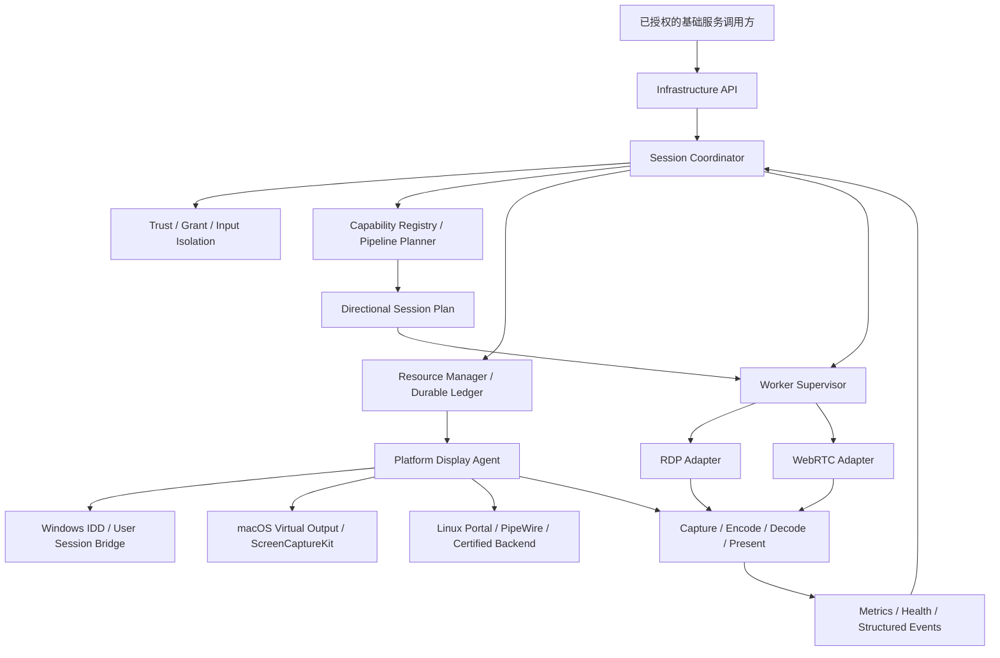
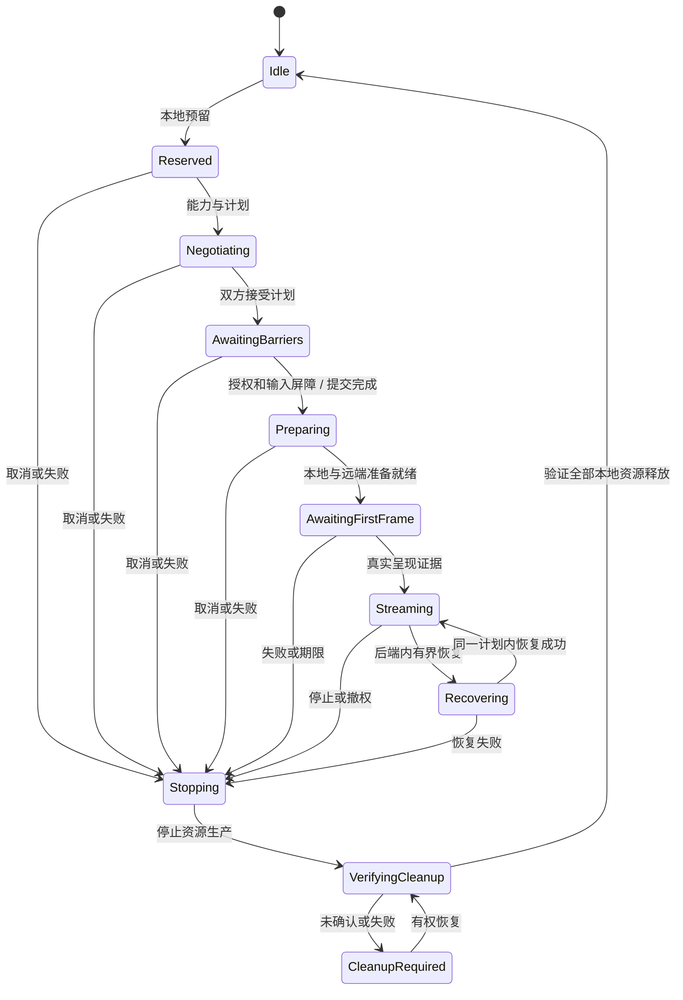

# BMouse 跨平台扩展屏底层基础设施架构设计

版本：1.0

日期：2026-10-27（Asia/Shanghai）

性质：可进入实现评审的目标架构；不是当前实现完成声明。

覆盖平台：Windows、macOS、Linux，均可承担发送或接收角色。

设计范围：基础设施、运行时、平台适配、媒体后端、协议协商、安全、资源管理、可观测性、测试和交付。

不在本文范围：界面布局、用户操作流程及上层业务交互设计。

## 阅读约定与文档效力

本文的“必须/禁止”是目标实现契约；“默认”是 V1 初始配置；“建议”是优化方向；“待验证”表示尚无项目实测证据，不能在实现中被当作已支持。

架构边界、身份与资源模型、生命周期和接口语义可按本版本实施。具体媒体引擎版本、各平台驱动/渲染实现及各方向默认协议属于后端准入项，按第 25 节验证后填入发行清单。未定的供应商实现不影响核心接口定型，但禁止用占位后端宣告完整链路可用。

本文优先于此前调研材料中“所有平台统一媒体协议”的假设。不同设备、不同发送方向可以采用不同成熟媒体协议；上层获得一致的基础服务契约。本文没有修改生产代码、系统配置或现有会话。

## 目录

1. 设计目标与边界
2. 架构决策与系统不变量
3. 分层架构与依赖规则
4. 进程、权限与部署拓扑
5. 身份、标识与时间模型
6. 能力注册与管线规划
7. 多协议协商与计划提交
8. 对外基础服务接口
9. 后端 SPI 与事件契约
10. 生命周期与并发模型
11. 虚拟显示资源所有权
12. 资源日志与崩溃恢复
13. 控制面与本地 IPC
14. 帧、内存、时钟与色彩模型
15. 缓冲、背压与拥塞恢复
16. RDP 媒体适配器
17. WebRTC 媒体适配器
18. Windows 平台基础设施
19. macOS 平台基础设施
20. Linux 平台基础设施
21. 安全、授权与信任撤销
22. 故障分类、期限与恢复策略
23. 可观测性与诊断
24. 配置、依赖与版本兼容
25. 三平台后端准入与协议策略
26. 验证体系与故障注入
27. 工程目录与现有代码迁移
28. 交付阶段与验收退出条件
29. 开源参考与设计取舍
30. 待定决策与风险登记
附录 A：规范数据契约
附录 B：核心错误码
附录 C：故障验证矩阵
附录 D：设计评审检查表

## 1. 设计目标与边界

### 1.1 系统职责

基础设施在发送端当前交互桌面中建立一个附加逻辑显示输出，将该输出的画面通过已授权媒体链路发送至另一设备，在接收端指定显示目标上解码并呈现；会话结束或不可恢复失败后，验证并回收自身拥有的资源。

镜像主显示器、仅共享一个窗口、建立独立远程登录桌面，均不能替代发送端附加输出。采集源失效时禁止隐式选择另一个显示器。

网络媒体、平台显示和现有键鼠核心各有独立角色。媒体发送者不等于既有键鼠服务端；媒体接收者不等于既有键鼠客户端。基础设施通过明确的输入隔离屏障与既有核心对接，不反转已有输入关系。

### 1.2 V1 边界

- 每个本地交互用户会话最多参与一个扩展显示会话，发送/接收互斥；资源锁还必须阻止同用户多个应用实例重复创建。
- 一次会话对应一个附加输出、一条视频源和一个接收呈现目标。
- 初始认证档位为 1920×1080、SDR、目标 30 fps。初始编码候选为 H.264；协议专属图形模式须单独认证。
- 首版只有媒体显示，不启用接收端输入、音频、文件、打印机、摄像头和剪贴板重定向。
- 视频经双方明确允许的可达网络承载；既有蓝牙基础连接可传递业务控制能力，但不能被视为视频通道，也不能突破仅蓝牙网络策略。
- 首版无需云服务、互联网中继或协议转换网关。不要求所有设备实现所有媒体后端，但发行承诺的每个方向都必须存在共同可用的链路。
- 协议在会话启动阶段选定。运行中透明跨协议切换、分辨率重建和自动重连不是 V1 的默认能力，接口允许未来扩展。

### 1.3 稳定性目标

| 类别 | 目标契约 |
| --- | --- |
| 正确性 | 不采集错误屏幕；不在清理未确认时启动新资源；不接受旧代次改变新会话 |
| 安全 | 身份、方向、授权与实际媒体连接绑定；无明文/忽略证书的自动回退 |
| 可恢复 | 在资源创建的每个阶段发生进程崩溃，重启后都能确定“已回收”或“需要处理”，不伪报成功 |
| 有界性 | 每个队列、请求、缓存、进程和恢复动作都有容量及期限 |
| 可解释性 | 能区分采集、编码、网络、解码、呈现和资源回收失败 |
| 跨平台 | 核心模块可脱离 GUI 和真实 GPU 测试，平台能力按环境认证 |
| 运维 | 可重现构建、锁定依赖、最小权限、诊断不泄露屏幕及密钥 |

首帧 10 秒、正常清理 5 秒、异常回收目标 15 秒、每发布方向 60 分钟运行作为既有验收目标继续保留。本文给出的内部预算是初始设计值，须经后端测试校准；不能把超时值当作已达到的性能。

## 2. 架构决策与系统不变量

### 2.1 核心决策

| ID | 决策 | 原因 |
| --- | --- | --- |
| ADR-01 | 统一基础服务契约，多媒体后端按方向协商 | 允许成熟平台链路复用，避免为形式统一承担额外适配 |
| ADR-02 | 控制面与视频数据面分离 | 停止、撤权与恢复不被视频排队阻塞 |
| ADR-03 | 优先 RDP/WebRTC 等成熟媒体实现；不将 DFVD/1 作为正式主线 | 将媒体协议复杂性留给成熟实现 |
| ADR-04 | 一个权威会话状态机、一个本地资源管理者 | 消除多组件各自判断“成功/结束”的竞态 |
| ADR-05 | 原生工作进程隔离媒体库与平台故障 | GUI/业务进程不承担逐帧数据和第三方解码故障 |
| ADR-06 | 持久资源意图先于有副作用操作 | 覆盖创建与回写之间的崩溃窗口 |
| ADR-07 | 显式资源所有权、代次与清理证据 | 拒绝误删、PID 复用和晚到回调 |
| ADR-08 | 单所有者事件循环＋异步效果执行 | 状态可重放、可确定性测试，阻塞工作离开控制线程 |
| ADR-09 | 原生内存表面优先，软件复制路径明确标记 | 控制 CPU 搬运、队列与能耗成本 |
| ADR-10 | 统计标注测量语义与有效性 | 不把 RTT、解码或提交显示误称端到端延迟 |

### 2.2 必须始终成立的不变量

- INV-01：只有具备当前身份绑定、有效授权及输入隔离确认的本地会话，才能建立发送端附加输出。
- INV-02：任何资源在创建前都已获得不可重用的本地 `ResourceOwnerId` 并持久记录创建意图。
- INV-03：每项平台资源只有一个负责销毁的权威所有者；媒体适配器不能绕过资源管理器创建第二个副屏。
- INV-04：清理权限依据原资源所有权，不因操作被取消或代次改变而失效；更新当前会话状态的权限则必须被代次隔离。
- INV-05：只有验证本地资源已经不存在或明确释放，才能记录 `cleanup=verified`；远端停止确认、进程退出和超时均不单独构成证明。
- INV-06：任意时刻不同时提交两个正式媒体后端；准备后备候选不得形成重叠副屏所有权。
- INV-07：网络输入不能指定本机程序路径、插件、设备文件、驱动控制码或要删除的系统显示 ID。
- INV-08：所有可排队工作有硬上限；不存在自动增长以“保证不丢帧”的无界视频队列。
- INV-09：不能随意丢弃存在引用依赖的已编码画面；丢帧及恢复由媒体后端按其编码/图形语义执行。
- INV-10：权限撤销、身份改变和基础信任撤销立即阻止后续采集/发送或输入注入，随后执行有界回收。
- INV-11：不以设备名称/IP、厂商/型号匹配或持久化 PID 作为资源删除与进程终止的充分授权。
- INV-12：状态上报中的“正在传输”必须具有该协议后端定义的真实呈现证据；证据强度与健康状态分别记录。
- INV-13：接收端物理显示器不是本会话创建的资源；只能释放自身呈现目标和图形对象，禁止将清理操作解释为移除物理输出。

## 3. 分层架构与依赖规则



图中是逻辑依赖，不意味着每个方框都必须独立进程。实际进程划分见第 4 节。

### 3.1 模块职责

| 模块 | 输入 | 输出 | 禁止承担 |
| --- | --- | --- | --- |
| Infrastructure API | 本地授权调用、会话要求 | 异步结果与快照 | GUI 状态、视频处理 |
| Session Coordinator | 命令、当前代次事件、期限 | 状态迁移及效果 | sockets、磁盘、平台阻塞调用 |
| Trust/Grant Service | 已认证身份、本地授权事实 | 受限授权上下文 | 按 IP 产生信任 |
| Capability Registry | 探测、安装/权限/设备变更 | 带来源和有效期的能力快照 | 创建持久虚拟屏作隐式探测 |
| Pipeline Planner | 双向能力、要求、策略 | 可执行候选及选择解释 | 启动编码器或修改桌面 |
| Resource Manager | 资源申请和清理请求 | 句柄、所有权、清理证据 | 自行改变授权 |
| Worker Supervisor | 锁定的计划和资源租约 | 受限进程、健康与结束事件 | 让子进程自行选择任意后端 |
| Media Adapter | 标准协商信令、帧源/呈现契约 | 实际媒体连接与反馈 | 创建未登记的系统副屏 |
| Platform Agent | 本机能力及资源租约 | 平台输出/帧源/呈现句柄 | 接受远端任意系统操作 |
| Observability | 有类型事件与测量 | 日志、指标、故障摘要 | 控制状态机的隐式分支 |

### 3.2 依赖约束

`core` 只依赖标准 C++ 类型、时钟与抽象接口；不包含 Qt Widgets、FFmpeg、FreeRDP、GStreamer、libwebrtc 和 OS SDK 头文件。适配器依赖 core，core 不反向依赖任何具体适配器。

传输实现与平台实现之间通过 `PipelineBinding` 连接，可暴露进程内原生表面接口，但不得把平台类型泄漏到公共控制消息。采集与编码之间的 GPU 同步、线程亲和要求由管线描述明确声明。

稳定边界采用版本化内部 IPC；V1 不提供任意第三方动态插件 ABI。后端是随应用打包、签名和白名单登记的实现，可分别构建工作进程，不能从网络或用户可写插件目录自动载入。

## 4. 进程、权限与部署拓扑

### 4.1 推荐进程结构

| 进程/组件 | 生命周期与权限 | 主要职责 |
| --- | --- | --- |
| 应用控制宿主 | 当前用户权限 | 托管基础服务 API、既有信任和输入协调边界 |
| `display-agent` | 每个交互用户会话唯一；用户权限 | 权威状态机、资源日志、平台代理监督、清理恢复 |
| `display-media-worker` | 每活动会话一个；按发送或接收角色启动 | 被选媒体后端、采集/编码或解码/呈现、媒体事件 |
| `display-platform-helper` | 仅后端确有需要时存在 | 持有原生输出对象、受权限/线程亲和约束的帧源 |
| Windows 驱动与最小桥接组件 | 按 IDD 安装与驱动权限模型 | 显示设备、表面、用户会话绑定，不运行网络解析器 |

应用现阶段可将控制宿主和 `display-agent` 合并到一个用户进程；合并必须保留单所有者、异步和持久日志边界，不能让媒体库进入业务主线程。是否拆成驻留代理不改变本设计的权限契约。

### 4.2 生命周期与父子约束

- 创建子进程时传递继承的私有 IPC 端点、随机一次性启动挑战和受限句柄。启动参数只含非秘密的配置 ID；密钥/令牌经私有通道交付。
- 子进程必须验证代理身份/挑战、IPC 版本、构建兼容性、允许的后端和资源代次，完成 `WorkerHello` 后才执行操作。
- POSIX 使用受监督进程组及已验证进程身份；Windows 使用进程句柄/Job Object。不能仅按进程名批量终止。
- 代理失去控制宿主且授权存续条件不再成立时停止会话；V1 不在应用退出后维持无人监督的显示会话。
- Worker 的父 IPC EOF 或监督租约过期触发停止。仅检查 `getppid()` 不足以替代本地连接身份和启动代次。
- 图形表面、GPU fence 和采集对象必须在后端要求的线程释放；监督器超时终止进程后仍要独立验证系统资源。

### 4.3 资源归属与故障域

虚拟输出归平台资源所有者持有；网络媒体 Worker 不能通过“自行恢复”重复创建。平台允许时，Worker 重建与输出生命周期解耦；无法分离的后端必须声明 `resourceCoupledToWorker=true`，Worker 退出即视为输出可能丢失，进入重新验证/清理。

不强制将逐帧原始像素跨 helper 边界复制。优先让采集、编码与网络在同一 Worker 内执行，或由平台 helper 交付可授权导入的原生表面。采用哪条路径由已验证管线决定。

Windows 用户态代理不能假设 Session 0 驱动表面可直接传给任意用户进程。桥接必须显式绑定用户 SID、登录会话和目标 GPU/adapter，检查句柄权限和同步方式。

## 5. 身份、标识与时间模型

### 5.1 标识定义

| 字段 | 范围/类型 | 语义 |
| --- | --- | --- |
| `PeerIdentity` | 已验证证书/公钥身份 | 不能由名称、地址或媒体自报产生 |
| `BaseConnectionId` | 本地当前基础认证连接 | 两端值可不同；连接重建后变化，旧连接事件无效 |
| `ControlBindingId` | 双端共同 SHA-256 绑定 ID | 当前认证连接上的 nonce 握手派生，映射各端本地连接 |
| `SessionId` | 128 位随机非零 ID | 一次端到端显示会话 |
| `OperationId` | 128 位随机非零 ID | 一次本地基础操作，支持幂等 |
| `Generation` | 本地无符号 64 位递增 | 取消/终止/新操作隔离；不比较两台机器的本地代次数值 |
| `MediaEpoch` | 会话内 32 位递增 | 媒体配置/流实例代次；V1 初始为 1 |
| `AttemptId` | 会话内递增或随机 ID | 一次候选媒体链路尝试 |
| `ResourceOwnerId` | 本地 128 位随机 ID | 资源回收授权；不随操作取消复用 |
| `WorkerInstanceId` | 每个进程启动随机 ID | 区分重启、PID 复用和旧 IPC |
| `CapabilityRevision` | 每个能力发布者递增 | 探测与能力快照修订号 |
| `PlanHash` | SHA-256 规范化计划 | 双方确认同一媒体方案 |
| `EventSequence` | 每事件流递增 | 检测重复、丢事件与快照重同步 |

跨 JSON 边界的 64 位值用十进制字符串，校验无前导零、溢出和非法符号；ID 使用约定长度的小写十六进制。所有代次到达上限时终止并建立新实例，禁止回绕。

### 5.2 授权绑定元组

媒体资源操作至少校验：

`(localUserSession, peerIdentity, baseConnectionId, sessionId, attemptId, planHash, localGeneration, workerInstanceId)`。

对网络事件，先验证 ControlBindingId 到实际认证连接的本地映射，再按双方协商的会话/尝试标识查找本地代次，不信任远端传来的本地 generation。清理操作额外持有独立 `ResourceOwnerId`；即使会话已进入终态，原所有者资源仍可回收。

### 5.3 时间与期限

控制期限、心跳和排队年龄使用本地单调时钟。墙钟仅用于审计和诊断，不用于授权剩余时间/队列判断。系统睡眠恢复后重新检查会话、权限和资源，不延续旧的媒体时钟假设。

网络消息不传送供对端直接使用的绝对单调截止时间；每端按本地状态建立期限，实际效果只取得本地剩余预算。发送端在确认双方授权与系统许可就绪的逻辑节点记录启动 T0，用它测量本次首帧绝对期限；对端按本地对应节点独立限时，不能通过自报剩余时间延长发送端期限。所有子阶段和备用尝试继承其父事务的本地绝对截止时间。

跨机器不直接相减单调时钟。真实采集时间、编码时间和 RTP 时间基需要明确映射；没有时钟关联和误差界时，跨机端到端延迟为 unknown。

## 6. 能力注册与管线规划

### 6.1 能力分层

能力是“当前环境中可执行且符合要求的链路”，不是已编译某个库的布尔值。

1. **静态能力**：打包后端、IPC/协议版本、可实现的标准图形/编码模式。
2. **运行环境能力**：当前 OS/桌面、GPU、驱动、库、图形会话、设备和网络策略。
3. **权限能力**：采集、输入隔离、平台输出创建的已知许可状态；未知不等于拒绝或同意。
4. **组合管线能力**：捕获格式与内存域能否交给编码器、媒体后端及呈现路径。
5. **会话可用性**：资源忙碌、清理屏障、当前角色和目标屏幕可用性。

每项能力携带状态 `unknown/checking/available/conditional/unavailable`、来源、修订号、环境签名和原因。`conditional` 表示需要本地权限或有副作用的受控验证，不能在候选过滤时当作已就绪。

### 6.2 Pipeline Profile

注册完整管线组合，避免把互不兼容的独立能力作笛卡尔积：

`pipelineId + role + wireProtocol + implementationVersion + captureProvider + encode/decodeProvider + memoryPath + graphicsMode + feedbackFeatures + securityProfile + lifecycleFeatures`。

例如，存在 NV12 硬编码和 BGRA 采集，不代表已具备低复制连接；存在 RDP 客户端，不代表存在 RDP 服务端；有视频硬解码器，不代表能在目标 GPU 呈现。

能力清单应公布有限的、已检验组合，默认最多 16 个管线 Profile；每项最多 8 个编码/图形模式。默认限制可调整，但网络解析硬上限必须存在。

### 6.3 探测与失效

静态、库加载、权限查询和设备枚举探测默认无副作用。需要创建临时输出/打开采集才能确认的能力，只能在已授权准备阶段执行，结束后验证回收。

GPU/驱动变化、屏幕热插拔、锁屏/睡眠、权限改变、媒体依赖升级、策略变化和进程重启都使相关结果失效。能力快照绑定当前基础连接，不持久相信上一连接发来的能力。

环境档案可持久缓存用于排序，但必须以构建版本、后端版本、OS/桌面/GPU/驱动签名为键；过期档案只能影响探测顺序，不能跳过本次安全和资源前置条件。

### 6.4 Pipeline Planner

Planner 是无副作用的纯逻辑模块，输入双方能力、方向、最低要求和策略，输出：

- 过滤后可执行的候选计划；
- 对每个拒绝候选的稳定原因码；
- 排序依据及使用的测试档案版本；
- 需要在准备阶段验证的条件；
- 明确的默认候选和有限备用列表。

先过滤安全、角色、版本、可达性、最低画质、输出/输入隔离与资源约束；再按认证档案、硬件路径、资源成本和稳定性排序。没有实测时使用确定的静态策略，不编造精确性能分数，也不在每次连接时跑高负载基准。

不存在共同协议时，返回 `NoCompatiblePipeline`。能力协商不提供转码/协议转换功能，也不静默启用实验 DFVD 后端。

## 7. 多协议协商与计划提交

### 7.1 协商权威与安全约束

显示发送端担任本次计划提出者，与基础键鼠角色无关。双方都能发起新的显示事务；每次事务必须明确发送/接收身份。双方的能力声明经过现有认证控制通道传送，但声明本身仍按不可信输入解析。

单次候选集合取“发送端可用发送管线”与“接收端可用接收管线”的兼容交集，不能只比较协议名称。还必须满足线协议版本、图形/编码模式、安全认证、分辨率/色彩、实际呈现、资源回收和反馈条件。

一个锁定计划至少包含双方身份/基础连接绑定、session/attempt、双方能力修订号、后端和管线 ID、协议版本、编码/图形模式、尺寸/帧率/色彩、网络/安全配置、生命周期预算、必选特性及计划摘要。不得包含私钥或长期密码。

`PlanHash` 对完整的、版本化 `SessionPlan` 使用确定性规范化 JSON 后求 SHA-256；采用 RFC 8785 规则并提供跨语言金向量。参与摘要的数值以整数或规范字符串表达，禁止 NaN/Infinity。媒体连接的动态候选/临时地址通过绑定同一计划的后续信令交换；不得因此修改已承诺的安全策略。[JSON 规范化](https://www.rfc-editor.org/rfc/rfc8785.html)

### 7.2 协商消息与顺序

| 步骤 | 消息/本地动作 | 必须校验 |
| --- | --- | --- |
| 1 | `CapabilitiesSnapshot` | 基础身份/连接、版本、修订号、大小及管线声明 |
| 2 | `PlanOffer` | 明确方向、有限候选、有界要求、请求未过期 |
| 3 | `PlanAnswer` | 选择精确候选或明确拒绝，不把未知项改成默认值 |
| 4 | `PlanPropose` / `PlanAccept` | 双方能力版本仍有效，计划摘要一致 |
| 5 | 本地 Grant 与 InputIsolationBarrier | 双方当前授权事实、路由停止/按键释放证据 |
| 6 | `PlanCommit` / `PlanCommitted` | 当前 session/attempt、摘要和授权范围，均可幂等 |
| 7 | 资源意图持久化、准备各自资源 | 已持有本地预留与资源所有权 |
| 8 | `MediaSignal` 与标准协议内部协商 | 会话/摘要/代次、安全配置、地址和消息预算 |
| 9 | `EndpointReady` / `MediaReady` | 对应资源及媒体验证完成，尚不宣称画面呈现 |
| 10 | `FirstFrameEvidence` | 接收端可信呈现路径、当前 epoch、证据等级 |

在第 6 步前不得创建发送端系统副屏或发送画面。能力查询和管线规划允许提前进行，不提前取得采集数据。资源准备可在双方提交计划后并行，但必须先写入各自本地意图。

这是带幂等与补偿的分布式准备/提交流程，不保证跨两台机器原子提交。任意消息都可能丢失、重复或在对端执行后确认丢失；双方依赖独立期限、租约和本地清理收敛。不能因收到 `PlanCommitted` 就认为远端资源一定长期存在。

### 7.3 并发请求和碰撞

- 同用户唯一资源槽由本地代理加锁，活动会话不被新请求抢占。
- 两端尚未创建资源、同时提出相反方向请求时，按双方共同可比较的 `(hostPeerIdentity, requestId)` 字节序选出唯一获胜事务；身份优先保证确定性，随机请求 ID 只用于消除同身份歧义。
- 失败事务返回 `OfferCollision` 并撤销自己的预留。不能把失败事务的授权用于获胜但方向不同的事务。
- 一端已有提交/资源准备中的事务时，新的不相关事务返回 `PeerBusy`；不强行合并。先完成原事务停止和清理，再允许重试。
- 同一操作 ID 的重复消息返回原结果；同 ID 不同参数是协议错误。重放窗口外的旧 session/attempt 一律拒绝。

### 7.4 后备候选

V1 最多选择 1 个主候选和 1 个备用候选，整个启动事务最多 2 次尝试。总启动绝对期限不随重试延长。只有原候选资源已经验证释放、输入屏障仍有效且授权范围覆盖新候选，才允许以新 `AttemptId` 和新本地 generation 尝试备用方案。

协议变化需要新 `SessionPlan/PlanHash` 并经对端确认；不能单端静默切换。安全标准不得降级；没有等价身份绑定方案的备用候选不进入自动尝试列表。重试失败应保留可诊断的主错误和所有尝试摘要。

运行中跨协议切换不在 V1 中实现；当前会话失效后清理并结束。未来若实现，需另有资源保留、帧时钟重建、授权和双端切换事务设计，不能复用启动重试逻辑冒充无缝切换。

## 8. 对外基础服务接口

接口面向本地已授权调用方，不承担 UI 逻辑。所有可执行操作异步返回 `OperationHandle`；返回“已接受”不代表已创建资源或已呈现。

```cpp
// 设计级伪代码；具体 Result/Future/类型定义由实现层统一。
interface DisplayInfrastructure {
  Future<CapabilitySnapshot> probe(ProbeRequest);
  Result<OperationHandle> reserve(SessionIntent, AuthorizationContext);
  Future<PlanSelection> negotiate(OperationHandle, PeerCapabilitySnapshot);
  Future<SessionHandle> start(CommittedPlan, StartBarriers);
  Future<StopResult> stop(SessionHandle, StopReason);
  Future<CleanupReport> verifyCleanup(ResourceOwnerId);
  Future<CleanupReport> recover(ResourceOwnerId, RecoveryAuthority);
  Subscription observe(SessionFilter, EventCursor);
  Snapshot snapshot(SessionId);
};
```

### 8.1 调用契约

- `probe` 默认只读，显式说明是否需要权限/有副作用验证；不能在普通探测中弹出系统授权或创建显示资源。
- `reserve` 只取得本地会话槽，带短期限；不具有创建输出权限。授权上下文由信任/许可模块产生，不能由任意 JSON 构造。
- `negotiate` 产生候选计划，不授予平台操作权限；`start` 只接受双方提交完成的计划和当前屏障证明。
- `stop` 必须幂等；停止已终止会话返回其终态与资源状态，不创建隐式新操作。不同 stop reason 采用明确优先级，撤权/安全错误高于正常结束。
- `verifyCleanup` 只读验证；`recover` 是带权限的补偿操作，两者分离。
- `observe` 按 revision 提供增量；事件丢失时返回 `ResyncRequired`，调用方取得全量快照后继续。订阅方慢不能阻塞状态机。

### 8.2 统一快照

快照包含身份/会话/方向、操作及代次、选定后端/计划、生命周期状态、资源状态、媒体健康、呈现证据、有效能力、错误分类和诊断关联 ID。

`lifecycleState`、`mediaHealth`、`cleanupState` 分离，避免单个字符串同时表达“连接中/卡顿/清理失败”。快照带单调 `revision`；不泄露私钥、临时信令令牌、系统句柄或完整 SDP。

## 9. 后端 SPI 与事件契约

### 9.1 接口集合

```cpp
interface PlatformDisplayBackend {
  ProbeResult probe(PlatformProbeContext);
  Future<OwnedOutput> create(OutputIntent, ResourceLease, CancellationToken);
  Future<TopologyEvidence> configure(OwnedOutput, LayoutSpec);
  Future<CaptureBinding> openSource(OwnedOutput, CaptureSpec);
  Future<DestroyResult> destroy(ResourceOwnerId);
  Future<ResourceEvidence> enumerateOwned(OwnershipQuery);
};

interface MediaBackend {
  BackendDescriptor descriptor();
  PipelineProbeResult probePipeline(PipelineProfile, EnvironmentSnapshot);
  Future<PreparedEndpoint> prepare(CommittedPlan, AuthorizedBindings);
  Future<void> applySignal(ValidatedMediaSignal);
  Future<void> start(MediaStartPermit);
  Future<void> stop(StopContext);
  Future<QuiescenceProof> quiesce();
};

interface CaptureSource {
  FrameSubscription start(FrameSink, CaptureBudget);
  Future<void> pause();
  Future<void> stop();
};

interface EncoderControl {
  Future<AppliedRate> setTargetRate(RateTarget, CommandGeneration);
  Future<KeyframeResult> requestRefresh(RefreshReason, MediaEpoch);
};

interface VideoPresenter {
  Future<PreparedTarget> prepare(PresentationTarget, VideoFormat);
  SubmitResult submit(FrameLease, FrameMetadata);
  Future<void> drainOrDiscard(StopContext);
  PresentationEvidence latestEvidence();
};
```

这些接口是能力边界，不要求每个媒体框架将编码器拆成独立对象。若引擎内部管理捕获/编码/呈现，适配器必须提供等价的反馈、限制、健康和清理语义；不得为了接口形式把高效引擎拆成大量原始像素 IPC。

### 9.2 事件分类

| 事件 | 权威来源 | 主要语义 |
| --- | --- | --- |
| `OutputCreated/TopologyConfirmed` | 本机平台代理 | 精确资源 ID 与实际系统拓扑 |
| `CaptureStarted/SourceInvalidated` | 本机采集适配器 | 对应输出是否产生有效帧 |
| `BackendPrepared/TransportReady` | 当前 Worker | 原生/协议准备完成 |
| `FirstDecodedFrame` | 解码器 | 已解码，不等于已呈现 |
| `FramePresented` | 可信呈现路径 | 帧/epoch、目标、证据等级与时间 |
| `MediaHealthChanged` | 本机健康聚合器 | 正常/拥塞/恢复/失效及证据 |
| `BackendFailed` | 当前 Worker/监督器 | 分类、可恢复性及受影响资源 |
| `WorkerQuiesced` | Worker 及监督器验证 | 不再接受新帧，回调已排空 |
| `CleanupEvidence` | Resource Manager/平台代理 | 本地资源释放的实际证明 |

事件都带 session/attempt/epoch、worker instance、事件序号和本地接收单调时刻。Worker 不能自行发布权威“会话已清理”状态，只能提交证据。

### 9.3 严格停止语义

`stop` 关闭新输入和新采集入口，但允许收到在途完成回调；这些回调只能释放其持有对象，不能推进当前状态。`quiesce` 完成后不得再发回调或访问已交回的帧/表面。

销毁后端实例前必须获得 quiescence 或结束承载进程；禁止等待持锁回调同时调用 `join()`。异步对象使用受限生命周期 token/weak ownership，不能以裸 `this` 跨进程/线程代次保存。

### 9.4 呈现证据等级

`Decoded`、`Submitted`、`NativePaintConfirmed`、`CompositorPresented`、`ExternallyObserved` 分别记录。V1 最低激活证据为可见且已暴露原生目标上的 `NativePaintConfirmed`，并明确这是应用呈现路径证据，不保证物理显示器扫描输出。支持合成器呈现回执时可提高等级，实机验收以物理屏观察/测量补充。

网络发送成功、RDP 帧确认和解码器完成不能自动转换为 `FramePresented`。发送端收到的是已认证对端的呈现声明，须标注来源，而不是本机测量。窗口被遮挡、最小化、锁屏与显示器关闭的状态分别记录，不虚构连续可见性。

## 10. 生命周期与并发模型

### 10.1 权威状态机



`Recovering` 仅代表已准入后端在同一协议/计划范围内请求关键帧、重建允许的解码上下文等有限动作，不能隐式重新授权、切换协议、创建副屏或恢复旧输入。

### 10.2 状态与动作约束

| 状态 | 允许执行 | 不能执行 |
| --- | --- | --- |
| Idle/Reserved | 只读探测、有限预留 | 采集/输出创建 |
| Negotiating/AwaitingBarriers | 计划、授权和隔离确认 | 未提交的媒体启动 |
| Preparing | 登记资源、创建精确输出、准备链路 | 创建第二个候选输出 |
| AwaitingFirstFrame | 有界媒体启动与呈现验证 | 把收到字节等同激活 |
| Streaming/Recovering | 同计划反馈、有限本地恢复 | 越权重新协商方向 |
| Stopping | 撤销、排空、释放 | 接受新媒体工作 |
| VerifyingCleanup | 只读核查与受权补偿 | 启动新会话 |
| CleanupRequired | 定位/恢复原资源 | 绕过清理屏障 |

终止原因不可被晚到的普通成功事件覆盖。错误保留 `primaryCause`、`cleanupCause` 和 `rollbackCause`，不因清理也失败而丢失最初根因。

### 10.3 线程与调度

控制状态由一个 owner executor 修改。网络、磁盘、平台、媒体线程返回有类型结果，统一经 owner mailbox 提交；禁止适配器同步回调状态机并造成可重入迁移。

停止/撤权/Worker 退出事件使用独立保留容量；高频帧统计采用合并 mailbox。无界事件洪泛不能挤掉停止事件。API 调用和异步完成不持有跨模块锁；平台锁与媒体库锁不得进入 core。

内部效果有唯一 ID 和参数摘要。重复完成可被去重；不同参数同效果 ID 是错误。取消是 token+代次失效，不假设 OS 调用一定可中断。取消后创建成功的结果必须交给原资源所有者清理，不可直接丢弃对象或返回值。

## 11. 虚拟显示资源所有权

### 11.1 所有权记录

每项资源有独立 `ResourceId`，记录父 `resourceOwnerId`、创建意图 ID、本地用户/登录会话、backend/provider ID 与版本、平台 resource ID、生命周期方式、创建前拓扑摘要、验证策略和依赖关系。

平台 ID 是定位符，不是授权凭证。可用时附带应用命名空间、会话随机标签、驱动侧 owner cookie、原生对象持有关系或代理可验证的创建登记。

### 11.2 创建流程

1. 取得本地全局预留及资源日志独占锁，核对无未清理资源。
2. 持久写入 `CreateIntent`，其中精确计划、owner ID、provider 和预先拓扑已确定。
3. 平台后端创建资源；返回原生句柄与实际系统 ID。
4. 持久写入 `ResourceObserved`，再对外报告准备成功。
5. 配置布局后重新读取系统拓扑，确认新增输出独立、源屏正确且尺寸满足计划。
6. 启动采集时绑定同一资源 ID 与拓扑代次，不以“最新屏幕/第一个屏幕”替代。

创建前写日志失败则不创建。创建后日志写入失败立即进入补偿清理，不能继续运行没有持久所有权记录的显示会话。

### 11.3 创建后未回写即崩溃

这时只有 `CreateIntent`，可能没有 display ID。恢复使用平台持有关系/可信 owner 标签、原生进程租约及受限枚举核查。创建前后差集、厂商 ID、型号或显示名称都只能提供线索；不能单凭这些删除新出现的显示器。

若能证明平台资源随已退出的 helper 自动消失，枚举确认后记录释放；若 helper 仍存活，通过受认证 IPC 请求其交付证据并停止。无法建立唯一归属时进入 `CleanupRequired`，保留日志，禁止猜测删除其他输出。

### 11.4 布局与系统外部变化

保存原布局只用于识别本会话改动和恢复本会话拥有的输出。清理不能无条件恢复整张旧拓扑，否则可能覆盖会话期间用户/系统新增的真实显示设备变化。

需要回滚系统属性时采用比较后修改：只有当前值仍等于本会话写入值时恢复；否则报告冲突并只移除自身输出。显示器热插拔导致资源 ID 重用时，必须重新验证所有权与拓扑代次。

## 12. 资源日志与崩溃恢复

### 12.1 日志设计

V1 使用每本地交互用户会话独占的追加事件日志及原子替换快照。写入采用长度/版本/递增序号/校验和，限制总大小，定期压缩；资源创建前的关键意图必须完成耐久写入。

POSIX 采用同目录临时文件、文件同步、原子 rename 和目录同步；Windows 使用等价的原子替换及显式刷新策略并验证故障行为。文件格式与迁移版本独立于媒体协议版本。校验和用于损坏检测，不替代文件访问控制或防恶意篡改。

初始总日志上限 4 MiB；只存资源、状态及恢复所需非秘密信息，不逐帧写磁盘。不得记录私钥、Grant bearer、媒体密码、完整信令或屏幕数据。达到容量且无法压缩时拒绝新资源申请，保留现有会话可安全停止的路径。

### 12.2 日志事件

`ReservationCreated → PlanCommitted → CreateIntent → ResourceObserved → LayoutConfirmed → MediaAttached → StopIntent → ReleaseAttempt → ReleaseVerified → OwnerClosed`。

每项资源可有多个释放尝试；只有 `ReleaseVerified` 才能完成该资源。一个 owner 的所有依赖资源均关闭后才写 `OwnerClosed`。系统资源已释放而最后写入失败，可在下次恢复通过独立核查补记；不能重新创建以匹配日志。

### 12.3 启动恢复顺序

取得独占锁 → 读取/校验/迁移日志 → 发现未关闭 owner → 核查本地 OS 登录会话/boot instance → 只读枚举与归属验证 → 有权停止旧 helper/资源 → 验证 → 持久关闭 owner → 才发布发送/接收就绪能力。

V1 重启默认清理旧显示会话，不自动恢复旧媒体凭证或旧输入路由。无法解析未知版本/损坏日志时，禁止批量删除并进入受限恢复状态；可保留只读诊断能力。

### 12.4 清理依赖图

默认顺序：撤销新工作许可 → 停止采集/提交 → 停媒体发送/接收 → 排空/丢弃可安全丢弃的帧 → 等待 GPU 引用释放 → 关闭解码/编码和平台采集对象 → 销毁本会话输出 → 系统枚举验证 → 清除 owner。

某些后端需要先关闭媒体回调才能停止采集，必须在后端清理 DAG 中明确声明依赖并验证无环。监督器终止进程是超时兜底，不替代上述资源不存在证明。

本地清理与远端清理独立记账。本地已释放、对端无法联系时允许关闭本地 owner，但会话摘要记录 `remoteCleanup=unknown`；不能把该值改成 verified，也不因等待对端而阻塞本地回收。

## 13. 控制面与本地 IPC

### 13.1 网络控制面

复用现有经认证且能提供对端身份的基础控制通道。定义独立版本标记 `display-infra/1`，与旧 `usage-display/1` 显式协商，不把新 JSON 塞入未经版本协商的旧输入字节流。

网络消息包括能力、计划、授权绑定、就绪、媒体信令、健康摘要、停止与停止确认；视频数据由所选成熟媒体后端承载，禁止通过业务控制通道转发原始/编码视频。

基础通道若经蓝牙承载，信令仍受消息预算约束，且视频必须满足双方网络策略。网络信令端点只代表可达地址，身份来自认证连接。

### 13.2 消息封装与预算

统一信封见附录 A。默认单条编码后消息上限 64 KiB；能力正文上限 48 KiB；单份 SDP 上限 32 KiB；单个 ICE candidate 上限 1 KiB，每个 attempt 最多 64 个。所有正文仍受最终编码后 64 KiB 限制，字符串转义不能绕过总预算。

公共 JSON 解析最大嵌套深度 16，单对象字段数最多 64，公共 body 字段数最多 32；字符串、数组和消息总量均先按预算检查。V1 不做无界分片重组；超限返回明确错误。每 peer 每秒初始限制：协商/命令 20 条、信令 100 条；突发容量分别 40/128。停止与撤权有保留额度，但也去重和限频。该初值需通过正常 ICE/后端启动测试校准。

接收顺序为：检查长度/封装版本 → 认证来源 → 字段类型与数量 → 会话绑定与状态 → 权限 → 交给适配器。后端专属信令由白名单适配器校验，不将未知字段映射成命令行。

### 13.3 幂等、重放和连接重建

每条命令有消息 ID、操作 ID 和请求参数摘要；保存有界结果缓存，默认每 peer 256 项、最多 10 分钟。重复消息不重复执行资源动作。缓存失效后仍用会话/owner 终态阻止旧操作重新创建。

基础连接重建产生新 connection ID；V1 当前媒体会话停止，旧令牌与未提交计划失效。未来可增加显式重绑定，但不能自动认为新连接继承旧会话控制权。重复 Stop 在未知会话上只产生无副作用的终态查询结果。

### 13.4 本地 IPC

采用用户级 Unix domain socket 或 ACL 限制的 Windows named pipe；传递原生句柄时必须使用 OS 支持的句柄传递/复制机制。身份包含本地用户/会话、进程实例、构建兼容版本和随机启动挑战。可用时验证 peer credentials、audit token/进程签名；同用户账户已完全被攻陷不在可保证隔离范围内。

私钥操作优先通过受限 credential broker/原生 key store；无法以库 API 使用时，临时材料置于私有目录/匿名句柄，限制访问和存续时间，停止时销毁。本地控制消息不能携带大块帧数据。

IPC 断开触发 Worker 自停，Supervisor 同时开始本地验证；两条检测路径必须幂等，不创建互相杀死新进程的竞态。

## 14. 帧、内存、时钟与色彩模型

### 14.1 FrameDescriptor 与 FrameLease

公共帧描述包含：来源资源/拓扑代次、session/epoch、帧序号、逻辑/像素尺寸、像素格式、平面数/stride/offset、可见区域、旋转、色彩、光标方式、采集单调时刻/时间基和有效性、损伤区域及内存域。

内存域至少区分 `CpuMemory`、`D3D11Texture`、`IOSurface/CVPixelBuffer`、`DmaBuf` 和后端私有原生句柄。公共 core 只持有 opaque handle 和 lease，不访问真实指针；后端内部保留原生强引用/OS 句柄。跨机不得发送本地句柄。

`FrameLease` 是不可变帧内容的受限所有权凭证。生产者只能写自己持有的可写槽，发布后不得改动；消费者完成读取和 GPU 操作后显式释放。池上限同时约束帧数和真实分配字节，消费者不能通过不释放对象使池无限扩张。

### 14.2 内存池与共享内存

默认每个原始帧池最多 6 个存活表面，V1 1080p CPU 池上限 64 MiB；实际采用更小值时由管线申明。GPU 分配也有 Profile 预算和计数，不能只统计 CPU 堆。目标尺寸、stride×height、平面 offset/length 和总和使用检查算术，拒绝溢出和重叠越界。

需要 CPU 共享内存时使用固定槽协议：`Free → Writing → Published → Reading → Released → Free`。每槽带池实例 ID、槽 generation、epoch、长度和 fence 信息。生产者/消费者通过明确的 acquire/release 内存序和 OS 同步原语发布；事件只用于唤醒，真实槽状态是权威依据。

共享区只能映射给已授权 Worker；消费者不能指定映射任意文件。禁止在共享区放置可解释为进程虚拟地址的指针。生产者故障时，部分写入槽永不作为完整帧发布；消费者故障时不盲目复用仍可能由 GPU 引用的槽。

零拷贝是具体管线属性，必须有 import 成功、格式匹配和 GPU 同步证据。CPU 复制回退允许存在，但必须作为独立已准入路径，报告复制次数和原因。

### 14.3 GPU 同步

跨设备/跨进程传递表面时明确 adapter/device identity、访问权限、fence 类型/值与导入方线程。不能仅传 handle 而假定写入已经完成。设备丢失、fence 超时、格式不兼容触发该管线失败，不在视频线程无限等待。

FrameLease 的应用引用释放不代表 GPU 已完成。只有引用归零且相关 fence 完成，或承载进程/设备上下文已按平台契约终止，才能回收。超时不能通过强行释放仍被使用的内存“修复”拥塞。

### 14.4 时间戳

帧携带本地真实捕获时刻和序号，单调递增；重复帧、没有实际变化和采集丢帧有独立标志。编码器可以丢弃未编码帧，但保持实际时间推进，不用 `frameIndex/30` 冒充真实采集时刻。

RTP 使用标准时间基映射，处理回绕；RDP 帧 ID、图形子帧和确认号由适配器保存映射。公共统计不能假设一个协议包对应一帧，也不能假设一个 RDP 更新对应一张完整桌面。

首帧标识需跨采集/编码/接收/呈现关联；若媒体协议无法携带额外元数据，可在可信控制面映射 epoch 与标准帧标识，禁止修改标准媒体包头来实现私有旁路。

### 14.5 色彩、缩放与光标

管线明确 SDR 色度/矩阵、全/有限范围、传递函数、像素格式和 chroma sampling；禁止沿用库默认值导致灰阶/色彩范围不一致。初始认证 SDR 8-bit，不因某端支持 HDR 就自动开启。

区分主机逻辑尺寸、捕获像素尺寸、编码尺寸和呈现目标。显示目标缩放只改变呈现，不隐式重建源输出。V1 只接受锁定的源尺寸；动态模式须协商新 epoch。

光标可选择嵌入画面或独立元数据，两种方式必须协商且只合成一次。V1 可优先嵌入；收到不支持的 cursor metadata 不能额外画第二份光标。

## 15. 缓冲、背压与拥塞恢复

### 15.1 每一阶段的有界策略

| 阶段 | 初始预算/策略 | 满载行为 |
| --- | --- | --- |
| 采集回调 → 编码入口 | 最新帧 mailbox，最多 2 个等待帧 | 释放被替换的未编码帧；不阻塞 OS 采集线程 |
| 编码器在途 | Profile 声明，计入总表面池 | 减少输入速率/跳过未编码帧，不堆积原始帧 |
| 编码输出 → 媒体引擎 | 优先直接交给引擎；外部桥接最多 2 个 AU、4 MiB | 反馈编码器，依后端恢复语义处理，不任意丢 P 帧 |
| 媒体内部发送/重传 | 引擎提供的有界 pacing/反馈/重传策略 | 可观测的降码率、降帧或失效 |
| 解码入口 | 引擎按引用依赖处理，限制 AU/图形更新大小 | 按后端请求刷新/关键帧，不通用删除字节 |
| 解码后 → 呈现 | 最新可呈现表面优先，默认 1 个等待帧 | 丢弃未提交呈现的旧帧并安全释放 |
| 控制事件 | 有界队列与保留停止槽 | 拒绝/合并普通重复事件，停止不可被统计淹没 |
| 遥测 | 合并为最近值、约 1 Hz 发布 | 丢弃旧统计，不影响媒体 |

外部 AU 限制只适用于对应视频 AU 桥接，不强行套到 RDP 图形命令。协议图形更新的尺寸/解压预算由适配器独立约束，但必须计入总内存与队列预算。

### 15.2 反馈闭环

`队列年龄/RTCP 或 RDP 反馈/编码耗时 → RateController 或引擎内部策略 → 目标码率与输入帧率 → 编码器实际应用确认 → 发送与呈现统计`。

应用层不能只发一次 setBitrate 就假定调节成功；记录 target、applied 和测得输出。编码器不支持热更新时，管线必须声明受限能力及可安全重建方式，否则不声称自适应可用。

实时性优先通过丢弃未编码旧帧、降低输入速率和引擎反馈保持。已编码流丢弃需遵守引用依赖、图形 surface 状态和恢复机制。必要时清除可重建上下文并请求协议刷新，而不是让下游永远等待已丢参考帧。

### 15.3 初始健康策略

- 监测等待年龄而不仅是队列项数；大 IDR 和小增量帧的成本不同。
- 初始在有持续变化内容且本地等待超过 250 ms 时标记 `degraded`，触发媒体反馈；超过 2 秒没有进度进入受限恢复评估。阈值是默认策略，须按认证 Profile 校准。
- 恢复窗口不超过本次故障的绝对 3 秒，且不能超过第 22 节总失效/回收期限。后端可提前报告不可恢复。
- 协议连接仍活着并不证明媒体健康；TCP RTT 小也不能证明编码/呈现及时。
- 静态桌面没有损伤帧不是故障。需结合采集状态、内容变化指示、引擎心跳和必要的标准刷新请求判断，不能以“几秒没帧”直接拆除副屏。
- 网络长期无法满足最小档位时明确失败并清理；禁止无限提高缓冲维持表面上的连接成功。

### 15.4 避免原实现的预算冲突

队列生产者的等待期限不得短于合法消费者操作的最长阻塞预算，除非设计明确把它作为独立的低延迟丢帧点且能够安全恢复。初始实现中“单帧可发送 1 秒，生产队列只等 150 ms”的不一致不能进入新后端。

新后端应优先使用非阻塞/异步发送和引擎内部背压，不复制这组常量。每项期限都受绝对事务期限约束，重复取得进度不无限刷新总体期限。

## 16. RDP 媒体适配器

### 16.1 范围与角色

RDP host adapter 实现服务端，将已登记虚拟输出的图形数据发送给 receiver adapter；receiver adapter 实现客户端并输出到受控呈现目标。连接方向和键鼠角色独立。

优先研究 FreeRDP 库接口和 GNOME Remote Desktop 集成，不直接启动系统远程登录桌面作为替代，不要求用户新增操作系统账户。系统 RDP 服务可用作基准，但正式资源所有权、授权和停止必须由 BMouse 可验证地掌握。

### 16.2 图形模式

通过 RDP 标准能力协商选择双方支持的 graphics pipeline 和 AVC420/AVC444 等模式。RDP AVC444 是协议专属图形重建模式，不能等同于当前普通 H.264 4:4:4 编码；允许在 Profile 中单独表达。

接入路径可为原始表面→FreeRDP 编码模块，或本机编码器→RDP 图形数据映射。后者必须证明输出、区域、帧/子帧和参考上下文语义正确；普通 Annex B 流不能未经适配当作完整 RDP 图形命令。

### 16.3 流控和呈现

利用 RDPGFX 帧确认、可用的网络检测与适配器调度限制在途图形工作；若参考 GNOME 的控制器，需要把其依赖与授权/资源边界一并梳理，不只复制阈值。[FreeRDP 图形接口](https://github.com/FreeRDP/FreeRDP/blob/b2403bb99fba33acc817ffd4042b64e077d59076/include/freerdp/server/rdpgfx.h)、[GNOME 帧控制器](https://github.com/GNOME/gnome-remote-desktop/blob/265339dc520f7c3978298a2509a22e4cb6c54e99/src/grd-rdp-gfx-frame-controller.c)

RDP 协议 ACK 的具体语义由标准与实现决定，不能统一解释为物理屏已显示。receiver 必须另从本机呈现路径生成证据。

### 16.4 安全与功能裁剪

- 禁止 legacy RDP Security/匿名进入媒体功能；通过已批准安全剖面要求 TLS、服务端身份验证和受限客户端授权。
- 为保持现有加密要求，初始 RDP 剖面要求可用 TLS 1.3；若某实现需要兼容 TLS 1.2，必须先形成单独安全 ADR，不能由握手失败自动放宽。
- 设备授权映射到标准认证扩展点，使用一次性短期会话凭证或经验证的等价机制；具体可实现性是 RDP 准入门槛。不能自造 RDP 加密层或仅因 TCP 来源 IP 匹配就授权。
- 禁用未准入的输入、剪贴板、文件、音频、磁盘、打印机、摄像头和任意动态虚拟通道。
- 不在全局默认端口抢占既有 RDP 服务；使用独立受控端点和明确 peer/session 绑定。

### 16.5 平台准入事实

FreeRDP `3.32.1` 已明确跳过无法编译的 Mac 平台/Shadow 服务端，因此 Mac 发送端需要通用服务端嵌入验证。独立 VideoToolbox 子系统在本次开发快照中提供解码，不构成现成发送编码路径；FFmpeg 硬编映射也需实测。该缺口不影响将 RDP 用于其他已验证方向。[发布构建脚本](https://github.com/FreeRDP/FreeRDP/blob/3.32.1/server/CMakeLists.txt)、[FFmpeg 编码后端](https://github.com/FreeRDP/FreeRDP/blob/3.32.1/libfreerdp/codec/h264_ffmpeg.c)

## 17. WebRTC 媒体适配器

### 17.1 媒体和信令

采用成熟 WebRTC 引擎的媒体 Track、RTP/RTCP、DTLS-SRTP 与 ICE。应用控制面负责提供经认证的信令承载；offer/answer、candidates、DTLS 指纹全部绑定 SessionPlan。

首版为单向 video Track，按实际要求禁用音频及远程输入 DataChannel。媒体不得经可靠 DataChannel 承载，避免自行重建实时媒体传输。[WebRTC 媒体规范](https://www.rfc-editor.org/rfc/rfc8834.html)

本地 LAN 优先 host candidates；是否支持其他候选由显式网络策略决定。V1 关闭样例默认外部 STUN/TURN、网页与信令服务器；不依赖公共服务。不具备可用路径时返回 `NetworkPathUnavailable`，不静默启用明文、未知中继或 DFVD。

### 17.2 编码和反馈集成

两种实现方式均可：

1. 引擎管理编码器，平台代理向受支持输入接口交付帧和真实时间戳。
2. 注入本机编码器/工厂，完整实现码率/帧率/关键帧、编码完成和丢帧反馈。

GStreamer `webrtcsink` 对已编码输入不会自动调整外部编码参数；不能把现有固定码率输出直接接入后即声称已有自适应。[官方说明](https://gstreamer.freedesktop.org/releases/1.24/)

原生 libwebrtc 的编码器工厂和 rate-control API 可用于适配；GStreamer 的完整管线可复用格式、时钟和媒体插件。两者均须验证硬件/内存/反馈实际贯通，不以编译成功作为准入。[编码器接口](https://webrtc.googlesource.com/src/+/refs/heads/main/api/video_codecs/video_encoder.h)

### 17.3 安全与生命周期

DTLS 媒体证书的指纹必须经已认证控制通道绑定既有设备与本次会话；加密建立成功不等于获得采集/显示授权。按 WebRTC 标准支持经批准的 DTLS-SRTP 剖面，不把 DTLS 和 TLS 的版本数字直接等同比较。[安全架构](https://www.rfc-editor.org/rfc/rfc8827.html)

PeerConnection/ICE 断开状态与媒体失效分别处理；标准内部短时恢复只能在授权、基础控制身份和绝对期限仍有效时进行。ICE restart、轨道/方向/编码模式改变不默认允许，必须声明并通过新的配置契约。

## 18. Windows 平台基础设施

### 18.1 发送端

以官方 IDD/IddCx 为首选虚拟显示模型，由已安装且可验证的驱动创建附加 monitor 并处理模式/帧表面。IDD 是 UMDF 驱动，仍需要驱动签名、安装、更新及权限边界，不能当作普通 DLL。[微软模型](https://learn.microsoft.com/en-us/windows-hardware/drivers/display/indirect-display-driver-model-overview)

平台代理负责：核查驱动/接口版本、当前交互会话、输出 owner、模式和布局；以受限 IOCTL/本地桥接完成自身输出操作。驱动不接受网络消息或任意程序路径。

帧路径在“驱动表面交付”与“对该附加输出使用公开采集接口”之间选择已验证实现；不同路径是不同 Profile。跨 Session 0 与用户进程的表面、共享句柄和 GPU 同步必须显式验证。禁止抓取安全桌面、登录界面或另一个登录用户的输出。

### 18.2 接收端

优先硬解码及 D3D11/GPU 呈现，检查编码支持、adapter LUID、设备丢失、目标屏幕变化和色彩范围。媒体引擎可提供实现，公共接口不强制 Media Foundation 与某个厂商 SDK。

Windows App 可作为 RDP 互通诊断端，不能替代 BMouse 的 receiver adapter、授权和资源回收。

### 18.3 回收与版本

驱动侧输出按 owner/登录会话绑定，提供只读枚举和受限销毁；设计 owner 连接断开后的租约清理，实际期限需驱动实测。重启后遗留输出必须能识别自己的命名空间和 owner，不凭显示名称删除。

驱动升级与应用升级分离。接口不兼容时仅禁用相关发送能力；不能自动卸载未知驱动或修改全局安全设置。没有 Windows 实机认证时，所有相关方向保持未认证。

## 19. macOS 平台基础设施

### 19.1 虚拟输出

当前候选为隔离的 CGVirtualDisplay 私有接口后端。运行时检查类/selector、返回对象、模式和系统拓扑；按实际 OS/芯片版本认证。签名/公证不等同于公开 API 支持或 App Store 可分发结论。

每个输出持有原生强引用和资源租约，句柄随 helper 生命周期释放。平台 helper 的失联/退出后仍独立枚举确认资源状态。仅匹配当前厂商/型号不能证明是本会话输出。

### 19.2 采集与编解码

使用 ScreenCaptureKit 按精确 display ID 过滤；采集权限由本机 permission broker 管理，agent 和 helper 的签名/启动责任链必须稳定。命令行启动与 LaunchServices/TCC 行为差异必须纳入打包测试。[官方采集框架](https://developer.apple.com/documentation/screencapturekit?changes=_1)

优先 CVPixelBuffer/IOSurface 与 VideoToolbox/GPU 路径；实际是否硬编/硬解由运行时属性报告。采集回调不执行网络阻塞写；编码完成与父进程停止并发时遵守帧所有权。

### 19.3 系统状态

锁屏、用户切换、睡眠、采集许可撤销或源输出失效时停止取得新画面，撤销媒体工作许可并回收。V1 不在解锁后自动重建旧会话；不以黑帧或旧画面维持“健康”。

Mac 接收不依赖私有虚拟输出接口，应独立认证。Mac 发送端若无法接受私有 API 的兼容风险，必须调整该能力的发布范围；网络协议选择不能消除这个限制。

## 20. Linux 平台基础设施

### 20.1 标准入口优先

首选 ScreenCast Portal 的 VIRTUAL 源与 PipeWire。查询接口版本、AvailableSourceTypes、CursorModes；在授权准备阶段创建会话并核查实际新增当前桌面的独立逻辑输出。Portal 声明能力不代表当前合成器的布局、尺寸、退出回收行为已经认证。[Portal 规范](https://flatpak.github.io/xdg-desktop-portal/docs/doc-org.freedesktop.portal.ScreenCast.html)

当前 Ubuntu 的只读结果为版本 5、SourceTypes=7；官方当前文档描述版本 6。实现必须按运行时版本使用字段，不能要求本机具备文档最新接口；版本 6 的 PipeWire serial 等机制只在实际支持时使用。

### 20.2 桌面专用后端

Portal 不能满足特定已认证需求时，可注册 GNOME/Mutter、KDE 或其他合成器专用后端，但不得把其能力发布为所有 Linux 通用。标准采集入口与专用布局入口可以组合，必须在 Profile 中记录实际依赖。

GNOME RDP 的 `extend` 模式为有效参考，但系统共享服务的会话管理、权限和 owner 归属不能默认被 BMouse 控制。[GNOME 设置](https://github.com/GNOME/gnome-remote-desktop/blob/265339dc520f7c3978298a2509a22e4cb6c54e99/src/org.gnome.desktop.remote-desktop.gschema.xml.in)

### 20.3 PipeWire 与呈现

对目标 stream 绑定正确的节点/会话身份，节点 ID 重用时重新验证。优先 DMA-BUF 与硬件路径；协商失败时可使用已准入的 CPU 路径。没有驱动支持时不宣称硬件不可用的机器“应该可以”。

Wayland/X11 分别认证。不能为取得某种窗口管理状态而无条件全局切换到 XWayland；后端应声明实际可实现的呈现/可见性能力。X11 的输出创建也是独立能力，不以 xrandr 命令存在或创建独立 X server 代替当前桌面扩展。

Portal Closed、PipeWire node 删除、用户总线失联、合成器重启和会话变化都触发 source invalidation。绑定本机图形登录会话，不能仅按 SSH 的环境变量推断目标桌面。

## 21. 安全、授权与信任撤销

### 21.1 信任边界

保护对象包括屏幕内容、设备身份/私钥、平台显示拓扑、输入所有权、本地文件/句柄和用户会话。需要处理网络对端不可信内容、重复/乱序/畸形消息、解码器漏洞、旧进程和本地误配置。

已完全控制本地用户账户/内核的攻击者超出可保证边界；设计仍以最小权限和隔离降低同用户误调用及第三方库故障影响。

### 21.2 AuthorizationContext

由现有信任模块产生不可伪造的本地上下文，包含双方身份、连接、session、方向、能力范围、允许的后端/安全剖面、期限、是否允许本次受限备用尝试及撤销版本。平台权限独立校验，网络授权不能代替 OS 许可。

若允许在 RDP/WebRTC 间备用，授权范围必须明确覆盖各自相同的采集和显示能力；后端不得趁重试启用输入/音频或放宽身份校验。授权 bearer 不写日志、不随诊断导出。

### 21.3 InputIsolationBarrier

作为既有输入核心的基础接口，提供 `probe → revokeRoute → releasePressedState → acknowledgeIsolation → verifyCurrent` 证据，绑定 peer、操作代次和基础连接。

收到明确完成确认前不能开始输出准备。确认超时、权限变化或存在未隔离路由，拒绝启动。停止显示后是否恢复输入由外部用途事务决定，显示基础设施本身不自动重新启用旧路由。

### 21.4 密钥与端点

设备私钥优先保存在系统安全存储或已有受限凭证设施；适配器取得受限签名/握手能力。若媒体库必须读取 PEM，由 credential broker 为当前 Worker 提供最小访问材料，持有时间受会话约束。禁止每个后端另建一套未经设备绑定的长期信任库。

端点只能来自本地绑定或经认证对端信令，仍需地址格式、接口和网络策略校验；禁止把远端地址用于任意 URL/本地服务访问。允许的网段/接口策略明确处理 loopback、link-local、IPv4/IPv6、VPN 和多网卡，不仅凭“私网地址”判断可信。

V1 视频仅使用双方允许的直接网络路径。任何额外监听服务都绑定合适本机接口、会话和 peer 认证，不自动修改防火墙、网关或权限配置。

### 21.5 撤销顺序

原子禁止新媒体/采集工作 → 失效本次授权与 worker permit → 发送受认证撤销/停止 → 停止媒体与平台对象 → 验证回收 → 清除临时凭证。

已经进入 OS 网络缓冲的数据不可承诺撤回，必须限制队列预算并记录边界。基础连接失效、证书/身份改变、授权撤销、权限丢失均触发此路径，不自动在新身份上续接。

## 22. 故障分类、期限与恢复策略

### 22.1 错误模型

统一错误结构：`code/category/origin/stage/retryClass/resourceImpact/primaryCause/relatedCause/diagnosticId`。`origin` 指本机 core、平台、Worker、对端控制或协议适配器；对端诊断是声明，不作为本机资源释放证据。

`retryClass` 为 `never / afterPermissionChange / afterEnvironmentChange / afterCleanup / backendInternal`。调用方不通过解析本地化错误文字决定恢复。底层 OS/库错误放入受限诊断字段，不直接成为公共枚举。

### 22.2 初始期限

| 项目 | 初始默认值 | 期限语义 |
| --- | --- | --- |
| 本地 pending 预留 | 30 秒 | 无资源创建；到期释放，系统许可晚到不得复活旧操作 |
| 单次计划协商 | 3 秒 | 不包含外部等待授权；不重置总体操作期限 |
| Worker 身份握手 | 2 秒 | 失败即终止该进程并核查资源 |
| 输入释放/隔离屏障 | 最多 5 秒 | 已有核心确认；仍受首帧绝对期限约束 |
| 启动至真实首帧 | 10 秒 | 双方授权与系统许可就绪后计时，包含后续屏障/准备/媒体尝试 |
| 本地 Worker 心跳 | 每 1 秒 | 连续 3 秒无心跳进入失效检查，不独立证明媒体失效 |
| 后端内部恢复窗口 | 最多 3 秒 | 同一故障绝对上限，不通过重复请求刷新 |
| 正常停止/本地清理 | 目标 5 秒 | 超时标记 CleanupRequired；不宣告已释放 |
| 异常检测至回收 | 总目标不超过 15 秒 | 包含检测、终止、回收和验证；OS 无法配合时报告未确认 |
| 未确认资源恢复尝试 | 单次受总回收期限约束 | 后续恢复是显式新操作，不无限后台重试 |

权限事实未就绪时不启动首帧计时，也不创建资源；已有 pending 操作可以到期，权限变化后由新操作继续，禁止给旧操作无限续租。正常停止期限从 stop 被接受开始，与远端 ACK 是否到达无关。

每个阶段实际使用 `min(阶段预算, 操作剩余绝对时间)`。10 秒启动预算不是每个步骤各 10 秒，备用协议也不能额外获得一份完整预算。

### 22.3 故障处理表

| 故障 | 当前链路处置 | 回收/恢复 |
| --- | --- | --- |
| 没有兼容能力、版本不匹配 | 不准备资源 | 结束预留，报告具体不匹配 |
| 身份/授权失效 | 立即撤销新工作许可 | 停止并独立回收，不自动换协议 |
| 输入隔离未确认 | 不创建输出 | 保留错误证据，由外部用途事务处理 |
| 创建/布局失败 | 不启动采集 | 按原 owner 补偿，确认后才可备用 |
| 采集源失效 | 停止新帧 | 不能抓主屏替代；停止/清理 |
| 轻度拥塞 | 有界反馈，原始帧减速/丢旧 | 不改变拓扑，持续监测 |
| 编码参考/图形上下文失效 | 后端内部刷新 | 限次限时，失败则停止 |
| 解码失败/格式不符 | 丢弃不安全输入并报告 | 标准刷新或终止，不能无限重试解析 |
| 呈现目标失效 | 停止提交该目标 | V1 不隐式选其他屏；失败后清理 |
| Worker 崩溃/失联 | 撤销 permit，阻止旧事件 | 结束原实例、验证原 owner；不自动恢复旧输入 |
| 平台 helper 崩溃 | 源和资源状态失效 | 枚举原 owner，不以进程退出代替验证 |
| 控制连接中断 | 撤销当前控制授权 | V1 停止媒体，独立清理 |
| 远端 Stop ACK 丢失 | 本地继续停止 | 本地可 verified，对端 unknown |
| 日志写失败/磁盘满 | 拒绝新增资源或转补偿 | 不删除尚未关闭的所有权记录 |
| GPU 设备丢失/fence 超时 | 停止使用该设备表面 | 平台清理与证据验证；允许的后端内重建须认证 |
| 锁屏/睡眠/用户切换 | 阻止新采集/工作 | V1 停止，唤醒不自动重建 |
| 无法证明资源已释放 | 保持资源屏障 | CleanupRequired，可诊断和受权恢复 |

### 22.4 退避与熔断

后端内部同一恢复窗口最多 2 次刷新/重建；不允许递归立即重试。恢复动作不能重复创建同一原生对象而不释放旧对象。

同一环境签名＋管线连续失败达到策略门槛时暂时熔断；初始建议 5 分钟内 3 次不可恢复失败，禁用候选 5 分钟。半开只做允许的只读探测，实际资源创建仍需新的授权操作。安全失败、日志损坏和未清理资源不能仅等熔断 TTL 到期后恢复。

## 23. 可观测性与诊断

### 23.1 指标集合

| 层 | 必须采集或明确 unknown 的指标 |
| --- | --- |
| 控制 | 协商耗时、阶段耗时、过期/重复事件、候选拒绝、备用尝试 |
| 资源 | 创建/布局/销毁/验证时长，未关闭 owner 数，恢复结果 |
| 采集 | 实际变化帧数、格式、尺寸、捕获错误、源失效、原始帧丢弃 |
| 编码 | 实际实现/硬件属性、耗时、target/applied bitrate、帧率、关键帧请求及完成 |
| 传输 | 实际协议/路径、应用字节与线速口径、RTT/丢包/重传/反馈有效性、队列年龄 |
| 解码 | 实际实现/硬件属性、帧数/错误、解码耗时、等待刷新状态 |
| 呈现 | 提交/呈现计数、证据等级、等待帧年龄、目标状态、丢弃旧帧 |
| 系统 | CPU、可用 GPU 指标、工作集/堆/表面池、handle/FD、线程/进程数 |

每个指标带 `scope/unit/source/sampledAtMonotonic/validity`。不把编码目标码率标为实测网络速率，不把应用帧字节当作含重传/协议开销的链路吞吐；RDP/WebRTC 不可得指标保持 unknown，不填 0。

### 23.2 延迟与健康

本机阶段测量可直接相减同一单调时钟。跨机延迟必须说明时钟关联方法和误差；标准协议统计提供的 RTT、jitter 或 frame delay 单独展示在诊断模型，不能统一改名为 end-to-end latency。

`MediaHealth` 通过多来源证据聚合：采集存活、内容变化、编码进度、协议反馈、接收/呈现进度、队列年龄。静止画面可以健康且低帧率，收到很多字节也可能处于呈现停滞。

### 23.3 结构化日志与追踪

默认记录状态变化与故障摘要；高频统计约 1 Hz 合并。关联字段为 session/attempt、peer 的受限标识、owner、worker instance、epoch、operation 与 trace ID；一次会话跨模块共用 trace。

日志采用固定上限环形文件，初始每文件 10 MiB、保留 5 份；诊断级别提升不允许输出私钥、令牌、密码、完整 SDP/ICE 地址集合或帧内容。崩溃转储可能包含画面/凭证，默认不自动上传。

故障包包含构建/后端/环境版本、去敏计划、阶段时间线、错误链、队列高水位、资源状态及最近有限事件。导出不包含实际屏幕数据，诊断接收端信息按安全策略最小化。

### 23.4 可重放事件

测试模式可记录去敏命令/效果/完成事件及虚拟时钟，重放控制状态机。媒体位流和 OS 句柄不进入控制重放；通过替身事件模拟。重放必须复现状态与效果顺序，以定位取消/晚到/超时竞态。

## 24. 配置、依赖与版本兼容

### 24.1 配置分层

发行安全基线 → 后端认证清单 → 本机策略 → 当前环境探测 → 本次已提交计划。下层不能放宽上层安全约束；远端不能修改本机超时、内存硬上限、程序路径或证书信任。

配置用有类型 schema，未知安全字段/必选字段拒绝；非安全可扩展元数据只在白名单内忽略。默认值集中在策略模块，禁止不同后端各写一份同名但意义不同的 magic number。

### 24.2 Build Manifest

每构建产物记录 core/control/IPC/ledger schema 版本、后端实现及补丁版本、实际依赖构建选项、插件集、平台最小版本、许可证清单和能力清单签名/摘要。

发布启动只加载 manifest 中的后端，库路径从签名安装目录解析。不从 PATH 任意寻找 Python/FFmpeg，也不扫描用户可写目录加载媒体插件。开发工具可保留独立实验启动方式，不带入产品默认链路。

### 24.3 多层版本协商

| 版本 | 不兼容处理 |
| --- | --- |
| 应用控制 API | 拒绝该扩展能力，基础输入连接可保留 |
| 本地 IPC | 不启动不兼容 Worker |
| 资源日志 | 支持明确迁移；未知版本只读保留并阻止新资源 |
| 媒体标准能力 | 交给后端标准协商，要求结果满足已提交计划 |
| 后端适配 SPI | 构建时/启动时校验，不依赖不稳定跨版本 C++ ABI |
| Windows 驱动接口 | 禁用不兼容发送管线，不自动更换驱动 |

旧 `usage-display/1` 与新控制面并存迁移时只经显式能力公告启用；不猜测旧对端是否支持。DFVD/1 可以留在实验工具目录作诊断基准，生产候选表不发布它。

### 24.4 升级与回滚

有活动显示资源时禁止热替换媒体二进制。先停止并验证清理，再更新；失败回滚不得覆盖未知日志或丢失旧 owner。安装包保留匹配旧日志恢复策略的受控清理能力，未知资源不按旧规则强删。

构建/升级后的首次探测使旧性能和能力缓存失效。远端版本差异只禁用不兼容扩展，不破坏既有已支持的基础键鼠能力。

### 24.5 许可与供应链

现有代码有 GPL-2.0-only WITH OpenSSL exception，候选库和插件许可证不同；使用开源不等于所有链接/分发方式自动兼容。按实际构建的 SBOM、编解码模块、静态/动态链接及发布形态进行准入核对；不能仅用拆分进程推断法律兼容。

锁定依赖版本及来源摘要、记录补丁并持续追踪安全更新。参考项目仅借鉴架构原则；复制代码或链接库需先完成相应许可检查。媒体工作进程隔离不能代替漏洞修复。

### 24.6 基础设施恢复运行手册

| 现场状态 | 代理/诊断工具允许的动作 | 必须避免 |
| --- | --- | --- |
| Worker 失联且 owner 存在 | 撤销 permit、确认原进程身份、停止原实例、平台枚举验证 | 按进程名结束所有媒体程序 |
| 有 intent 但没有平台 ID | 只读核查 helper/驱动 owner 与创建前拓扑，按唯一证据恢复 | 按名称、型号或“新增的那个”猜测删除 |
| 日志不可写/磁盘满 | 保留最后有效 owner，停止新创建，完成可证实的回收后补记 | 清空日志以解除阻塞 |
| 日志损坏/未知版本 | 锁定资源入口、导出去敏诊断、使用匹配版本恢复器 | 使用较旧 schema 覆盖或跳过坏记录 |
| 平台枚举权限不足 | 将清理标为 unknown，恢复权限后重新验证 | 将 API 报错当作资源不存在 |
| helper/驱动版本不兼容 | 禁用相关 Profile，保留原资源只读与受控恢复 | 自动卸载驱动/删除未知系统设备 |
| 更新失败 | 保留原产物/日志关系，回滚受控二进制，再核查 owner | 活动会话中替换正在使用的库 |

恢复工具只通过同一 Resource Manager 执行受控命令，不提供任意 PID/显示 ID 删除参数。所有恢复动作记录操作者类型、owner、证据、开始/结束及结果，仍受相同文件权限、身份和期限限制。

## 25. 三平台后端准入与协议策略

### 25.1 支持矩阵

每一个认证条目是：

`发送 OS/版本/桌面/GPU/驱动 + 发送管线 + 接收 OS/版本/桌面/GPU/驱动 + 接收管线 + 协议/图形模式 + 安全剖面 + 测试版本`。

至少覆盖六个跨平台方向：Windows→Mac、Windows→Linux、Mac→Windows、Mac→Linux、Linux→Windows、Linux→Mac；同系统 Mac→Mac、Linux→Linux、Windows→Windows 单独覆盖。支持任一客户端不证明对应服务端可用。

### 25.2 协议策略表的生成

策略源于测试档案和明确的工程成本，不按 OS 名称写死。可以出现 Linux→Mac 使用 RDP、Mac→Linux 使用 WebRTC 的组合；反方向各自协商。

候选选择顺序：

1. 通过身份/授权/安全/资源/最低格式和能力过滤。
2. 优先发行认证且适配当前环境的完整链路。
3. 根据办公文字质量、动态延迟、资源和可靠性档案排序。
4. 在收益接近时优先较少依赖/维护成本的已稳定链路。
5. 双方确认精确计划，使用剩余预算准备。

没有真实对照结果时只发布受限测试候选，不声称“智能最优”。可以限制某 OS 只带一个发送后端、多个接收后端，只要发行承诺的方向均有实际交集。

### 25.3 媒体引擎准入

| 候选 | 必须消除的未知项 |
| --- | --- |
| FreeRDP | 发送端自定义帧源、身份/授权映射、图形调度、硬件路径、呈现证据和安全裁剪 |
| GStreamer WebRTC | 三端插件打包、Qt/原生表面、编码控制闭环、信令适配与 GPU 同步 |
| 原生 libwebrtc | 构建/升级成本、平台编码器工厂、帧/纹理适配、呈现与依赖许可 |

初始正式适配器类别为 RDP 和 WebRTC；同一类内部不默认并行维护多个引擎。GStreamer/libwebrtc 先做受限样机比较，选定可维护实现后再纳入正式发行。确有平台差异需两个引擎时，写明收益、边界和测试成本。

### 25.4 性能与场景验证

统一 1080p SDR、目标 30 fps、相同逻辑缩放与相同内容。记录中文/英文小字、IDE 彩色文本、表格、网页滚动、窗口拖动和视频片段。RDP AVC444 与普通 H.264 4:2:0 不是同质量设置，应分别比较相同码率和相近主观质量。

正常有线 LAN 的操作到显示 P95 ≤120 ms 可作为建议性能目标，尚未实测、不是本设计已兑现的保证。最终 Profile 应记录真实分位及方法，不用 ping、协议 ACK 或解码时间替代。

实测应直接观察接收设备物理屏，避免经 RDP 再观看 BMouse 窗口造成二次编码/传输而污染结果。每个发布方向连续 60 分钟、无不可解释退出/持续增长/遗留副屏，正常/异常期限按第 22 节核验。

## 26. 验证体系与故障注入

### 26.1 分层验证

| 层 | 方法 | 证明范围 |
| --- | --- | --- |
| Core 单元/模型测试 | 虚拟时钟、事件重排、性质断言 | 状态、不变量、代次和有界重试 |
| 协议/schema 测试 | 金向量、畸形/超限、版本/重放测试 | 解析和协商，不证明真实媒体 |
| 后端契约测试 | 每个适配器运行同一生命周期套件 | probe/prepare/start/stop/quiesce/cleanup 语义 |
| 媒体集成 | 合成源、标准协议互通、实际引擎 | 编解码/反馈/内存同步，不证明真副屏 |
| 平台集成 | 真实当前桌面创建、采集、布局和回收 | 正确源及 OS 资源生命周期 |
| 双机系统验收 | 真实认证/输入屏障/物理屏 | 完整方向可用性 |
| 发行验证 | 干净系统/新用户、签名安装包 | 分发、权限和依赖完整性 |

单台回环、offscreen renderer、解码帧数和外部客户端连接成功都不能独立替代双机实际呈现。

### 26.2 必须覆盖的性质

- 任意命令/完成/取消排列下，不出现两个资源 owner 同时激活。
- generation/attempt/epoch 不匹配的成功事件不能改变当前会话，但原资源仍得到清理。
- 每个创建副作用都有前置持久意图；每个 owner 关闭都有资源释放证据。
- 断线与本地停止同时发生、双端同时请求、Stop 确认丢失时均收敛。
- 任何队列和结果缓存都不会超过已配置硬上限。
- 背压不会在不具备刷新恢复条件时丢弃依赖帧。
- 跨协议备用只有在旧资源确认清理后启动，并重新确认计划。
- 撤销授权后不接受新媒体/平台工作，旧 IPC 不能控制新 Worker。

### 26.3 崩溃点与恢复测试

在日志写入前后、原生输出创建前后、资源 ID 回写前后、GPU 表面发布/引用/释放、媒体握手、首帧、停止与日志关闭前后逐点杀死相应测试进程。重启后以真实平台枚举验证输出/进程/句柄状态。

磁盘满、只读、日志尾部截断/校验失败、系统时间跳变、睡眠、PID 重用、端口被占、句柄重复/过期等均纳入。注入只作用于本次测试资源，不终止用户其他进程或修改真实工作网络。

### 26.4 网络与解码鲁棒性

测试正常 LAN、带宽阶跃、短时约 250 ms 阻塞、20/50 ms RTT、1%/3% 丢包及控制/媒体链路不同步失效。使用隔离测试链路/命名空间或可控模拟层，不改变用户默认网络。

对标准媒体解析器进行上游安全测试复用与本地边界测试；恶意尺寸、超大 AU、异常子帧/图形上下文及错误色彩/stride 不得导致越界分配或控制进程崩溃。

### 26.5 长时与性能回归

正常采样和故障诊断均测性能开销。预热后记录 RSS、GPU 表面/显存、FD/handle、线程与队列高水位，区分缓存稳定增长和持续泄漏；阈值由同一环境的认证基线定义，不能跨机器用一个 RSS 数值作结论。

每个发布方向至少 60 分钟；重要版本增加 8 小时 soak。若缺少设备或权限，记录 blocked/unverified，不能以其他 OS 的结果替代。

## 27. 工程目录与现有代码迁移

### 27.1 建议目录

```text
src/lib/display/
  core/          # 纯状态机、类型、策略、计划与验证
  api/           # 本地基础服务门面与快照
  control/       # 既有信任控制面适配、版本化信令
  capability/    # 探测注册、缓存、管线兼容图
  resource/      # owner、耐久日志、恢复与证据
  supervision/   # Worker 进程、IPC、租约与健康
  media/
    spi/         # 受控适配契约，不暴露任意第三方插件 ABI
    rdp/         # FreeRDP/经准入实现
    webrtc/      # 经准入的完整 WebRTC 实现
  platform/
    windows/     # IDD/会话桥接、表面与呈现
    macos/       # 虚拟输出、SCK、VT/原生表面
    linux/       # Portal/PipeWire/桌面后端、呈现
  observability/ # typed metrics、日志、诊断与 trace
src/apps/
  display-agent/
  display-media-worker/
  display-platform-helper/  # 仅必要平台构建
```

目录是职责建议，可逐步迁移；不要求先进行大规模重命名再实现稳定契约。

### 27.2 现有模块映射

| 当前实现 | 迁移策略 |
| --- | --- |
| `Coordinator/SessionState` | 保留纯状态机思路，扩展 attempt、plan 和细化资源状态，兼容门面映射 |
| `UsageCoordinator/UsageDisplayBridge` | 保留输入隔离/用途事务边界，调用新基础服务，不理解媒体包 |
| `ProductDisplayRuntime` | 拆出能力、已认证控制与计划协商；移除隐式 Python/PATH 选择 |
| `MediaSupervisor` | 保留监督经验，改为后端工厂/进程实例/租约与有类型事件 |
| `ResourceJournal` | 迁移至带意图和资源列表的 schema；明确升级/损坏恢复 |
| `DisplayViewer` | 保留独立呈现进程边界；用受支持 GPU presenter 替换固定 BGRA 复制管线 |
| `virtual_display_probe` / Mac helper | 保留为平台实验/测试，将有用平台能力迁入正式适配器 |
| DFVD framing/实验 TLS 会话 | 保留实验基准；不作为正式候选或隐式回退 |
| 当前诊断/队列超时工作区修改 | 作为旧链路复现与对照，不计为新架构已实现 |

当前 `Capabilities` 总体 send/receive 布尔信息需扩展到有向管线列表；既有 JSON API 可以在门面适配，不能把旧“支持发送”直接翻译成所有媒体后端 available。

### 27.3 渐进迁移安全

每次只接入一个受控后端和一条认证方向。使用内部构建/策略门禁选择旧实验或新基础设施，单次会话只归一个实现管理，禁止双栈同时拥有副屏。

先使资源日志和停止契约兼容，再替换媒体。保留旧故障回归和真实资源恢复测试；新引擎首帧成功不能作为删除旧清理屏障的理由。

## 28. 交付阶段与验收退出条件

| 阶段 | 交付物 | 退出条件 |
| --- | --- | --- |
| F0 契约冻结 | 类型/schema、状态/不变量、预算、日志与错误码 | 跨模块评审通过，无资源/身份语义冲突 |
| F1 基础运行时 | 纯 core、持久资源 owner、进程监督、IPC 与恢复器 | 核心故障注入、日志崩溃窗口和幂等测试通过 |
| F2 平台资源链 | Mac/Linux 资源后端，Windows 驱动/桥接样机 | 正确附加输出、精确采集与独立回收证据 |
| F3 媒体候选样机 | RDP 与 WebRTC 的有限完整链路 | 身份绑定、反馈、呈现、预算和打包可行 |
| F4 协商与适配集成 | 方向候选表、PlanCommit、有限备用、输入屏障 | 旧事件、碰撞、撤权和失败补偿通过 |
| F5 方向认证 | 三端六方向及承诺的同系统方向报告 | 实际设备与安装包、长时/网络/生命周期验收 |
| F6 发布维护 | SBOM、版本策略、诊断与回滚运行手册 | 不依赖开发机 PATH，无未关闭资源/高风险依赖问题 |

可按设备可用性分批完成 F2/F5；尚无 Windows 实机时，Windows 支持不得发布为已认证。总体开发工期需在 F2/F3 样机后估算，不以本文模块数量虚构精确排期。

## 29. 开源参考与设计取舍

以下为架构借鉴，不代表选择其完整协议、默认安全配置或直接复制源码。阅读记录为 2026-10-27；核心 FreeRDP/GNOME 快照见调研记录，其他文件的内容 blob SHA 记录在随附参考清单。

| 项目/资料 | 本次核对与可借鉴点 | 不直接采用的假设 |
| --- | --- | --- |
| FreeRDP / GNOME Remote Desktop | 图形服务接口、PipeWire/桌面集成、帧确认与节流、虚拟输出生命周期 | 不能把系统远程登录、示例安全配置或 Linux 集成当作三端成品 |
| Sunshine | 平台内存/像素格式、采集返回状态、编码设备接口、色彩与配置边界 | 游戏主机定位及其完整协议栈不自动成为办公副屏主线 |
| Moonlight common-c | 解码单元时间、接收/排队/呈现时基、setup/start/stop/cleanup 契约、需要 IDR 的反馈 | 不继承可选加密或游戏输入通道的默认策略 |
| RustDesk | 分平台采集/编码服务与受限恢复状态；本次核对视频服务的 DXGI 恢复计数/窗口 | 不引入其公网发现/中继、无人值守和完整远控业务 |
| Looking Glass | 明确 framebuffer 读写/等待及等待耗时接口，借鉴所有权与局部传输可观测性 | 其 KVM/IVSHMEM 场景不是两台物理电脑的网络协议替代品 |
| GStreamer / libwebrtc | 完整媒体管线、标准反馈、编码适配入口 | 不假设名字为 WebRTC 就已经有完整硬件与自适应链路 |

来源：[Sunshine 平台接口](https://github.com/LizardByte/Sunshine/blob/master/src/platform/common.h)、[编码配置](https://github.com/LizardByte/Sunshine/blob/master/src/video.h)、[Moonlight 公共接口](https://github.com/moonlight-stream/moonlight-common-c/blob/master/src/Limelight.h)、[RustDesk 视频服务](https://github.com/rustdesk/rustdesk/blob/master/src/server/video_service.rs)、[Looking Glass framebuffer](https://github.com/gnif/LookingGlass/blob/master/common/include/common/framebuffer.h)、[Looking Glass 场景说明](https://looking-glass.io/docs/B7/)。

这里的共同经验是帧/资源所有权、反馈、明确停止语义及平台差异隔离；这些经验已转化为本文契约，不依赖采用它们相同的 UI 或网络协议。

## 30. 待定决策与风险登记

| ID | 待定项 | 影响/决策门槛 | 阻塞范围 |
| --- | --- | --- | --- |
| D01 | WebRTC 引擎选型 | GStreamer 与 libwebrtc 的三端构建、反馈、硬件与打包样机 | 具体 WebRTC 适配器，不阻塞 core |
| D02 | RDP 身份授权映射 | 标准安全入口能绑定既有设备授权，满足安全剖面 | RDP 后端准入 |
| D03 | Windows IDD 来源/交付路径 | 可维护驱动、签名安装、owner/会话/表面桥接 | Windows 发送 |
| D04 | Mac 私有接口认证范围 | OS/芯片矩阵、生命周期与分发边界 | Mac 发送 |
| D05 | Linux 标准虚拟输出行为 | Portal 实际拓扑、布局、尺寸与退出验证 | 对应 Linux 发送 Profile |
| D06 | 原生 GPU/跨进程表面方案 | 真正 import/fence/回收与复制成本证据 | 对应硬件管线 |
| D07 | 各方向默认/备用协议 | 同设备/内容/网络的画质、延迟、资源、稳定性 | 正式方向策略表 |
| D08 | 依赖许可与分发兼容 | 实际 SBOM、链接/分发审核，不能仅按项目名称判断 | 对应发布产物 |
| D09 | 初始预算校准 | 最差编码帧、图形更新、反馈和停止验证 | 性能认证及 Profile 默认值 |
| D10 | 恢复证据不足的平台行为 | 创建意图未回写、helper 退出与输出残留验证 | 对应自动清理能力 |

这些决策必须有 ADR、负责人角色、实验记录和明确结论后才能进入发布清单。尚未决策时能力为 unknown/conditional/unavailable，不以临时默认实现填充 available。

架构 V1 的完成定义是基础契约完整且可实施；产品完成定义仍是具体后端和方向经过真实认证，两者分别追踪。

## 附录 A：规范数据契约

本附录定义跨模块字段语义；随附 `contracts.schema.json` 为公共 `SessionPlan`、`ResourceRecord` 和外层 `ControlEnvelope` 提供 JSON Schema 2020-12。具体 RDP/WebRTC 信令正文仍由相应适配器按标准验证；公共 schema 通过不代表后端正文已合法。

### A.1 本地标识与跨机绑定

本地 `BaseConnectionId` 由每端认证传输产生，两端数值不必相同，不允许相互比较。控制消息使用共同 `ControlBindingId`：双方在当前认证连接上交换各 32 字节随机 nonce，对协议域标记、规范顺序的双方身份与对应 nonce 求 SHA-256；每端将结果绑定到本地当前 BaseConnectionId。

引导消息 `BindingHello` 只含 `protocol=display-infra-bind/1`、已知 senderPeerId 与 64 个十六进制字符表示的随机 nonce；单条上限 1 KiB。每端每条实际基础连接只接受一次 nonce，同值重复可幂等，改变 nonce 必须关闭旧绑定并重新建立控制连接。双方派生同一摘要后才进入 display-infra/1。

消息必须从该本地真实认证连接到达，且 ControlBindingId 匹配；仅携带正确字符串不能跨连接重放。nonce 握手前只允许有界的引导消息，禁止 session/资源操作。连接重建重新交换 nonce，旧绑定立即失效。若基础传输提供安全 channel exporter，可纳入绑定材料，但不能由远端自报替代。

### A.2 ControlEnvelope 示例

```json
{
  "protocol": "display-infra/1",
  "type": "PlanPropose",
  "messageId": "11111111111111111111111111111111",
  "controlBindingId": "aaaaaaaaaaaaaaaaaaaaaaaaaaaaaaaaaaaaaaaaaaaaaaaaaaaaaaaaaaaaaaaa",
  "senderPeerId": "bbbbbbbbbbbbbbbbbbbbbbbbbbbbbbbbbbbbbbbbbbbbbbbbbbbbbbbbbbbbbbbb",
  "sequence": "12",
  "sessionId": "22222222222222222222222222222222",
  "attemptId": "1",
  "planHash": "cccccccccccccccccccccccccccccccccccccccccccccccccccccccccccccccc",
  "body": {
    "planRef": "plan-1"
  }
}
```

示例中的重复字符仅为格式占位，不能用作真实 ID、nonce、摘要或凭证。正文 `planRef` 表示经同一有界交换已取得的计划对象引用；实现可在该消息直接携带计划，但必须满足总长度预算。

`CapabilitiesSnapshot` 可在绑定建立后、session 产生前发送；其他与会话相关消息必须携带 session/attempt，除 `PlanOffer/PlanAnswer` 之外的已选计划事件必须携带 planHash。附录 schema 只负责公共封装；消息注册表执行这些状态相关约束。

### A.3 SessionPlan 示例

```json
{
  "schemaVersion": 1,
  "controlBindingId": "aaaaaaaaaaaaaaaaaaaaaaaaaaaaaaaaaaaaaaaaaaaaaaaaaaaaaaaaaaaaaaaa",
  "sessionId": "22222222222222222222222222222222",
  "attemptId": "1",
  "senderPeerId": "bbbbbbbbbbbbbbbbbbbbbbbbbbbbbbbbbbbbbbbbbbbbbbbbbbbbbbbbbbbbbbbb",
  "receiverPeerId": "dddddddddddddddddddddddddddddddddddddddddddddddddddddddddddddddd",
  "senderCapabilityRevision": "4",
  "receiverCapabilityRevision": "7",
  "senderPipelineId": "macos.capture.webrtc.h264.sdr.v1",
  "receiverPipelineId": "linux.receive.webrtc.h264.sdr.v1",
  "mediaBackend": "webrtc",
  "wireProfileId": "webrtc.video.h264.v1",
  "securityProfileId": "webrtc.authenticated-dtls-srtp.v1",
  "authorizationScopeDigest": "eeeeeeeeeeeeeeeeeeeeeeeeeeeeeeeeeeeeeeeeeeeeeeeeeeeeeeeeeeeeeeee",
  "video": {
    "width": 1920,
    "height": 1080,
    "fpsNumerator": 30,
    "fpsDenominator": 1,
    "graphicsMode": "h264-constrained-baseline",
    "colorProfileId": "sdr-bt709-limited-8bit",
    "cursorMode": "embedded"
  },
  "policy": {
    "startupDeadlineMs": 10000,
    "normalStopTargetMs": 5000,
    "abnormalCleanupTargetMs": 15000,
    "maxAttempts": 2,
    "allowRemoteInput": false,
    "allowAudio": false,
    "allowRedirection": false
  }
}
```

上述 pipeline/security ID 是设计命名示例，不代表存在已准入实现。计划只引用经双方验证的 Profile，不接受任意字符串触发加载。摘要在计划外传送，避免自引用；动态网络参数作为绑定该摘要的标准信令传送。双方身份必须不同，实际方向须符合授权；这些跨字段约束由语义验证器执行。

### A.4 消息正文注册表

| 消息 | 必须包含/验证的正文 |
| --- | --- |
| `CapabilitiesSnapshot` | revision、环境代次、受限管线列表、可用/条件/失败原因 |
| `PlanOffer` | 方向双方、最低要求、有限 candidate references、能力修订号 |
| `PlanAnswer` | 精确候选或拒绝原因，不接受未知/替代候选 |
| `PlanPropose` | 完整 SessionPlan 或同会话内受控引用、规范化摘要 |
| `PlanAccept` | 同一摘要、当前能力修订与接受状态 |
| `PlanCommit` | 当前双方授权范围摘要、屏障就绪引用、承诺的计划摘要 |
| `PlanCommitted` | 同一计划/尝试、接收并完成本地提交状态 |
| `MediaSignal` | 后端 ID、标准信令类型、受限 payload、当前 signal sequence |
| `EndpointReady` | 当前资源/端点准备状态、受限端点参数，不泄露私钥 |
| `MediaReady` | 标准协商完成、实际图形/编码配置与所选计划一致 |
| `FirstFrameEvidence` | epoch、帧标识、呈现等级、来源、目标有效性；跨机时间不得伪作本机测量 |
| `HealthSummary` | 健康分类、有限指标及有效性，不参与任意远程系统控制 |
| `Stop` | 明确 reason、最后已知 epoch/序号，允许重复 |
| `Stopped` | 本地停止状态、localCleanup 状态；不代表另一端已清理 |
| `Error` | 错误码、阶段、关联消息 ID、资源影响，不含堆栈/密钥 |

所有消息依赖注册表验证大小、必填字段、状态和权限。未知必选消息/枚举导致不兼容；可选扩展只在双方声明并且不改变安全/资源语义时忽略。

### A.5 资源记录与耐久格式

`ResourceRecord` 表达一个平台资源的最新事实，包括 owner、创建 intent、会话、本地登录/boot 引用、provider、生命周期、平台定位符及证据引用。原生句柄/长期密码不持久化。

追加日志的 V1 固定头为 32 字节，大端：

| 字段 | 字节 | 约束 |
| --- | --- | --- |
| magic | 4 | ASCII `BMDL` |
| formatVersion | 2 | 1 |
| headerBytes | 2 | 32 |
| payloadBytes | 4 | 不超过 64 KiB |
| sequence | 8 | 本日志 generation 内严格递增，不能回绕 |
| crc32 | 4 | IEEE CRC-32，计算时该字段置零，覆盖头与 payload |
| reserved | 8 | 全零 |

payload 为 UTF-8 规范 JSON 日志事件。CRC 只检错；攻击防护由本地权限和受信代理提供。只有尾部未完成记录且前面完整有效时，才可保留最后有效前缀恢复；中间损坏、序号断裂或未知头部不得扫描跳过继续执行。

压缩使用独立 generation 目录中的快照与新日志：owner executor 暂停新资源变更 → 写快照及起始日志并同步 → 同步 generation 目录 → 原子替换并同步 CURRENT 指针 → 在新 generation 追加。旧 generation 在新指针耐久确认前保持可恢复；不得先截断旧日志。崩溃后只读取完整可验证的已提交 generation；CURRENT 损坏/不确定时进入诊断恢复，不能盲目回退后开始新资源。

快照包含 ledger schema、generation、最后序号、资源 owner 列表与摘要。恢复器校验快照/日志起点一致。日志/快照迁移必须先保留可恢复副本，再提交新 CURRENT。

### A.6 FrameMetadata 最小类型

```text
FrameMetadata {
  SessionId, MediaEpoch, FrameSequence,
  ResourceOwnerId, SourceId, TopologyRevision,
  pixelWidth, pixelHeight, logicalExtent, rotation,
  pixelFormat, planeLayout[], visibleRect, damageRects[],
  colorProfile, cursorMode, memoryDomain,
  captureTimestamp {clockId, ticks, timebase, validity},
  repeatedFrame, sourceChanged
}
FrameLease {
  poolInstanceId, slotId, slotGeneration,
  readonlySurfaceRef, synchronizationRef, releaseContract
}
```

平面数默认最多 4，damageRects 最多 256；过多损伤区域可合并为全帧损伤，不扩展无界列表。帧尺寸、内存与实际协商配置必须一致；V1 未准入动态尺寸变化直接拒绝并终止/重建受控会话。

### A.7 清理报告

`CleanupReport` 逐资源列出 owner、provider、定位信息摘要、是否存在、执行动作、验证方法、验证时间和状态 `verified/unknown/failed`。只读枚举不可用与资源存在不是同一结果。

会话本地 `cleanup=verified` 需要所有本地 owner 的资源和 Worker 引用关闭。对端状态独立，不覆盖本地结果。无资源产生的取消操作可以通过已耐久确认的“无副作用”状态完成，不必伪造枚举删除。

## 附录 B：核心错误码

| 类别 | 稳定错误码 | 初始恢复约束 |
| --- | --- | --- |
| 协商 | NoCompatiblePipeline / UnsupportedControlVersion / StaleCapabilities / OfferCollision | 更新能力或结束当前事务 |
| 计划 | PlanMismatch / UnsupportedRequiredFeature / AttemptExpired | 不创建资源，禁止单端修正计划 |
| 身份 | IdentityChanged / ControlBindingMismatch / UntrustedPeer | 撤权并停止，不自动降级 |
| 权限 | AuthorizationExpired / PermissionRequired / PermissionDenied / PermissionRevoked | 由本地权限事实变化后新操作继续 |
| 输入屏障 | InputIsolationUnavailable / InputReleaseUnconfirmed / RouteConflict | 不准备副屏，保留明确证据 |
| 平台 | OutputCreateFailed / TopologyMismatch / SourceInvalidated / DisplaySessionUnavailable | 补偿并验证原 owner |
| 管线 | UnsupportedFormat / SurfaceImportFailed / DeviceLost / EncoderUnavailable | 对应 Profile 失败，清理后才允许备用 |
| 媒体 | MediaHandshakeFailed / NetworkPathUnavailable / CongestionUnrecoverable / DecodeFailed | 后端内受限恢复或停止 |
| 呈现 | TargetUnavailable / PresentationUnconfirmed | 不激活，停止/回收 |
| 监督 | WorkerHelloFailed / WorkerCrashed / WorkerLeaseExpired / QuiesceTimeout | 结束原实例并验证资源 |
| 持久化 | LedgerUnavailable / LedgerCorrupt / UnsupportedLedgerVersion / DurabilityFailed | 拒绝新增资源，保留恢复状态 |
| 清理 | OwnershipUnproven / ResourceStillPresent / CleanupVerificationUnavailable / CleanupDeadlineExceeded | CleanupRequired |
| 资源上限 | MessageBudgetExceeded / QueueBudgetExceeded / SurfaceBudgetExceeded / RateLimited | 拒绝新增工作，不扩大预算 |
| 一致性 | StaleGeneration / StaleEpoch / DuplicateConflict / EventStreamGap | 丢弃或重同步，不改变新资源 |

后端原始错误与这些码保持映射关系和 cause chain；公共错误码不会依赖 FreeRDP/GStreamer 的具体整数值。未知后端错误映射为内部失败且保留去敏诊断，不误归为网络问题。

## 附录 C：故障验证矩阵

| ID | 注入点 | 必须成立的结果 |
| --- | --- | --- |
| T01 | 两端同时提出相反方向会话 | 单一获胜事务，无资源重叠，授权不串用 |
| T02 | 过期能力参与 PlanAccept | 拒绝/重新协商，不默认继续 |
| T03 | 同消息 ID 不同内容 | 协议错误，无重复副作用 |
| T04 | 新连接重放旧 PlanCommit | ControlBinding 校验拒绝 |
| T05 | 无当前 Grant 的 MediaReady | 不启动资源/不激活 |
| T06 | 输入释放 ACK 丢失 | 不创建输出，屏障失败可诊断 |
| T07 | CreateIntent 耐久写入失败 | 系统输出数量不变 |
| T08 | CreateIntent 后、创建前崩溃 | 重启可确认无副作用并关闭 owner |
| T09 | 输出创建后、ID 回写前崩溃 | 依据归属恢复；不明归属保持屏障 |
| T10 | 返回取消后平台创建才成功 | 清理旧 owner，不能成为新会话资源 |
| T11 | 资源 ID 被另一显示器复用 | 不按旧 ID 删除新设备 |
| T12 | 会话中真实屏幕热插拔/布局改变 | 不整张恢复旧拓扑覆盖新变化 |
| T13 | 控制消息洪泛/统计订阅变慢 | 停止/撤权仍可执行，队列有界 |
| T14 | 采集回调快于编码 | 只替换未编码旧帧，表面池有界 |
| T15 | 大 IDR/图形更新遇短时发送阻塞 | 有界反馈，不随意丢依赖帧，不立即毁屏 |
| T16 | 持续带宽不足 | 达到恢复期限后明确停止与清理 |
| T17 | 静态桌面长时间无变化 | 不误报媒体失效 |
| T18 | 编码器拒绝动态码率/关键帧请求 | 报告未应用，不能声称反馈成功 |
| T19 | 解码错误和标准刷新失败 | 有限恢复后终止，无无限循环 |
| T20 | GPU fence 永不完成/设备丢失 | 有界结束，不回收仍被引用内存作新帧 |
| T21 | Worker 崩溃及 PID 重用 | 仅操作原实例，原资源可验证回收 |
| T22 | helper 退出但平台资源仍存在 | 不宣告 cleanup verified |
| T23 | 本地 Stop 与远端断线同时发生 | 停止幂等，本地回收不等待对端 |
| T24 | 远端 Stopped 到达但本地输出未移除 | 本地保留 CleanupRequired |
| T25 | 第一后端准备失败 | 旧资源 verified 后才以新 attempt 尝试备用 |
| T26 | 备用时安全/身份条件不满足 | 禁止降级，不尝试该候选 |
| T27 | 旧 Worker 的首帧回调晚到 | 不激活当前会话，释放旧帧引用 |
| T28 | 锁屏/睡眠/用户切换/撤销采集许可 | 停止新画面，撤权并验证回收 |
| T29 | 日志尾部截断 | 仅使用有效前缀；已耐久创建意图不丢失 |
| T30 | 日志中部损坏/未知版本 | 不扫描猜测执行，不创建新资源 |
| T31 | 清理完成但 OwnerClosed 写入失败 | 重启只读验证后补记，不重建资源 |
| T32 | 压缩 CURRENT 替换前后断电 | 可定位唯一有效日志代次，不丢 owner |
| T33 | 新版本 Worker 与旧代理 IPC 不兼容 | 不启动媒体，保留已有资源恢复路径 |
| T34 | 未知插件/程序路径来自对端 | 白名单和 schema 拒绝 |
| T35 | 通过外部 RDP 再观察接收窗口 | 仅作辅助观察，不用于直接性能结论 |
| T36 | 干净机器未装开发用 Python/FFmpeg | 已准入发行链路仍可运行或明确能力不可用 |
| T37 | Windows 服务与用户登录会话不匹配 | 不采集其他用户/安全桌面 |
| T38 | Linux Portal/node 关闭及 ID 重用 | source invalidation，不误绑定其他流 |
| T39 | Mac 权限责任链/签名变化 | 探测与权限失败准确，不抓其他来源 |
| T40 | 长时运行与诊断开启 | 表面/FD/线程/内存有界，统计不阻塞媒体 |

## 附录 D：设计评审检查表

- [ ] 每个资源、线程、进程、GPU 表面和临时凭证均有明确所有者及释放路径。
- [ ] 单独说明创建前意图、创建后回写、取消晚到和重启恢复四个崩溃窗口。
- [ ] 网络/本地 IPC 消息有版本、大小、身份、状态和幂等验证。
- [ ] 计划提交不被误写成跨机原子事务，分区时能各自停止收敛。
- [ ] 本地 BaseConnectionId 与跨机 ControlBindingId 没有混用。
- [ ] 所有停止/恢复期限来自绝对预算，重试不能无限续期。
- [ ] 编码依赖帧、GPU 引用和原始帧丢弃规则分别定义。
- [ ] 呈现证据、RTT、各级时延和统计 unknown 语义清晰。
- [ ] RDP 与 WebRTC 后端都通过同一生命周期与安全契约。
- [ ] 三平台发送/接收分开，六方向与承诺的同系统方向有实际准入记录。
- [ ] 权限撤销、控制连接变化、输入隔离和本地清理屏障不会被媒体重试绕过。
- [ ] 发布清单与能力公告一致，不把开发分支源码功能当作本机安装版本已支持。
- [ ] 依赖许可、签名、驱动、插件路径、升级/回滚和旧日志恢复已核对。
- [ ] 未决项有独立 ADR 和实测门槛，不以伪能力或占位实现宣布完成。
