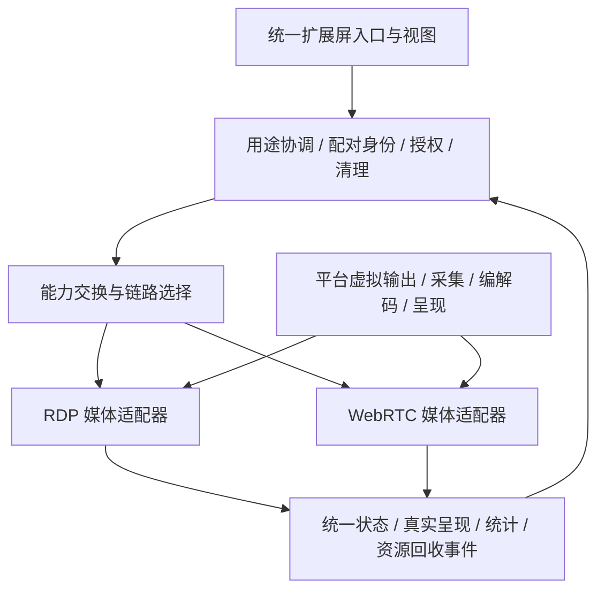

# BMouse 拓展屏：结合产品场景与三平台的选型复评

日期：2026-10-27。状态：需求、源码和环境评估完成；没有安装依赖、修改系统设置或实施协议迁移。本报告修订上一轮仅从媒体协议角度出发的推荐，作为目前最新评估。已按用户进一步澄清更新为“上层统一、底层按设备能力协商多协议”的架构。

## 1. 实际要解决的问题

依据项目 `docs/product/extended-display-requirements.zh-CN.md` v1.3：

- 两台已经配对且建立基础连接的电脑，在同一局域网使用一个副屏。不是另建远程登录桌面，也不是主屏镜像。
- 发送端把副屏加入**当前交互桌面**，应用仍在发送端运行；键鼠操作发送端应用，接收端的原有键鼠共享路由必须停用并确认释放。
- 接收端主要显示画面，有选屏、窗口/全屏与结束功能；首版不回传输入，无音频、文件重定向、互联网中继或多接收端。
- 保留现有首页角色、设备发现、证书身份、地址输入和连接流程。不能为了 RDP 要求用户重新选择服务器、输入系统账户，或改变键鼠方向。
- 首轮认证包含 Mac ↔ Ubuntu、Mac ↔ Mac；长期方案必须覆盖 Linux、Windows、macOS 任意一端发送或接收。平台支持按真实后端、版本和硬件分别声明。
- 产品要求是 1080p SDR、目标 30 fps、文档/代码/网页可用、每个发布方向连续 60 分钟、正常结束目标 5 秒内确认释放。静态桌面不需要人为持续编码 30 个重复帧。

办公文字、浏览器、代码和窗口拖动是本轮重点工作负载；视频播放与连续滚动用于检查动态表现。游戏电竞、会议、互联网直播不是选型基准。

因此，选择标准协议的目的，是减少核心维护工作并改善副屏体验，不能仅按功能列表、浏览器兼容性或是否支持 UDP 排名。

## 2. 当前推荐与明确边界（按用户澄清修订）

**推荐采用统一产品会话和可协商的多媒体后端：按“发送设备 → 接收设备”的实际能力选择成熟协议。RDP/FreeRDP 与完整 WebRTC 引擎均为候选，不要求所有设备组合采用同一种协议，也不要求每个平台实现所有候选后端。**

用户进一步明确，底层不同设备组合采用不同协议可以纳入方案，用户只面对统一视图。因此，上一轮将“三端统一媒体协议”作为约束的判断撤回。需要统一的是产品行为、安全底线、授权、会话与清理契约，媒体实现可以按平台和方向分别优化。

全局维护成本仍需计入，但一个后端在所有平台都有适配缺口时，不能仅为了协议统一而承担不必要的工作。例如，若 Linux 的 RDP 发送与 Mac 的 RDP 接收更成熟，而 Mac 的 WebRTC 发送与 Linux 的 WebRTC 接收更合适，两条方向可以采用不同链路。这是架构上可行的组合，尚非实测结论。

具体选择以候选链路的文字画质、动态延迟、资源、硬件加速、稳定性、安全和接入/维护成本综合决定。没有真实测量前，不预设某个系统一定使用某种协议。先验证当前设备上的候选边，再为 Windows 补齐实机证据。

以下结论已可以确定：

1. 不继续扩展自定义 DFVD/1 成为正式媒体主线。
2. 平台虚拟显示/采集与统一媒体协议分层，不能将“换 RDP/WebRTC”视为解决虚拟屏创建。
3. 保留现有用途互斥、授权、身份、输入释放及资源清理。
4. 淘汰产品链路里依赖用户 PATH 的 Python/FFmpeg 调度及固定 BGRA 管道；使用版本锁定的库接口与媒体工作进程。
5. 首轮评估 RDP 与 WebRTC 两类成熟后端；只有收益明确时再扩展候选。通过统一适配契约限制多后端复杂度，不以强制单一协议消除平台差异。

## 3. 场景优先级与两条路线

| 本项目要求 | RDP/FreeRDP | 完整 WebRTC 引擎 | 选型影响 |
| --- | --- | --- | --- |
| 中文小字、代码、表格 | 有桌面图形管线、区域更新与 AVC444 等实现基础 | 常见 H.264 4:2:0 路线要特别验证彩色细字 | RDP 值得优先做画质对照；不能未经测试认定必然更清晰 |
| 连续滚动、拖动、视频 | 取决于实际编码、帧确认和渲染实现 | 有媒体反馈/自适应引擎基础 | 两者都必须测真实画面更新与队列时长 |
| 仅局域网、已经配对 | 不需要为互联网能力付出额外复杂度 | 可使用本地信令和 host ICE candidates，不要求云服务 | WebRTC 的穿透与浏览器生态不是本项目的主要加分项 |
| 首版仅显示、不远控 | 必须关掉输入、剪贴板、磁盘等默认通道 | 单向视频 Track 即可，无需启用 DataChannel 输入 | 都可以实现；RDP 的完整远程桌面功能不是自动收益 |
| 不新增系统账户登录 | 需要把标准安全/认证入口接入已有设备授权 | 需要把 SDP/ICE/DTLS 指纹绑定已有设备授权 | 都有应用集成工作，不能照搬演示配置 |
| 三端均发送、均接收 | 通用库可研究；Mac 现成平台服务端被停用 | 媒体核心可三端复用，平台表面/编解码仍需适配 | 影响各方向后端选择，不再要求 Mac 提供 RDP 发送 |
| 图形/媒体流控 | RDPGFX 帧确认；成熟服务器还有调度逻辑 | RTCP、pacing、反馈与引擎编码适配 | 不能只接库的低层 API，就把整套策略算作已经拥有 |
| 安全与维护 | 协议公开、开源库成熟，但大量桌面通道与认证配置须裁剪 | 成熟标准与实现，但构建和依赖可能较重 | 比较最终维护范围，不按“开源/标准”二元打分 |

RDP 图形扩展有公开规范，FreeRDP 提供库级接口；WebRTC 媒体规范也不只是视频分包，而包括反馈和适配要求。[RDPGFX 规范](https://learn.microsoft.com/en-us/openspecs/windows_protocols/ms-rdpegfx/)、[WebRTC 媒体规范](https://www.rfc-editor.org/rfc/rfc8834.html)

## 4. 源码核查得到的关键事实

本轮读取上游源码固定快照：FreeRDP `b2403bb99fba33acc817ffd4042b64e077d59076`；GNOME Remote Desktop `265339dc520f7c3978298a2509a22e4cb6c54e99`。另外核对 FreeRDP `3.32.1` 发布标签。开发分支的功能不能推导安装版本已包含，也没有对这些上游源码进行编译验证。

### RDP：适合参考，但不是完整现成替换

- FreeRDP 的服务端图形接口存在 `CreateSurface`、`SurfaceFrameCommand`、`FrameAcknowledge` 等入口，具备接入自定义图形源的库级基础。需要我们实现图形会话、能力协商、表面映射和资源生命周期。[图形服务端接口](https://github.com/FreeRDP/FreeRDP/blob/b2403bb99fba33acc817ffd4042b64e077d59076/include/freerdp/server/rdpgfx.h)
- `server/CMakeLists.txt` 明确警告 Mac shadow server 与 Mac platform server 已不能编译，因而未构建。这个警告在 `3.32.1` 中同样存在。**它不意味着通用 FreeRDP 服务端库不能在 Mac 上使用，也不意味着库必然不能编译；意味着不能把已有 Mac 服务端当作成品拿来。** [发布版本构建脚本](https://github.com/FreeRDP/FreeRDP/blob/3.32.1/server/CMakeLists.txt)
- 本次快照的独立 VideoToolbox 编解码子系统仅提供解码，压缩上下文会被拒绝；不是现成的 Mac 发送端编码后端。FFmpeg 子系统有 `h264_videotoolbox` 编码器映射，但仍需验证实际启用、像素格式、表面转换、动态参数和 CPU 搬运，不能仅凭名称认定已经硬编或零拷贝。[VideoToolbox 源码](https://github.com/FreeRDP/FreeRDP/blob/b2403bb99fba33acc817ffd4042b64e077d59076/libfreerdp/codec/h264_videotoolbox.c)、[FFmpeg 后端](https://github.com/FreeRDP/FreeRDP/blob/3.32.1/libfreerdp/codec/h264_ffmpeg.c)
- AVC444 有完整图像重建和额外处理成本，不是把现有 VideoToolbox H.264 Baseline 单路输出改一个名称即可得到。必须测彩色文字收益、CPU/GPU 和带宽成本，不能因协议支持 444 就承诺当前两端已支持。
- GNOME 的图形帧控制器根据 RTT 和未确认帧数量节流，说明稳定桌面服务依赖协议之外的调度实现。只调用 FreeRDP 的发送函数不能自动获得 GNOME 那套行为。[帧控制器](https://github.com/GNOME/gnome-remote-desktop/blob/265339dc520f7c3978298a2509a22e4cb6c54e99/src/grd-rdp-gfx-frame-controller.c)
- 不将微软 Windows RDP 的 UDP 能力直接归于 FreeRDP 服务端。本轮只看到服务端多传输请求/响应基础及客户端隧道逻辑，没有证明目标服务端已形成完整可用的 UDP 图形数据面。对实际传输应通过握手与数据流确认。
- FreeRDP Sample Server 是示例，其安全、输入、重定向和图形默认项不能当成产品配置。BMouse 必须保留安全认证和独立授权，禁用不需要的功能。[Sample Server](https://github.com/FreeRDP/FreeRDP/blob/b2403bb99fba33acc817ffd4042b64e077d59076/server/Sample/sfreerdp.c)

### WebRTC：也有必须补齐的工程成本

- GStreamer 的 `webrtcsink` 支持已编码输入，但官方说明这种方式不会由其拥塞控制调整已编码流的参数。我们当前 Mac 编码器固定输出 H.264，直接接入不能解决固定码率问题。[官方版本说明](https://gstreamer.freedesktop.org/releases/1.24/#webrtc)
- 正确集成须让框架管理编码，或通过适配器把目标码率、帧率和关键帧要求传入本机编码器；仍需保持正确的采集时间戳。
- 原生 libwebrtc 提供编码器工厂与 `SetRates` 等适配入口，但构建体积、工具链、接口更新和平台编码器仍需维护。API 注入能力不等于现有编码器可以不加适配直接使用。[编码器接口](https://webrtc.googlesource.com/src/+/refs/heads/main/api/video_codecs/video_encoder.h)、[编码器工厂](https://webrtc.googlesource.com/src/+/refs/heads/main/api/video_codecs/video_encoder_factory.h)
- GStreamer 官方提供三端发行/构建路径，但当前 Ubuntu 未装相关 WebRTC 插件，Mac 也未发现 GStreamer 命令；已有 PipeWire 采集管线不等于三端媒体引擎已部署。[发行说明](https://gstreamer.freedesktop.org/download/)

## 5. 三个平台的职责与真实缺口

| 平台 | 发送端：新增屏幕与采集 | 接收端：解码与显示 | 当前证据/风险 |
| --- | --- | --- | --- |
| **macOS** | CGVirtualDisplay 私有接口＋ScreenCaptureKit；VideoToolbox 编码候选 | VideoToolbox 解码＋原生/GPU 视频表面；保留 Qt 窗口控制 | 已有短时 Mac→Ubuntu 画面；私有接口、长时稳定、媒体集成未认证 |
| **Linux** | 优先 ScreenCast Portal VIRTUAL＋PipeWire；实际桌面后端及布局能力分别探测 | 按显卡选择硬解码与 Wayland/X11 呈现 | Ubuntu 声明 VIRTUAL；GNOME RDP 有 extend；其他桌面不能直接推导 |
| **Windows** | 官方 IDD/IddCx 驱动，配合经验证帧源；编码用受支持硬件后端 | Media Foundation/D3D11 或媒体引擎的受支持解码/呈现路径 | 无实机验收；驱动、签名、用户会话与表面交付仍是大项 |

这些平台工作不随 RDP/WebRTC 的选择消失。[ScreenCaptureKit](https://developer.apple.com/documentation/screencapturekit?changes=_1)、[Portal VIRTUAL 定义](https://flatpak.github.io/xdg-desktop-portal/docs/doc-org.freedesktop.portal.ScreenCast.html)、[Windows IDD 模型](https://learn.microsoft.com/en-us/windows-hardware/drivers/display/indirect-display-driver-model-overview)

Windows 的系统 RDP 服务不能直接等同于 BMouse 的附加显示发送端；macOS 的 Windows App 是客户端，也不能等同于 Mac 服务端；Linux 自带 RDP 功能更不能作为 Windows/Mac 同样集成成本的依据。

## 6. 六个跨系统方向的验证矩阵

下表描述目标链路与待验证工作，不代表已经可用。每条方向可选择不同媒体协议，按实际组合认证。

| 方向 | 发送端必须证明 | 接收端必须证明 | 当前状态 |
| --- | --- | --- | --- |
| Mac → Linux | Mac 当前桌面新增副屏、正确源和硬编码、退出释放 | Linux 解码、选屏、原生呈现 | 有旧管线短时画面；新协议未验证 |
| Linux → Mac | Portal/桌面后端确实新增当前桌面的输出、采集/编码 | Mac 解码/呈现和权限/打包 | 有原型基础；新链路未验证 |
| Windows → Mac | IDD、用户桌面拓扑、帧交付和编码 | Mac 解码/呈现 | Windows 无实机，不认证 |
| Windows → Linux | 同上 | Linux 显卡/桌面组合的解码/呈现 | Windows 无实机，不认证 |
| Mac → Windows | Mac 虚拟屏/采集/编码 | Windows 解码、窗口和屏幕选择 | Windows 无实机，不认证 |
| Linux → Windows | 对应 Linux 桌面真实虚拟输出/编码 | Windows 解码/呈现 | Windows 无实机，不认证 |

另补 Mac → Mac（需求首轮范围）、Linux → Linux、Windows → Windows 作为同系统覆盖；不可用单台机器的回环来替代两机系统权限与实际显示验收。

## 7. 现有 Ubuntu 环境：可以怎样利用，不能怎样推断

本次只读核查：

- GNOME Remote Desktop：`50.2-0ubuntu0.1`。
- FreeRDP 客户端/服务端运行库：`3.32.1+dfsg-0ubuntu0.26.04.1`。
- 用户级 GNOME Remote Desktop 服务在运行。
- `screen-share-mode` 支持 `mirror-primary` 和 `extend`；当前是 `mirror-primary`，本轮没有修改。
- Portal ScreenCast 版本 5，源类型位为 7，含 VIRTUAL；这项查询来自前一轮只读检查。
- 未发现用于本次核查的 FreeRDP 开发头文件，`pkg-config` 没有返回相应开发包版本。安装运行库与具备编译 SDK 是两回事。

GNOME 的源码设置说明 `extend` 会创建虚拟显示器，初始尺寸由远端客户端的显示配置决定。这是 Ubuntu 发送侧有价值的基准；但产品首版固定 1080p，必须确保不会因为接收窗口缩放而不断重建源屏。[GNOME 设置定义](https://github.com/GNOME/gnome-remote-desktop/blob/265339dc520f7c3978298a2509a22e4cb6c54e99/src/org.gnome.desktop.remote-desktop.gschema.xml.in)

当前用于远程查看 Ubuntu 的 Windows App 连接，走的是 Ubuntu RDP 桌面共享；此前在这个 RDP 桌面里再看 BMouse 接收窗口，属于**二次编码/传输/显示**。它可以辅助确认界面出现，但不能拿来公平比较 BMouse 的原始画质或端到端延迟，也可能引入额外负载。实际比较需要直接观察 Ubuntu 物理屏。

## 8. 与 BMouse 集成时，两条路线都不能改变的约束

**共用控制面。** 现有基础连接负责设备身份、能力交换、本次显示同意、用途切换、取消与结束。显示发送/接收角色独立于现有键鼠 server/client 角色。

**RDP 路线。** 将 FreeRDP 作为 BMouse 的媒体库/工作进程，接收端嵌入自己的窗口，不依赖用户手动启动 Windows App。服务端只暴露本次虚拟输出。证书验证和标准认证入口必须绑定既有设备及本次会话；具体认证适配必须验证，不能为方便关闭校验，也不能要求创建系统远程登录账户。禁用输入、剪贴板、音频、磁盘/打印机/摄像头等非首版功能。

**WebRTC 路线。** 经已认证控制连接交换 SDP/ICE/DTLS 指纹，使用单向视频 Track。首版不引入云信令、TURN、音频或输入 DataChannel；明确关闭样例默认的外部服务。网络反馈必须接通编码器，不能把大块视频塞进可靠 DataChannel。

**生命周期。** 两条路线都必须把“媒体断开”和“应立即销毁副屏”之间的策略定义清楚：短时拥塞先进行有界适配，真正失败则及时标记失效并清理，不能无限保留黑屏，也不能每次短暂阻塞就让桌面拓扑消失。

**依赖许可。** 已确认现有代码包含 `GPL-2.0-only WITH LicenseRef-OpenSSL-Exception` 文件，FreeRDP 主体采用 Apache 2.0。不得将“开源”直接等同于可任意链接；选定二进制边界与分发方式前需逐项核对兼容性，不能假设 OpenSSL 例外适用于其他库。WebRTC/GStreamer 的第三方依赖同样需要按实际构建清单检查。本轮未作法律兼容结论，也不通过仅拆进程来宣称自动解决。

## 9. 最小验证范围：围绕真实产品，而不是通用演示

先建立能覆盖两类后端及双向真实桌面的最小链路集合，例如：

- `Linux 当前桌面附加输出 → RDP → Mac 接收`：利用现有 GNOME/FreeRDP 基础验证桌面图形链路；不能以外部系统服务代替 BMouse 最终授权和生命周期集成。
- `Mac 当前桌面附加输出 → WebRTC → Linux 接收`：验证当前验收方向、原生采集/编码和完整媒体反馈。

示例用于安排验证顺序，不预设性能赢家。若某条方向两个后端都具备合理接入成本，再在同一对设备上做直接 A/B 对照。无需为了协议形式统一，先把成本高的 Mac RDP 服务端完整做出来。Mac→Mac 仍须提供共同可用后端；Windows 单独补齐驱动、帧源与双向实机证据。

| 验证内容 | 必须记录的证据 | 淘汰条件 |
| --- | --- | --- |
| 真正副屏 | 新增当前桌面输出，可拖入本机窗口，只发送该输出 | 只能新建远程登录桌面/抓主屏 |
| 原生可接入性 | 可重复构建；自定义帧源、编码参数、解码与视频表面可接入 | 只能使用样例屏幕，或要求维护大规模上游分叉 |
| 既有授权 | 保留配对与每次同意，取消/重放/错设备被拒绝 | 必须关闭认证或新增系统账户流程 |
| 办公画质 | 中文、IDE 彩色字、表格、浏览器，静态及滚动均可用 | 达到可接受文字质量时 CPU/延迟/带宽不可接受 |
| 性能 | 同一设备记录真实帧率、端到端延迟、CPU/GPU、内存及队列 | 依赖持续排队隐藏吞吐不足 |
| 网络与恢复 | 正常 LAN、同条件限带宽/抖动/短阻塞后恢复 | 短阻塞即使拓扑消失，或恢复后长时间播放旧帧 |
| 产品生命周期 | 窗口/全屏、结束、断线、锁屏/睡眠、媒体进程崩溃 | 资源不能确认释放，或输入互斥被破坏 |
| 跨平台扩展 | Windows 和 Mac/Linux 的接口与依赖清单，逐方向证据 | 所需方向无共同可用后端，或维护成本超过该链路收益 |

RDP 样机可用 Windows App 作协议互通诊断端，但最终必须验证 BMouse 自己的接收窗口，不能以启动外部远程桌面客户端视为完成产品接入。

## 10. 公平比较的方法

- 基线统一为 1920×1080、SDR、目标 30 fps、相同字体与逻辑缩放、同一显示器和网络。固定窗口大小与源屏分辨率，不让某一客户端动态降低分辨率获益。
- 分别比较 RDP AVC420、可用时的 AVC444，以及 WebRTC H.264 4:2:0；写明实际协商模式。码率相同和主观质量相同是两个不同的比较维度，都应记录。不能用 RDP 静态画面与 WebRTC 全屏运动画面比较。
- 用固定的文档/代码/网页滚动、窗口拖动、视频片段；文字清晰度包括彩色细字，不仅看黑白截图。静态画面记录空闲流量与资源，不强求持续 30 fps。
- 相同条件记录真实更新帧率和分布、操作到显示时延、资源及断流；不能用 ping、RDP 帧确认或 decode 完成代替实际显示时间。
- 网络受限实验限定在测试媒体链路；不修改用户日常网络。先建立正常有线基线，再用实际 Wi-Fi 情况检查稳定性。
- 每个最终发布方向按需求连续使用至少 60 分钟，并覆盖正常结束目标 5 秒内确认释放、异常清理目标 15 秒、取消/拒绝/授权过期等。

## 11. 哪些证据决定各方向的选择

**某方向选择 RDP/FreeRDP：** 该方向的发送/接收端可用较薄适配接入，硬件/呈现路径可维护；办公文字画质或空闲资源收益明显；在实际 LAN 上动态表现和故障恢复达标；与既有授权及分发条件兼容。此时可在这个方向采用 RDP，不要求反方向也改为 RDP。

**某方向选择 WebRTC：** 在该方向，RDP 需要修复/长期维护平台服务端、桌面调度和专用编码链路，或其 CPU/GPU 搬运/分发成本过高；而完整 WebRTC 引擎在该方向能达到文字和稳定性门槛，就在该方向采用 WebRTC。其他已有优势的 RDP 链路可以保留。

**二者都未通过：** 不继续堆补丁或增加第三套正式协议；先解决共同的平台显示/采集/解码与生命周期问题，保留能力受限状态。没有证据时不宣称“换协议即可稳定”。

## 12. 本轮结果

已完成产品场景映射、三平台/六方向矩阵、RDP 与 WebRTC 的关键源码核查、Ubuntu 只读环境验证和下一步淘汰标准。

目前可以给出三平台统一架构建议，但不能给出真实性能赢家或准确开发工期：尚未编译候选引擎样机、未进行同条件 A/B 测试、没有 Windows 实机。当前推荐是 **统一上层产品契约，底层对已认证设备按方向协商成熟后端；以 RDP 与 WebRTC 建立候选链路矩阵，用实测收益决定每个方向的协议。**

## 13. 可协商多后端的具体架构

### 13.1 用户面对统一产品行为

主界面仍只有“键鼠共享 / 扩展屏幕”、请求允许、准备、使用中、结束与恢复。接收窗口统一提供选屏、缩放、窗口/全屏。协议、编码器和网络细节只用于诊断，不增加普通用户的选择步骤。

这里的自定义部分是产品能力协商和业务控制，不是重新定义视频分包、加密或丢包恢复。选定 RDP 后继续使用 RDP 自身的能力协商；选定 WebRTC 后继续使用其 SDP/ICE 协商。BMouse 的外层选择不能代替或绕过这些标准机制。[SDP offer/answer](https://www.rfc-editor.org/rfc/rfc3264.html)、[RDP 图形能力规范](https://learn.microsoft.com/en-us/openspecs/windows_protocols/ms-rdpegfx/)

### 13.2 以有向能力交集选择链路

每个设备分别公布当前可用的**发送**和**接收**能力，并绑定基础连接及能力代次：

- 后端 ID、协议/适配器版本，以及是否真正安装、探测通过、权限可取得。
- 可用图形/编码模式，分辨率、帧率、色彩、硬件路径与软件回退条件。
- 可满足的安全认证模式、网络条件，以及目标屏幕/呈现功能。
- 当前忙碌、清理未确认、已撤销或仅实验支持等状态。

以 A 发送给 B 为例，候选是 `A.send ∩ B.receive`，再检查版本、编码、身份认证和本次产品要求。A→B 与 B→A 分别决策；不能根据“这台电脑支持 RDP 客户端”就宣布它也支持 RDP 服务端。

双方必须共同支持所选链路。A 只有 RDP、B 只有 WebRTC 时，协商本身不能将二者互通；该方向需补充一个兼容后端，或明确不可用。本轮不引入协议转换网关、转码或中继。

### 13.3 候选组合示例，尚未定版

| 方向 | 值得优先评估的组合 | 需要证明的点 |
| --- | --- | --- |
| Linux → Mac | Linux RDP 发送＋Mac RDP 接收；WebRTC 对照 | 当前桌面扩展、BMouse 授权接入、文字与动态表现 |
| Linux → Windows | RDP 与 WebRTC 接收端对照 | Windows 原生接收/打包与实际硬解码 |
| Mac → Linux | Mac WebRTC 发送＋Linux WebRTC 接收；通用 FreeRDP 服务端对照 | 保留原生采集/硬编码，反馈闭环和实际文字质量 |
| Mac → Windows | WebRTC 与可行的 FreeRDP 发送路径对照 | Windows 呈现、编码互通和安装包 |
| Windows → Mac | Windows 帧源＋RDP 或 WebRTC；Mac 分别接收 | IDD、用户会话、编码与 Mac 接收链路 |
| Windows → Linux | Windows 帧源＋RDP 或 WebRTC；Linux 分别接收 | 同上，以及目标 Linux 桌面/GPU 的实际呈现 |
| Mac → Mac | 双端可用的 WebRTC 或 RDP 组合 | 两台 Mac 实机、双端权限与资源清理 |

这个矩阵可以降低对“所有 OS 都实现 RDP 发送”或“所有 OS 都实现 WebRTC 全套后端”的强制要求。最终仍须覆盖产品承诺的每一条方向，不能以每个平台各有一种协议就视为全互通。

### 13.4 选择策略与失败处理

先过滤必须条件：正确的虚拟输出、最低可接受文字质量、认证/授权、权限、实际可用后端及清理状态。再在合格候选中依据经过测量的设备/版本档案比较延迟、资源、稳定性、画质和维护成本。不使用未经校准的“智能评分”制造精确排名，也不在每次连接前运行重型性能测试。

通过已认证基础连接交换候选、选择结果和会话绑定，双方确认后再准备资源。选择结果锁定本次会话，使用白名单后端 ID；网络内容不能指定可执行文件、插件路径或降低认证要求。

首版在开始会话时选择后端。若准备失败，可以在已验证清理后，以新操作代次尝试另一个合格候选；不并行创建副屏、不复用旧授权到其他设备、不绕过输入释放屏障。是否在同一次本机用户请求中自动重试及其次数/总时限应写入产品契约，不无限尝试。会话运行中的无缝跨协议切换是另一项功能，本轮不作为默认承诺。

### 13.5 对现有工程的具体改造位置

- `Coordinator.h` 中的 `Capabilities`：从总体 send/receive 声明扩展为按方向的后端能力列表；保留权限、会话和资源前置条件。
- `ProductDisplayRuntime`：在既有已认证设备控制面中交换能力和选定方案，绑定 session ID、操作代次、epoch 与基础连接。
- `MediaSupervisor`：现有 `MediaRuntime` 固定依赖 Python/sessionScript，应改为受控的媒体后端工厂和适配接口；继续监督进程并执行清理验证。
- `DisplayService / UsageCoordinator / UsageDisplayBridge`：保留统一生命周期、互斥、释放确认和失败恢复，不读取 RDP/SDP 的具体帧格式。
- 媒体适配器：实现探测、准备、开始、停止、呈现控制和统计事件。平台虚拟输出资源拥有者与具体传输尽量解耦，资源日志记录足以恢复清理的类型与所有权。
- 统一事件不掩盖语义差异：RDP 帧确认、WebRTC 解码回调均不直接等同于用户看到画面；真实呈现确认及延迟有效性仍需实际证据。某后端没有的统计保持 unknown。

接口名称是设计建议，尚未修改这些源码或实施协议协商。后续测试按“设备版本＋发送/接收角色＋后端＋编码模式”记录，增加能力不相交、版本不匹配、过期/伪造选择、准备失败换后端、清理失败阻断等情形。通过共同的生命周期契约测试复用基础覆盖，再对每个后端运行实际画面与性能验收。
