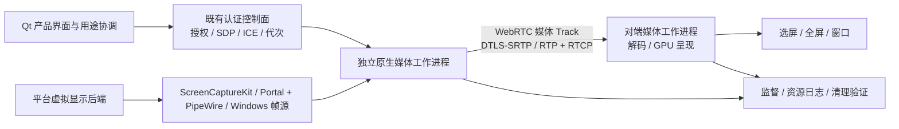

# 拓展屏技术栈重新评估

> 更新：最新结论以 [结合产品场景与三平台的选型复评](scenario-and-platform-review.zh-CN.md) 为准。本文保留初评过程；最新架构允许按设备方向协商多协议，不再要求所有设备组合采用同一种协议。具体后端映射尚未实测定版。

日期：2026-10-27

状态：代码与资料初评完成；补充纳入 RDP/FreeRDP 深评候选。推荐方案尚未实施，性能与互通尚未实测。

范围：Mac、Ubuntu/Linux、Windows 的真正扩展桌面。依据当前 Mac/Ubuntu 代码、此前实机日志、本次只读环境探测，以及文末官方资料。用户要求优先采用行业成熟协议与实现，本报告据此重新排序技术路线。

## 1. 决策建议

1. **正式媒体传输改为 WebRTC 协议族，停止将 DFVD/1 自定义视频传输作为产品主线继续扩展。** 使用媒体 Track、RTP/RTCP、DTLS-SRTP 和 ICE；视频不经可靠 DataChannel 搬运。现有实验可保留为基准与回归工具。
2. **优先验证 GStreamer 的完整 WebRTC 媒体管线，以其作为当前项目的首选工程候选；原生 libwebrtc 是备选。** 优先复用框架的拥塞控制、编码调节、反馈与播放管线，避免仅引入一个 RTP 传输库后继续自己补齐媒体引擎。最终引擎选型以双机样机门槛为准，不能把文档能力当作项目实测。
3. **保留 H.264 和各平台成熟的采集/编解码 API。** H.264 首选硬件路径；软件回退须显式报告。先完成 1080p SDR/30 fps，60 fps、HiDPI、4K、HDR 与 4:4:4 分阶段开放。
4. **替换正式链路中的 Python 调度、外部 FFmpeg 命令和跨进程 BGRA 管道。** 使用有版本锁定的原生媒体工作进程和库接口，Qt 继续负责产品界面；硬解码后优先直接交给 GPU 呈现。
5. **Linux 优先采用 ScreenCast Portal 的 VIRTUAL + PipeWire。** 当前 Ubuntu 已声明支持 VIRTUAL，应先做功能验证；只有标准入口确实不足时，才保留受版本约束的桌面专用后端。
6. **Mac 发送端的私有虚拟显示接口仍是独立高风险项。** 换 WebRTC 无法消除这一限制。当前不应宣称所有 macOS 版本稳定支持；接收端和发送端需分别认证。
7. **保留现有设备信任、每次显示授权、用途互斥、输入释放、代次隔离及资源清理。** 这些是产品业务规则，适合由应用定义；迁移媒体协议不应推倒已验证的控制逻辑。

这是对旧设计“等 TCP 出问题后再考虑 WebRTC”的修订：成熟媒体方案应成为默认选项，自定义媒体协议需要额外证明必要性。刚才增加队列等待预算的修复只能用于定位和对照，不能替代架构升级，也尚未完成持续传输复验。

## 2. 当前实现与证据

### 2.1 已核对的实际链路

| 层 | 当前实现 | 判断 |
| --- | --- | --- |
| Mac 虚拟屏 | 私有 `CGVirtualDisplay*`，单独 Objective-C++ helper | 可作为受限平台后端；兼容性风险高 |
| Mac 采集 | ScreenCaptureKit，按虚拟屏 display ID 采集 | 保留，属于官方采集框架 |
| Mac 编码 | VideoToolbox，H.264 Baseline、无 B 帧、目标 30 fps，配置约 4 Mbps | API 保留；固定码率改成可受反馈调节，核验实际硬编 |
| Linux 虚拟屏 | Mutter ScreenCast `RecordVirtual` | 优先替换为标准 Portal 入口 |
| Linux 采集/编码 | PipeWire → GStreamer BGRx → Python/管道 → FFmpeg/libx264 软件编码 | 保留 PipeWire，重做 CPU 搬运与编码集成 |
| 网络媒体 | DFVD/1 自定义帧头；三个独立 TLS 1.3/TCP 连接 | 正式视频链路替换为 WebRTC |
| 解码 | 外部 FFmpeg；当前产品路径未启用明确硬解码配置 | 替换为框架内硬解码优先路径 |
| 呈现 | 固定 1920×1080 BGRA → 本地管道 → QImage.copy → QWidget/QPainter | 界面能力保留，正式视频表面重做 |
| 产品控制 | C++/Qt，`usage-display/1`，显示同意与会话状态 | 保留；适配 SDP/ICE 与媒体事件 |
| 输入 | 既有 Deskflow 输入核心，按设备暂停、释放、恢复确认 | 保留。当前副屏接收窗口明确不回传输入 |
| 故障恢复 | MediaSupervisor、资源日志、清理验证 | 保留并接入新媒体工作进程 |
| Windows | 当前接收 viewer 显式禁用；尚无完成的发送后端及实机认证 | 未实现/未认证，不能算已支持 |

代码依据：`src/lib/display/{ProductDisplayRuntime,MediaSupervisor,DisplayViewer}.cpp`，`tools/virtual-display-prototype/{display_session,display_transport,virtual_display_probe}.py`，`tools/virtual-display-prototype/macos/VirtualDisplayProbe.mm`。旧设计依据：`docs/dev/cross-platform-virtual-display-design.zh-CN.md` 第 7.1 节。

### 2.2 本次实际观察，及其不能证明的事项

- Mac → Ubuntu 已出现真实虚拟副屏画面，并验证过接收窗口/全屏切换；不代表持续动态内容与完整用途切换验收通过。
- 发送端日志报告：`Encoded queue congested: 2 pending, 221860 bytes; refusing dependent-frame drops`。接收端随后报告断线，用户观察到窗口消失。已定位直接退出条件；**尚未证明最初的阻塞来自丢包、TCP 队头阻塞、解码、绘制或线程调度中的哪一个。**
- 代码原先允许单帧发送阻塞 1 秒，编码队列稳态等待只有 150 毫秒。已在工作区对齐发送端预算，并通过双端传输测试；未完成这项改动的长时实机复验。
- 视频协议声明 `captureTimestamps=false`，发送帧时间字段填 0。现有 RTT 是网络/控制往返时间，不能当作采集到显示延迟。
- 当前 1080p30 BGRA 管道每条原始帧流的数据量为 `1920×1080×4×30 = 248,832,000 B/s`，约 249 MB/s。这个值是尺寸计算，不是实测吞吐；QImage 复制和额外内存转换会继续增加搬运。
- 本次 Ubuntu 只读 Portal 查询：接口版本 **5**，`AvailableSourceTypes=7`，`AvailableCursorModes=7`。类型位包含 `4=VIRTUAL`。这证明后端声明能力，尚未验证真实扩展拓扑、布局管理与退出清理。[Portal 定义](https://flatpak.github.io/xdg-desktop-portal/docs/doc-org.freedesktop.portal.ScreenCast.html)
- Ubuntu 现有 GStreamer **1.28.2**，FFmpeg **8.0.1**。`rtph264pay` 可用；`webrtcbin/webrtcsink/webrtcsrc`、所检查的 VA/NVIDIA H.264 编解码插件、`qml6glsink` 均不可用。插件缺失不能推导显卡没有硬件能力。Mac 当前 PATH 中未找到 `gst-inspect-1.0`。
- Mac 系统 Python 的 TLS 能力曾阻塞会话；选择另一个 Python 后恢复。说明运行时发现与分发也是正式技术栈问题，不能要求用户机器碰巧装好兼容依赖。

## 3. 媒体协议比较

以下是针对“交互式副屏、原桌面扩展、三端原生应用”的工程适配判断，不是各协议绝对性能排名。

| 方案 | 可以复用什么 | 仍需承担什么 | 结论 |
| --- | --- | --- | --- |
| **WebRTC** | 标准媒体协商、加密、RTP/RTCP 反馈，成熟引擎的拥塞控制/恢复/播放管线 | 平台虚拟屏、信令与设备身份绑定、编解码适配、GPU 呈现 | **首选** |
| RTP/RTCP + SRTP，自行组装 | 标准分包、反馈和加密 | 协商、拥塞策略、pacing、抖动缓冲和恢复的完整集成 | 技术可行，但比完整引擎承担更多工作 |
| RTSP + RTP | 成熟流会话控制与播放器生态 | 对等设备授权、交互式自适应管线及平台显示生命周期 | 作为媒体源/诊断接口可考虑，不作为主线 |
| SRT | 加密、ARQ 恢复、可配置延迟的视频传输 | 桌面交互反馈、编码调节与显示/输入集成 | 有直播传输优势，本项目不优先 |
| RDP | 成熟远程桌面协议与实现生态 | 三端服务端能力、现有交互桌面扩展语义及驱动集成 | 不能直接替代本项目的六方向虚拟副屏后端 |
| VNC/RFB | 通用帧缓冲查看与控制 | 虚拟屏创建、高帧率视频路径及扩展兼容 | 不优先作为统一媒体主线 |
| QUIC / WebTransport 自定义媒体 | 安全传输与流/数据报基础 | 仍需自行定义媒体层、反馈、恢复和播放策略 | 不符合本次减少媒体协议自研的方向 |
| 继续 DFVD/1 + TCP | 已有代码与基准 | 几乎完整的实时媒体策略、兼容与维护 | 仅保留实验基准，退出正式主线 |

WebRTC 的媒体基础是 RTP/RTCP，鲁棒性与码率控制属于规范内容；协议并不保证任意接入方式自动达到低延迟，具体引擎和编解码反馈闭环仍需验证。[RFC 8834](https://www.rfc-editor.org/rfc/rfc8834.html)、[RFC 8835](https://www.rfc-editor.org/rfc/rfc8835.html)

RTSP 主要负责建立和控制媒体交付，并不等于完整实时媒体引擎。[RFC 7826](https://www.rfc-editor.org/rfc/rfc7826.html) SRT 项目描述的主要场景包括视频贡献/分发和可配置延迟恢复。[SRT 官方说明](https://github.com/Haivision/srt) RDP 传送远端图形及输入；RFB 定义帧缓冲访问。两者的协议能力均不能直接证明可以在所有目标平台创建本机当前桌面的附加输出。[RDP 说明](https://learn.microsoft.com/en-us/openspecs/windows_protocols/ms-rdpbcgr/5073f4ed-1e93-45e1-b039-6e30c385867c)、[RFB 说明](https://www.rfc-editor.org/rfc/rfc6143.html) QUIC 本身提供安全传输，不是桌面视频媒体引擎。[RFC 9000](https://www.rfc-editor.org/rfc/rfc9000.html)

## 4. 实现库选择：优先复用完整媒体能力

| 候选 | 与当前项目的适配 | 主要代价/限制 | 建议 |
| --- | --- | --- | --- |
| **GStreamer + WebRTC** | Linux 已使用 GStreamer；跨平台发行；编解码、时钟、缓冲与渲染可放进同一管线 | 三端插件打包；GLib/Qt 线程协调；高层 rswebrtc 的 Rust 构建依赖；Mac GPU 表面和 Windows 路径必须验证 | **首选样机及产品候选** |
| **原生 libwebrtc** | 原生 C++ PeerConnection 和媒体适配入口；支持三端 | Chromium/GN 工具链、较重构建及版本更新；外部硬件编码与 Qt 呈现仍需适配 | GStreamer 关键门槛失败时的备选 |
| libdatachannel + 自有媒体引擎 | C++ 接入较轻，提供媒体传输与 DataChannel | 仍需组合编解码、播放与完整自适应闭环，不能仅凭支持 WebRTC 就认为全都具备 | 本次不作为首选 |
| Qt WebEngine 中嵌入浏览器 WebRTC | 浏览器可做互通测试端 | Chromium 体积、原生虚拟屏采集和硬件表面的桥接、额外进程 | 适合测试，不建议为视频单独引入 |

GStreamer 的 `webrtcbin` 提供 PeerConnection 级别能力，但应用需要组装媒体管线；不能把“接上 webrtcbin”视为已经接好拥塞控制。高层 `webrtcsink`/`webrtcsrc` 值得优先验证，前者提供 GCC 等配置及编码缓解能力，但定制控制比底层有限。[webrtcbin](https://gstreamer.freedesktop.org/documentation/webrtc/index.html)、[rswebrtc 设计说明](https://gstreamer.freedesktop.org/documentation/rswebrtc/index.html)、[webrtcsink 属性](https://gstreamer.freedesktop.org/documentation/rswebrtc/webrtcsink.html)

**关键接入约束：** 若直接向引擎灌入当前固定码率的已编码 H.264，拥塞反馈不会凭空改变外部编码器。优先让框架管理编码；若为原生表面效率保留外部编码器，必须实现目标码率、帧率、关键帧请求及时间戳的双向适配。无法证明这个闭环工作的候选不得进入产品集成。

原生 libwebrtc 官方文档列出 Windows/macOS/Linux 支持及 GN/Ninja 构建；这说明可接入，不是对项目硬件路径的认证。[开发说明](https://webrtc.github.io/webrtc-org/native-code/development/) libdatachannel 官方定位是 DataChannel 和媒体传输网络库，不能将其与完整采集/编解码/呈现引擎等同。[项目说明](https://github.com/paullouisageneau/libdatachannel)

## 5. 平台显示与采集策略

### macOS

- 保留 ScreenCaptureKit，继续按明确 display ID 采集，不能失败后静默改抓主屏。[Apple ScreenCaptureKit](https://developer.apple.com/documentation/screencapturekit?changes=_1)
- 将当前私有 CGVirtualDisplay 后端限定在独立适配层，进行运行时检测、已认证 OS/芯片矩阵、锁屏/睡眠/拔屏/进程崩溃回收测试。本次没有找到足以替代它的、官方明确支持的一般用途虚拟显示创建方案；不能把 ScreenCaptureKit 的官方支持误写成虚拟屏创建接口也是公开 API。
- Mac **接收**不需要创建虚拟屏，可与 Mac **发送**分开发布/认证。
- 如果产品要求完全排除私有 API，就必须调整 Mac 发送能力范围，或评估实体显示输出方案；标准网络协议无法突破这项平台限制。

### Linux

- 第一候选：ScreenCast Portal 的 VIRTUAL 源 + PipeWire。查询实际能力，获取用户授权，核验当前交互桌面新增逻辑输出，并检查正确源、尺寸、光标、布局和结束清理。
- 当前 Ubuntu 声明支持该入口，是本次最值得优先做的验证之一。不能由一台 GNOME 的声明推导所有 KDE、wlroots、X11 均可用。
- PipeWire 是帧流基础，Portal 是授权和会话入口；它们不保证每个桌面后端提供相同布局控制能力。若必须调用桌面专用布局 API，需把这个范围单独记录。
- Mutter 专用接口仅作为经过验证且明确标注版本的后备。X11 单独认证，不能以 `xrandr` 存在或独立 X server 创建成功代替当前桌面扩展。

### Windows

- 优先采用官方 IDD/IddCx 模型创建附加显示输出。它是 UMDF 驱动，仍需驱动生命周期、安装、签名和分发工作；SDK 示例不是可直接发布的成品驱动。[微软 IDD 模型](https://learn.microsoft.com/en-us/windows-hardware/drivers/display/indirect-display-driver-model-overview)
- 产品应用与驱动分离，明确会话/表面所有权。帧源可评估驱动表面交付或公开采集 API，但不能假设两条路可以无成本互换。
- 没有 Windows 实机时，仅完成编译不计入支持矩阵。当前 Windows 方向全部保持未认证。

## 6. 编解码与呈现

**编码策略：** H.264 继续作为首选互通格式，协商 profile/level、packetization-mode、色彩与实际分辨率；不把 Annex B access unit 直接等同于 RTP 包。媒体引擎负责标准分包、序号和时钟映射。完整 WebRTC 合规评估还应检查 VP8 等强制实现要求，不能把只跑通 H.264 的样机直接宣称为完整合规端点。[RFC 7742](https://datatracker.ietf.org/doc/html/rfc7742)

**硬件策略：** Mac 使用 VideoToolbox；Linux 按实际显卡/驱动探测 VA-API、NVENC/NVDEC 等；Windows 评估 Media Foundation、D3D11 及厂商后端。每次会话报告实际编码器/解码器、硬件状态和回退原因。GStreamer 提供相关插件，但插件存在不等于当前硬件支持或零拷贝成立。[Apple 插件](https://gstreamer.freedesktop.org/documentation/applemedia/index.html)、[VA 插件](https://gstreamer.freedesktop.org/documentation/va/index.html)、[D3D11 插件](https://gstreamer.freedesktop.org/documentation/d3d11/index.html)

**呈现策略：** 逐步淘汰固定 BGRA 字节管道和每帧 QImage.copy；保留 Qt 的选屏、窗口/全屏、缩放与结束入口，视频表面采用框架 GPU sink 或原生纹理适配。`qml6glsink` 要求正确共享 Qt/GStreamer GL display/context，而且当前应用是 QWidget：它不是可以原样替换的控件，也不能推导三端自动零拷贝。先验证独立原生/GStreamer 接收窗口，再决定 Qt 内嵌方式。当前 Linux viewer 为获得可确认的最小化状态会在部分环境选用 xcb/XWayland；新管线应优先验证原生 Wayland，最小化等窗口管理能力按合成器实际支持声明，不把切换到 XWayland 当作通用修复。[Qt/GStreamer GL 集成约束](https://gstreamer.freedesktop.org/documentation/qml6/qml6glsink.html)

**画质策略：** 4:2:0 H.264 对彩色细字可能不理想；用 IDE、中文小字、表格、滚动和混合视频实测。不要为了兼容保留低码率后再把清晰度问题归结为网络。HiDPI、4:4:4、HEVC/AV1 根据硬件、互通和许可另行评估，暂不把它们加入首轮迁移。

**时延策略：** 给采集、入编码、出编码、发送、接收、解码、提交呈现保留真实时刻。RTP 时间戳不是直接的墙钟；跨机时间关联要有明确同步与误差说明。用高速相机/同画面参考时钟验证采集到显示和操作到显示，不能用 ping 或解码结束时间替代。

## 7. 安全、控制与输入

- 保留既有已认证基础连接，通过它交换 offer/answer、ICE candidates、DTLS 指纹及会话绑定。临时 WebRTC 媒体证书的指纹必须绑定到已验证设备身份、本次同意与代次；DTLS 加密本身不能代替设备信任。[WebRTC 安全架构](https://www.rfc-editor.org/rfc/rfc8827.html)
- 首版 LAN 可使用 host candidates，通过已有点对点控制连接完成信令，不必引入云信令服务或 TURN。UDP 不可达时明确失败/说明，不静默降级到旧自定义视频链路。未来是否引入中继单独评估。
- 关闭框架演示默认的公开信令/Web 服务、外部 STUN 地址及自动输入导航。尤其 `webrtcsink` 文档存在默认公共 STUN 配置，应显式覆盖，避免把局域网产品变成依赖外部服务的部署。
- 控制和视频即使复用媒体引擎，也要有独立优先级和队列预算。授权、停止和资源清理保留在已认证应用控制面；不能依赖视频通道先排空才停止。
- 保留用途互斥和释放确认。第一阶段继续仅回传画面：A 的键鼠操作 A 的虚拟扩展桌面，不自动获得 B 的输入注入权限。
- 将来启用接收端反向控制时，再加入独立同意、控制租约、多屏/缩放/旋转坐标转换、权限撤销和卡键释放测试。WebRTC DataChannel 只是承载，不能直接信任所有收到的输入事件。

## 8. 推荐模块边界

媒体工作进程隔离编解码和平台 API 的故障；GUI 不做网络等待和逐帧数据搬运。通过有界本地 IPC 传递命令、状态和统计，尽量让捕获、编码与网络在同一媒体进程内衔接。媒体进程退出必须撤销自己的虚拟输出并进行独立验证，进程退出不等于资源已清理。

抽象边界建议围绕 `VirtualDisplayBackend`、`CaptureSource`、`MediaSession`、`VideoPresenter` 和 `MediaStatistics`。协议与媒体引擎先支持一套正式后端，避免为尚无需求的多协议体系增加复杂度。

## 9. 打包与维护

- 把媒体依赖版本、构建参数、插件清单与运行路径锁定在构建产物中；不在用户 PATH 中寻找任意 Python/FFmpeg，也不把 Homebrew 路径作为正式安装方案。
- Ubuntu 的发行版包和 Mac/Windows 随应用分发分别设计。GStreamer 跨平台提供发行/构建路径，但需要选择实际插件集和最小支持版本。[官方发行说明](https://gstreamer.freedesktop.org/download/)
- Mac helper 与动态库采用稳定签名/Bundle 身份并验证权限行为；Windows 驱动与应用更新分开；Linux 校验 portal backend 和插件兼容。
- 逐组件记录许可证、源码提供义务、NOTICE 和编解码配置。现仓库根目录有 GPLv2 许可证，若干新文件标 MIT，不能只看新模块就把整个产品判为 MIT。FFmpeg 的许可会随构建选项改变，GStreamer 插件也需逐项核对。[FFmpeg 官方说明](https://ffmpeg.org/legal.html)、[GStreamer 官方说明](https://gstreamer.freedesktop.org/documentation/application-development/appendix/licensing.html)
- 记录媒体后端版本和 CVE 更新策略，限制不可信输入、插件搜索目录与工作进程权限；日志不写私钥、令牌、完整 SDP 或屏幕内容。

## 10. 迁移顺序与决策门槛

| 阶段 | 工作 | 必须拿到的证据 |
| --- | --- | --- |
| A：标准入口/引擎样机 | Ubuntu Portal VIRTUAL；Mac/Ubuntu 上 GStreamer WebRTC 双机媒体样机；必要时对比 libwebrtc | 真正当前桌面扩展；双向首帧；硬件路径；编码调节及关键帧反馈；离线 LAN 建链；可复现打包 |
| B：替换媒体工作进程 | 连接现有用途协调、身份信任、授权、停止、监督及资源日志 | 原有输入/显示屏障不退化；取消、断线、崩溃、重启全部正确 |
| C：Mac ↔ Ubuntu 验收 | 动态内容、画质、窗口/全屏、受限网络、睡眠/锁屏、长时运行 | 每个方向单独报告真实统计、限制和失败；不沿用旧实验的“通过” |
| D：Windows 与更多桌面 | IDD 驱动、原生采集/呈现、签名安装；Linux 桌面版本扩展 | 有对应实机和发布安装包的方向才进入支持矩阵 |

A 阶段是工程选型的最终关口：若 GStreamer 无法把本机采集表面、可调编码、RTCP 反馈、接收渲染及授权信令贯通，或打包维护成本超出收益，改选原生 libwebrtc；不能绕过关键门槛，退回“有 RTP 包就算成功”。

**保留与替换清单：** 保留用途/显示状态机、清理与监督、认证设备关系、输入核心、Qt 产品交互和现有故障回归。适配平台 helper 以对接标准入口。替换 DFVD 视频传输、Python 产品调度、FFmpeg CLI 管线、固定 BGRA viewer、无效时间戳和固定码率策略。旧代码可保留在实验工具中，不作为正式链路的隐式回退。

本轮是评估，不安装新媒体依赖、不迁移协议、不继续改动现有验收流程。此前的未提交诊断和超时修复已保留，不计为新架构实现。

## 11. 新架构验证门槛

既有产品要求中的“首帧 10 秒内、目标 1080p30、每发布方向连续 60 分钟”继续有效。以下新增项是建议验收目标，尚未验证，应写入后续需求/测试计划后执行。

| 类别 | 建议方法与门槛 |
| --- | --- |
| 真正扩展 | 系统显示设置存在新增输出，窗口可拖入；实际编码源是该输出；结束移除，主屏不被替代 |
| 稳定运行 | 每方向至少 60 分钟，包含文本编辑、连续滚动、运动视频和窗口/全屏；无无故退出、持续内存增长、遗留副屏 |
| 实际帧率 | 持续运动源逐阶段计数采集/编码/解码/呈现，报告平均与分位；30 fps 目标不以静止桌面的损伤帧率验证 |
| 时延 | 建议正常有线 LAN 的操作到显示 P95 ≤120 ms；作为候选产品目标，需通过真实测量确认可达性；不能以 RTT 代替 |
| 受限网络 | 在可控测试链路比较 0/1%/3% 丢包、20/50 ms RTT、带宽阶跃和约 250 ms 短阻塞；记录降码率、恢复时间及画质，短阻塞不应直接拆除副屏 |
| 不可恢复 | 断网、解码器失败、无可用 ICE 路径时明确终止且验证清理；不承诺所有网络都不断流 |
| 反馈闭环 | 限带宽后可见发送目标码率下降；关键帧请求确实到达编码器；恢复不会一直播放旧队列 |
| 资源与 GPU | 记录实际编解码器、CPU/GPU、内存、温度/降频与每阶段队列时长；明确发生过的 CPU 回退 |
| 文字与色彩 | 中文/英文小字、彩色语法、表格、光标、缩放与 HiDPI；测试范围与截屏/人工观察一起记录 |
| 生命周期 | 取消、拒绝、30 秒授权过期、锁屏/睡眠、拔屏、应用/媒体进程崩溃、重启、撤销信任、输入释放 |
| 分发 | 全新用户环境不依赖开发机 PATH；正确请求原有范围的系统权限；安装包可重复构建 |

网络损伤试验只对测试媒体链路进行，不改变用户日常网络。Windows 无实机、Mac 私有接口兼容性、Linux 标准虚拟输出行为和跨平台 GPU 表面集成，是当前仍待消除的关键不确定性。

## 12. 结论与当前完成状态

推荐技术方向是：**平台适配的虚拟显示/采集 + 成熟 WebRTC 媒体引擎 + H.264 硬件优先 + GPU 呈现 + 既有产品信任及用途协调**。

WebRTC/GStreamer 是本轮初评推荐，尚未最终定版；RDP/FreeRDP 应作为正式对照候选，补齐比较后再决定协议与引擎。Mac 私有虚拟显示风险与 Windows 驱动工作不会因协议迁移自动消失。

本次已完成技术评估和只读环境核对；没有完成 WebRTC 样机、协议迁移或完整 Mac → Ubuntu 产品验收，不把现有短时显示结果写成发布通过。

## 13. 补充：Windows App、RDP 与开源实现

用户进一步提出 Windows App 的参考价值。微软 Windows App 是 RDP 客户端；应用本身按微软专有许可分发，不能作为可直接复用的开源客户端。RDP 协议有公开规范，另有开源实现。协议公开、客户端开源和某项功能在当前平台实际可用，是不同的问题。[Windows App 许可](https://learn.microsoft.com/en-us/legal/windows-app/windows-app-license-terms)、[RDP 公开规范](https://learn.microsoft.com/en-us/openspecs/windows_protocols/ms-rdpbcgr/5073f4ed-1e93-45e1-b039-6e30c385867c)

FreeRDP 是 Apache 许可的 RDP 实现，可研究和复用其库接口；仓库也有服务端示例。GNOME Remote Desktop 的 RDP 后端已经使用 FreeRDP，并通过 PipeWire 和 Mutter 管理桌面，项目采用 GPLv2 或以后版本。这是比单看 RDP 文档更有价值的实际集成参考。[FreeRDP](https://github.com/FreeRDP/FreeRDP)、[服务端示例](https://github.com/FreeRDP/FreeRDP/tree/master/server/Sample)、[GNOME Remote Desktop](https://github.com/GNOME/gnome-remote-desktop)

对初评的修正：第 3 节关于 RDP 不能自动提供六方向虚拟副屏的限制成立，但这一限制同样存在于 WebRTC，不能单凭该点降低 RDP 的候选优先级。RDP/FreeRDP 应进入正式对照，初评的 WebRTC 推荐不应作为已经定版的决策。

对照重点：从现有虚拟输出接入自定义帧源的服务端工作量；Mac/Windows/Linux 上库级客户端与服务端的实际支持；文字桌面的图形压缩与色彩质量；帧确认/流控/网络适应性；硬件编码与 GPU 呈现；设备身份及每次授权能否保持；仅传指定附加输出、禁止额外输入/剪贴板/磁盘重定向；打包与维护。不能用 Windows App 当前已能查看 Ubuntu 的桌面，直接证明 Mac 发送附加虚拟屏也已具备同一能力。

本补充确认 RDP 路线有明确开源参考价值；尚未编译 FreeRDP 服务端或实测上述六方向能力，因此目前两条路线都需要样机证据才能最终选定。
