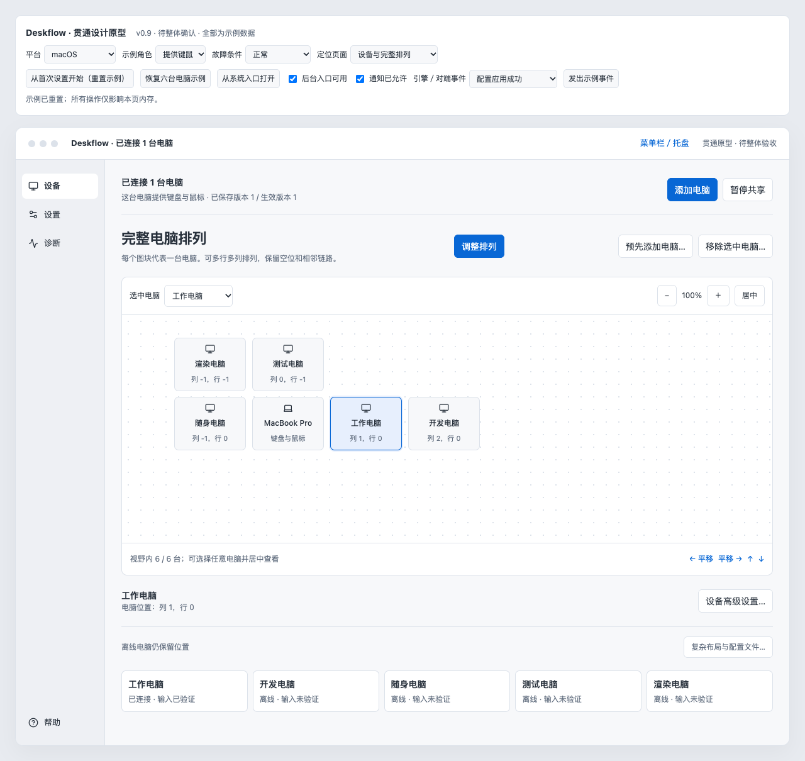
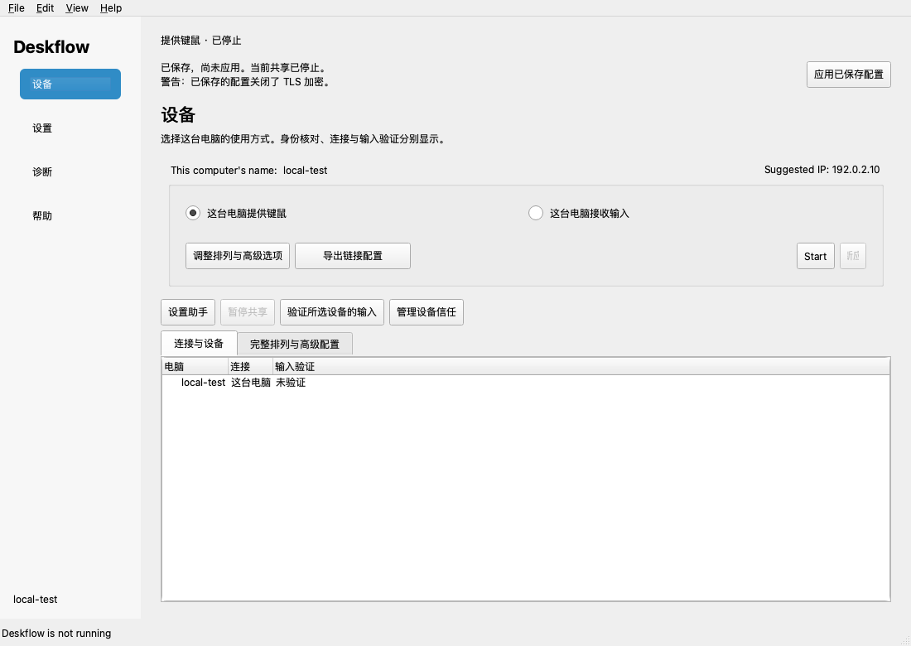

# 原型对齐复核与确认

日期：2026-10-20。状态：用户已确认按本基准继续重构，并要求细节布局、稳定性与高标准交付。下列偏差表记录纠偏开始时的状态，当前进展与证据另见产品实现与验证记录；不据此改写原设计要求。

## 复核结论

上一轮没有完成按贯通原型交付的界面重构。实现主要是在旧主窗口外增加四导航，再嵌入旧设置／排列对话框。虽然接入了部分状态、配置、安全及生命周期能力，页面结构、功能归属、视觉层次和主要操作流程仍明显偏离原型。构建成功、35 个测试目标通过和 106 个源控件仍然存在，都不能证明界面符合设计。

上一轮将原型整体标注为“历史评审材料”范围过宽。用户批准的来源切换中断恢复方案仅调整相关运行行为，没有取消原型的页面、布局及视觉要求。旧控件需要迁移能力与语义，不要求把旧控件和旧对话框整体保留在新页面上。实现记录中的“已授权实施”也不等于设计验收已通过。

## 本次重新核对的材料

- 入口及全部第 01–10 章：需求、信息架构、页面交互、状态契约、视觉文案、平台规则、迁移、验收、风险和决策。
- 原型 `index.html`、`prototype.js`、`prototype.css`、`integration.css`、操作说明；已查看设备、设备信任、首次身份核对、深色四张原型截图。
- 106 个功能控件的 CSV／JSON 映射、需求与验收映射、状态与验收用例、状态示例，以及原型验收脚本／记录。
- 当前 `MainWindowWorkspace`、`MainWindowSetup`、旧编辑器的嵌入方式、Qt 工作区测试及上一轮设备／设置渲染截图。
- 对照 Git 中原设计和上一轮文档改动，区分原始要求、用户明确确认的运行例外与实现现状。

本轮浏览器工具阻止直接打开本地 HTML，因此没有声称交互运行了原型；视觉证据使用仓库已有原型截图，其他页面结合模板、样式、交互源码和页面规范核对。已有原型验收结果属于上一轮设计测试证据，本轮没有重新运行。

## 直接可见的差异

| 原型设备页 | 上一轮 Qt 设备页 |
|---|---|
|  |  |

两图示例数据、状态和截图尺寸不同；这里比较页面结构，不把设备数量或停机状态差异当作缺陷。核心差异是原型以排列画布为主，当前以旧连接控制面板和表格为主。Qt 截图为上一轮 offscreen 渲染，不能代表用户当前原生窗口的全部外观。

## 全部页面的对齐账本

| 页面 | 文档／原型要求 | 当前实现偏差 | 纠偏目标 |
|---|---|---|---|
| S01 首次设置与添加 | 主内容区内连续步骤；角色卡片、权限、等待／发现／手动、身份、双方确认、连接、位置、输入、完成 | 四页 QWizard 与独立指纹弹窗拼接；核心运行时助手直接拒绝进入，不能实现不中断既有设备的添加流程 | 同一工作区内完成分步流程；添加、替换、重验复用步骤和状态，保留取消／错误恢复 |
| S02 设备与排列 | 首页主体为完整点阵画布；顶部共享摘要、添加／暂停；选中设备、缩放／居中／平移、设备详情及状态卡片 | 首页默认表格；旧角色单选和开始按钮占据主体；画布藏在“完整排列与高级配置”页签 | 画布成为来源端首页；接收端为本机与实际来源摘要；编辑排列有保存／取消；精确位置及窄屏列表保留 |
| S03 设备高级设置 | 设备上下文内按名称／标识、修饰键、角落、兼容分组；切分类保留草稿 | 主要沿用旧 ComputerSettingsDialog，再追加显示名等控件 | 按原型分组重建编辑视图，复用校验与配置模型；不牺牲全部别名／六类映射／目标平台选项 |
| S04 通用 | 行式分组面板；语言、更新、图标、启动／关闭、标题、电源；显示偏好自动保存 | “通用、安全与系统”内又嵌 General／Window 等旧页签；保留整页 Save／Cancel；中文与英文混排 | 新设置分类与通用面板；区分立即生效偏好与需要应用的运行参数 |
| S05 共享与切换 | 设置中的独立分类；剪贴板、边缘切换；高级输入与心跳折叠 | 被放进设备的旧来源配置编辑器 | 移回设置／共享与切换；独立开关、原数值范围和角色／文件接管说明保持完整 |
| S06 快捷键 | 设置中的规则列表；规则名称、组合、动作数／摘要；完整有序动作编辑 | 仍在旧来源配置的热键／动作双列表内，缺少原型的规则页面层次 | 独立规则页与动作编辑器；保留触发时机、目标、排序、冲突及危险动作确认 |
| S07 接收端输入 | 设置分类中显示本机作用域；重试、语言、X/Y 反向和倍率分组 | 独立旧对话框被改为设置第二页签，视觉与作用域说明没有完整对齐 | 按原型的接收端表单重建；来源角色查看预设时明确当前不使用 |
| S08 本机证书 | 高级子页；TLS／对端证书要求、本机证书、完整摘要与图案、重建影响 | 仍混在旧 SettingsDialog 结构中 | 独立证书页及身份核对组件；明确保存与激活，保留真实验证能力 |
| S09 设备信任 | 设置分类内按设备展示名称、信任、连接、输入验证、完整指纹和操作 | 设备页按钮打开按角色／指纹列出的模态表格，缺少可靠设备关联和页面表达 | 独立信任页；不能用发现名称猜测身份。旧记录无法关联时明确未知；逐设备关联缺口仍需实现／核验 |
| S10 网络 | 独立分类；真实接口、端口、候选来源地址及说明 | 接口与端口在旧 Network 页签；来源地址仍在首页连接面板 | 重组为网络页；保留 IPv6、多候选、导入边界和实际生效地址 |
| S11 配置文件与协议 | 高级子页；协议、外部模式、位置、内容预览、检查、导出及错误 | 旧来源配置中的外部文件开关／路径为主；真实校验接在应用前，没有完整的预览与检查页面 | 完整配置页；复用真实解析器和序列化；文件模式应用成功后才接管相关编辑 |
| S12 维护与自动化 | 高级子页；服务／提权、本机进入离开命令、偏好恢复和危险清除分组 | 控件仍分散在旧设置和新增全宽备份按钮中 | 按意图分组，备份／恢复／清除集中且范围明确；平台不可用时解释原因 |
| S13 诊断 | 权限→网络→身份→会话→输入的分层结果，每项有状态、下一步与重试 | 多行 QLabel 加通用按钮，缺少逐项诊断面板及检测时间／细分状态 | 逐项结果、就近操作、持续问题横幅及报告预览；无证据明确未知 |
| S14 日志 | 诊断内技术日志页；六级日志、文件记录、查找计数／跳转、独立窗口／嵌回、导出 | 日志仍以 dock 入口为主，偏好分散在旧设置 | 形成完整技术日志页并保留独立窗口，共用真实日志源 |
| S15 帮助 | 关于页含真实构建、更新状态、版本复制、许可、贡献者 | 当前帮助页为版本文本和打开旧关于／帮助弹窗的按钮 | 对齐关于与更新页面；平台原生文件／系统对话框保持原生 |
| S16 系统入口 | 简洁状态、连接摘要、问题及打开／暂停／重连／退出，读同一状态 | 部分命令与生命周期已接入，但摘要、问题标记及页面跳转未完整对齐 | 保留真实生命周期处理，补齐与主窗口一致的状态、问题和目标页面 |

## 视觉与交互基准（已获用户确认）

1. 以现有贯通原型的内容区域为高保真目标：相同的主次层级、功能分组、操作位置、面板、留白、颜色与状态表达。不是只保留四导航并另设计一套界面。
2. 继续 C++／Qt Widgets。复用模型、校验、序列化及已验证的核心适配；视图按目标重新组织，不再整体嵌入旧对话框作为最终页面。
3. 侧栏图标＋文字，帮助靠底部；工作区统一共享状态条、角色说明、连接摘要、添加／换来源与暂停动作；待应用区说明影响范围。
4. 设置主分类保持通用、共享与切换、快捷键、接收端输入、网络、设备信任、高级；高级可达本机证书、配置文件、维护与自动化。诊断内承接技术日志。
5. 浅／深色采用第05章 token：窗口 #F7F8FA／#21252B、面板 #FFFFFF／#2B3038、侧栏 #EEF0F4／#282D34；正文／说明／标题按 14／12／23 逻辑像素基准，边距24–26、分组20–24，控件／面板圆角6／8。系统高对比模式按规范优先系统调色板。
6. 系统标题栏、字体具体字形、原生文件选择器和权限窗口按平台适配。不复制原型模拟窗口圆点，也不把评审控制条、平台／角色故障选择器、示例设备或模拟事件带入产品。
7. 保留100×100和所有106项旧能力的表达与数据语义；功能移到映射指定页面。保留旧能力不等于保留旧布局。新增中文页面不接受当前这种未经整理的中英文混排。
8. 空态、离线、未验证、身份变化、只读、保存失败、应用中／失败、缺权限等状态，都要与正常态一起对齐；不能只评一张已连接截图。

## 已确认运行边界与未完成事项

- 用户已明确接受：来源更换允许短暂中断，失败／取消后尝试恢复旧来源，并显示实际恢复结果。此例外不改变页面布局和视觉目标。
- 已采用的人工输入确认、接收端不虚构完整拓扑、真实系统权限／服务回执等继续保留；原型模拟事件不能充当实际证据。
- 当前按证书指纹管理信任、缺少完整设备关联，属于与 S09 的实现缺口，不是已获用户批准取消逐设备信任要求。
- 当前构建与35目标测试结果保留为底层及局部行为证据；界面还原、全部106项行为、真实双机及跨平台验收仍未完成。

## 纠偏交付顺序（已获用户确认）

1. 先完成共用外壳、设备首页、通用设置、设备信任和首次核对身份这组代表视图；提交真实 Qt 浅／深色截图，与原型在相同内容尺寸、角色和状态下并排核对。不是再提交一份 HTML 示意。
2. 风格和结构确认后，在同一组件基准下完成 S01–S16 的全部页面、弹窗及异常状态；逐项迁移106项能力。
3. 完成连接／配置／身份／系统集成回归；分别记录视觉、交互、底层及实机结果，不再用编译或模型测试通过替代整体验收。

请用户核对的是上述还原基准与交付检查点。现有原型已经明确的导航、页面归属、配色和布局不需要用户重新设计或重新列需求。
